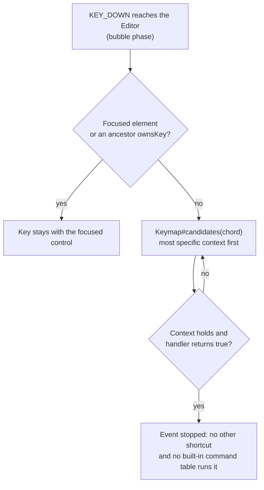

# Keymap

<VersionBadge version="2.2.40" label="Since" icon="tag" />

Every `Editor` has its own `Keymap`. A keymap is a list of `EditorAction`s, each with a stable id, default chords, a context, and a handler. Users can rebind any action from **Settings → Keymap**, and editors, views, and projects can add their own actions.

<figure>

<figcaption>
The Keymap settings page. Actions are grouped by category; each row has a main chord and an optional second one.
</figcaption>
</figure>

## How a Key Press Is Resolved



The dispatcher listens on the editor in the **bubble** phase. A control that already consumed the key, such as a text field typing a character, stops the event first, so the keymap never sees it.

When several actions share a chord, `Keymap#candidates` orders them by context specificity, then `priority`, then registration order (newest first). A handler that returns `false` passes the chord to the next candidate. This is how one key can serve several panels.

## Built-in Actions

The ids are constants in `EditorActions`.

| Action | Id | Default | Alternative |
| --- | --- | --- | --- |
| Save | `ldlib2:editor.save` | `Ctrl+S` | |
| Save As | `ldlib2:editor.save_as` | `Ctrl+Shift+S` | |
| Open Project | `ldlib2:editor.open_project` | `Ctrl+O` | |
| Settings | `ldlib2:editor.settings` | `Ctrl+Alt+S` | |
| Close Editor | `ldlib2:editor.close` | unbound | |
| Undo | `ldlib2:editor.undo` | `Ctrl+Z` | |
| Redo | `ldlib2:editor.redo` | `Ctrl+Y` | `Ctrl+Shift+Z` |
| Copy / Cut / Paste | `ldlib2:editor.copy` / `cut` / `paste` | `Ctrl+C` / `Ctrl+X` / `Ctrl+V` | |
| Duplicate | `ldlib2:editor.duplicate` | `Ctrl+D` | |
| Select All | `ldlib2:editor.select_all` | `Ctrl+A` | |
| Find | `ldlib2:editor.find` | `Ctrl+F` | |
| Next Tab | `ldlib2:editor.next_view` | `Ctrl+PageDown` | `Ctrl+Tab` |
| Previous Tab | `ldlib2:editor.previous_view` | `Ctrl+PageUp` | `Ctrl+Shift+Tab` |
| Maximize Pane | `ldlib2:editor.maximize_pane` | `Ctrl+M` | |
| Minimize Window | `ldlib2:editor.minimize_window` | `Ctrl+Alt+Down` | |
| Maximize / Restore Window | `ldlib2:editor.maximize_window` | `Ctrl+Alt+Up` | |

The Edit actions (Undo through Find) do not act on their own. They send the matching `CommandEvents` command to whatever has the focus, so the focused view decides what "copy" or "undo" means. See [Command Handling](./views/builtin-views.md#command-handling).

Save works the same way: the focused view gets the `save` command first, and the editor saves the project only if no view claims it.

## Define an Action

```java
EditorAction.builder(MyIds.RUN_PREVIEW)
        .category(KeymapCategories.GENERAL)
        .defaultChord(KeyChord.key(GLFW.GLFW_KEY_F5))
        .defaultAlternative(KeyChord.ctrl(GLFW.GLFW_KEY_R))
        .when(KeyContext.focusWithin(PreviewView.class))
        .onAction(this::runPreview)
        .build();
```

| Builder method | Description |
| --- | --- |
| `category(String)` | Settings page group. A translation key; constants are in `KeymapCategories` (`GENERAL`, `FILE`, `EDIT`, `VIEW`, `WINDOW`). Unknown strings show as themselves. Default `GENERAL`. |
| `displayName(Component)` | Name on the settings page. Default: the translation key `keymap.<namespace>.<path>`, for example `keymap.ldlib2.editor.save`. |
| `defaultChord(KeyChord)` | Main default chord. Default unbound. |
| `defaultAlternative(KeyChord)` | Optional second default chord. |
| `when(KeyContext)` | When the action may run. Default `KeyContext.global()`. |
| `priority(int)` | Breaks ties between actions of equal specificity. Higher runs first. |
| `onAction(Runnable)` | Handler that always counts as handled. |
| `onAction(Handler)` | Handler that returns `false` to pass the chord on. |

`build()` throws `IllegalStateException` if no handler was set.

### Chords

`KeyChord` is a GLFW key code plus modifiers. Use the factory methods: `KeyChord.key(key)`, `ctrl(key)`, `shift(key)`, `alt(key)`, `ctrlShift(key)`, `ctrlAlt(key)`, or `KeyChord.of(key, ctrl, shift, alt)`. `KeyChord.UNBOUND` means no key.

On macOS, the Command key is read as Ctrl.

### Contexts

| Context | Runs when | Specificity |
| --- | --- | --- |
| `KeyContext.global()` | Always. | 0 |
| `KeyContext.withProject()` | A project is open. | 10 |
| `KeyContext.notTyping()` | The focus is not in a text field, text area, or code editor. | 10 |
| `KeyContext.focusWithin(Class)` | The focus is on an element of that type, or inside one. | 100 |
| `a.and(b)` | Both hold. | The higher of the two |
| `KeyContext.of(predicate, specificity)` | Your own condition. | Given |

A more specific context is tried first, whatever the registration order. A candidate whose context does not hold is skipped, so it never hides the action behind it.

## Register Actions

### From an editor subclass

Override `initKeymap()` and call `super`. To change what a built-in action does, register your own action under the same `EditorActions` id. It replaces the built-in one.

```java
@Override
protected void initKeymap() {
    super.initKeymap();
    keymap.register(EditorAction.builder(EditorActions.FIND)
            .category(KeymapCategories.EDIT)
            .defaultChord(KeyChord.ctrl(GLFW.GLFW_KEY_F))
            .onAction(this::openShopSearch)
            .build());
}
```

### From a project

The editor outlives the project, so register in `IProject#onLoad` and unregister in `onClosed`:

```java
private ISubscription actions = () -> {};

@Override
public void onLoad(Editor editor) {
    actions = editor.getKeymap().registerAll(
            EditorAction.builder(MyIds.RUN_PREVIEW)
                    .defaultChord(KeyChord.key(GLFW.GLFW_KEY_F5))
                    .when(KeyContext.focusWithin(PreviewView.class))
                    .onAction(this::runPreview)
                    .build());
}

@Override
public void onClosed(Editor editor) {
    actions.unsubscribe();
}
```

`register` and `registerAll` return an `ISubscription`. Unsubscribing does nothing if another action has since been registered under the same id, so a view being disposed cannot remove its successor.

Registered actions appear on the Keymap page and can be rebound like built-in ones.

## Show the Current Shortcut

Shortcuts can change, so never write them into translation strings. Read them from the keymap:

| API | Use |
| --- | --- |
| `Keymap#menuLabel(id, translationKey)` | A menu entry name with the bound chord after it in grey. |
| `Keymap#shortcutHint(id)` | Only the grey chord, or an empty component when unbound. |
| `Keymaps.of(element)` | The keymap of the editor that contains an element, or `null`. |
| `Keymaps.shortcutTooltip(element, id, fallback)` | A tooltip line for a button. Uses `fallback` when the element is not inside an editor. |

```java
menu.leaf(Icons.PLAY, editor.getKeymap().menuLabel(MyIds.RUN_PREVIEW, "shop.menu.run_preview"), this::runPreview);
```

## User Bindings

`KeymapSettings` stores only the bindings the user changed. An action the user never touched keeps following its default, so a later version can change a default without overriding the user.

All editors share one settings file, `config/ldlib2/editor.json`. Bindings for actions the current editor does not know are kept, so saving one editor does not wipe another editor's keymap.

On the Keymap page:

* the search box filters actions,
* clicking a chord field records the next key you press, including `Esc`,
* `Backspace` or `Delete` clears the binding,
* clicking elsewhere cancels recording,
* each row has a reset button, and chords used by more than one action are marked.

Changes take effect when the settings dialog is applied.

## Keep Keys in a Focused Control

A custom control that handles a key without stopping the event can still lose it to a shortcut. Override these `UIElement` methods to keep it:

| Method | Description |
| --- | --- |
| `ownsKey(UIEvent)` | Return `true` for keys this element takes while it has the focus. The keymap does not run any action for them. |
| `isTextInput()` | Return `true` while the user types into this element. `KeyContext.notTyping()` reads it. |

Built-in text fields, text areas, and code editors already implement both.

::: warning Esc and the old behavior settings
Before 2.2.40, `BehaviorSettings` handled Esc, Save, Save As, and the settings panel. These are keymap actions now. `BehaviorSettings#shouldCloseOnEsc` is deprecated: if it was on, the editor binds `Esc` to `ldlib2:editor.close` once, on first load.
:::
