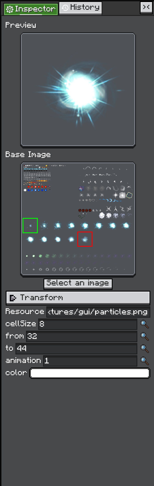

# Built-in Views

`Editor` ships with common views that most editor tools reuse.

## InspectorView

`InspectorView` wraps LDLib2's `Inspector` component and is placed in the right-side panel by default.

<figure>

<figcaption>
Inspector editing an &lt;code&gt;AnimationTexture&lt;/code&gt;.
</figcaption>
</figure>

Use it when the current selection should expose editable properties:

```java
editor.inspectorView.inspect(selectedObject);
```

The inspected object can be any `IConfigurable` object. The inspector asks that object to build its configurators, then displays those configurators as editable UI.

The full overload lets you listen to created configurators, run cleanup on close, and provide a history action:

```java
editor.inspectorView.inspect(
        selectedObject,
        configurator -> {},
        () -> clearSelection(),
        () -> editor.historyView.pushHistory(name, action)
);
```

The inspector already shares the editor's `HistoryView`, so property changes can participate in undo and redo.

### Read-only Inspector

<VersionBadge version="2.2.42" label="Changed" icon="tag" />

To show values without allowing edits, deactivate the inspector or any ancestor:

```java
editor.inspectorView.setActive(false);
```

Under an inactive element, every widget that sets a value refuses: buttons, toggles, fields, selectors, sliders, color pickers, resource dialogs, paste, list reordering, and drops onto configurators. Reading still works: foldouts open, scrollers scroll, and lists select. Before 2.2.42, widgets under an inactive element could still take presses, keys, drops, and focus, and change values.

::: warning Custom configurators
A custom configurator must check `isActiveInHierarchy()` where it changes a value. `isActive()` only reports the element's own flag, not its ancestors'. Popups and menus that open on the UI root are outside the panel, so check before opening them.
:::

This page only covers how to use the inspector inside an editor. The Configurable / Configurator system is covered separately in [Configurable](../../configurable/index.md).

## HistoryView

`HistoryView` is the default undo/redo stack for an editor. It is also a visible view, so users can jump to previous history points.

Push a change with `pushHistory`:

```java
editor.historyView.pushHistory(
        Component.translatable("shop.rename_entry"),
        EditAction.of(
                () -> entry.setName(newName),
                () -> entry.setName(oldName)
        )
);
```

If `execute` is true, the action runs immediately. If it is false, the action is only recorded.

History items can merge when they share the same source and name. This is useful for repeated edits from one configurator or text input.

`clearRedo()` <VersionBadge version="2.2.42" label="Since" icon="tag" /> drops every entry that could be redone. Use it after a snapshot restore that replaced the objects those entries act on, because redoing them would change nothing that is still shown.

`HistoryView` listens for:

* `CommandEvents.UNDO`
* `CommandEvents.REDO`

`Editor` handles `CommandEvents.SAVE` for the current project. `GraphEditorView` is a useful reference for a custom view that handles undo and redo with its own internal history stack.

## Command Handling

<VersionBadge version="2.2.42" label="Changed" icon="tag" />

The Edit shortcuts (undo, redo, copy, cut, paste, duplicate, select all, find) and Save reach views as commands. The command names are constants in `CommandEvents`. The [keymap](../keymap.md) decides which chord sends which command.

A command is routed in one of two ways:

* **Something has the focus.** An `EXECUTE_COMMAND` event starts at the focused element and **bubbles** up through its ancestors. A view therefore still gets copy, paste, and undo when one of its children has the focus.
* **Nothing has the focus.** A `VALIDATE_COMMAND` event asks the elements in turn. The first one that calls `stopPropagation()` claims the command, and `EXECUTE_COMMAND` is then sent to it.

Handle both events with the same condition, and stop the event when you act on it:

```java
addEventListener(UIEvents.VALIDATE_COMMAND, event -> {
    if (CommandEvents.COPY.equals(event.command) && hasSelection()) {
        event.stopPropagation();
    }
});
addEventListener(UIEvents.EXECUTE_COMMAND, event -> {
    if (CommandEvents.COPY.equals(event.command) && hasSelection()) {
        event.stopPropagation();
        copySelection();
    }
});
```

::: warning Stop what you handle
Since 2.2.42, a command you handle without `stopPropagation()` keeps bubbling, and an ancestor runs it again. For example, `HistoryView` listens on the editor, so a view that runs its own undo without stopping the event undoes twice. Since 2.2.43, a shortcut key is kept from the game only when a handler stopped or claimed its command.
:::
