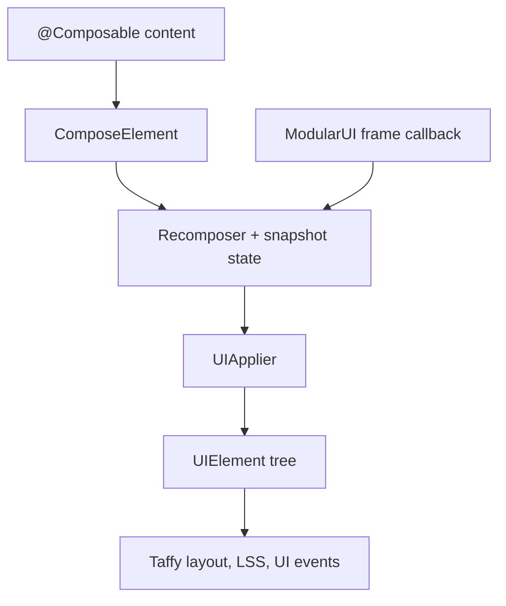

# Compose

<VersionBadge version="2.2.44" label="Since" icon="tag" />

`ldlib2-compose` lets you build LDLib2 UI with `@Composable` functions. You change state, and the element tree follows. You don't call `clearAllChildren()`, rebuild the tree, or track dirty flags.

```kotlin
@Composable
fun DynamicButtonList() {
    var items by remember { mutableStateOf(listOf("A", "B", "C")) }

    ScrollView {
        items.forEach { item ->
            key(item) {
                Button(onClick = { println(item) }, text = item)
            }
        }
        Button(onClick = { items = items + "Button ${items.size + 1}" }, text = "Add")
    }
}
```

<figure>

<figcaption>
A todo panel written with Compose. The rows come from a <code>List</code> in state: adding, ticking or removing an item changes the list, and the element tree follows. Every widget is a composable wrapper around a regular LDLib2 element.
</figcaption>
</figure>

::: info Optional module
**Install it first.** Nothing on these pages works until your mod depends on `ldlib2-compose`: follow [Optional module: ldlib2-compose](../../java_integration.md#optional-module-ldlib2-compose) on the Java Integration page.

`ldlib2-compose` (mod id `ldlib2_compose`) is a separate mod, built once per Minecraft version; its version starts with the Minecraft line, so `21.0.0.1` is the first release for 1.21.x (see [Versions](./getting-started.md#versions)). It is published to Maven only and is not inside the LDLib2 jar. It needs LDLib2 2.2.44 or later, and your composables must be written in Kotlin. See [Getting Started](./getting-started.md).
:::

## How it works

The runtime is the JetBrains Compose runtime 1.8.2 (package `androidx.compose.runtime`). `@Composable`, recomposition, snapshot state, `remember`, `key` and effects work as they do in Compose.

Only the runtime is included. There is no `compose.ui` and no `compose.foundation`, so there is no `Modifier`, no `pointerInput`, and none of the foundation layouts. LDLib2 provides the rest:

- an applier that turns the composition's tree edits into `UIElement` inserts, moves and removals;
- a frame clock driven by the `ModularUI` render loop.

Layout is still Taffy, styling is still LSS, and events are still LDLib2 UI events.



| Object | Role |
| --- | --- |
| `ComposeElement` | A `UIElement` whose children come from a composition. The entry point. |
| `composeUI` / `composeModularUI` | Build a `UI` or `ModularUI` whose root is a `ComposeElement`. |
| `UIElementNode` | Emits any `UIElement` subclass as a node. Every wrapper is built on it. |
| `rememberServerMessenger` | Sends named messages from a composition to the server. |
| `ComposeSavedState` | Keeps `rememberSaveable` state while a screen with a `stateKey` is closed. |

## When to use it

The [Kotlin DSL](../kotlin_support.md) and [XML](../xml.md) build a tree once. Compose suits UI whose structure follows data: lists that grow and shrink, panels that appear on a condition, tabs added at runtime.

You can mix the two. Put a `ComposeElement` into a tree built any other way, or place an existing element inside a composition with `Mount`.

## Pages

- [Getting Started](./getting-started.md): dependencies, a first screen, a first menu.
- [Styling and Events](./styling-and-events.md): the named parameters, style blocks, event handlers, hover state.
- [Components](./components.md): the widget wrappers, controlled values, containers, wrapping your own elements.
- [State and Sync](./state-and-sync.md): `rememberSaveable`, the binding bridges, server-driven UI.
- [Lazy Lists and Animation](./lazy-and-animation.md): `LazyColumn`, `LazyRow`, `LazyVerticalGrid`, animations, `AnimatedVisibility`.
- [Limitations](./limitations.md): differences from Jetpack Compose, side and lifecycle rules.
