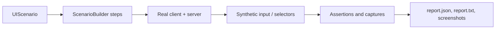

# UI Test Harness

<VersionBadge version="2.2.34" label="Since" icon="tag" />

The UI test harness runs scenarios in a real Minecraft client. It creates an isolated world, opens real UIs, sends input through the normal screen path, waits for server synchronization, records assertions, and writes screenshots and reports.



<figure>

<figcaption>
An actual <code>snake_hud</code> scenario capture. The harness opened this HUD in a real client, drove its controls, and wrote the image beside <code>report.txt</code> and <code>report.json</code>.
</figcaption>
</figure>

| Page | Covers |
| --- | --- |
| This page | Setting up the Gradle scripts, writing a scenario, run options, steps, and UIs in their own OS window. |
| [Running Tests](./running.md) | Background runs, headless runs, resolution, and parallel runs with `runParTest`. |
| [Multi-Process Tests](./multi-process.md) | A dedicated server plus several clients with `runMpTest`. |

## 1. Set up in your mod {#set-up-in-your-mod}

The LDLib2 jar contains the harness itself: the scenario registries, the builders, and the orchestrators for parallel and multi-process runs. The Gradle wiring is **not** in the jar. It lives in three scripts in the [LDLib2 repository](https://github.com/Low-Drag-MC/LDLib2) under `gradle/`, and your mod applies copies of them.

| Script | Adds | Needed for |
| --- | --- | --- |
| `ldlib2-uitest.gradle` | The `-PldTest*` properties on the `client` run, `verifyUiTest`, report clean-up, and `-PldTestHeadless`. | Every run. Required. |
| `ldlib2-uitest-par.gradle` | `runParTest`, `verifyParTest`, and the `uiTestShard<N>` runs. | [Parallel runs](./running.md#parallel-runs). |
| `ldlib2-mptest.gradle` | `runMpTest`, `verifyMpTest`, and the `mpServer`, `mpClientA`, `mpClientB` runs. | [Multi-process tests](./multi-process.md). |

Copy the scripts from the LDLib2 tag that matches the LDLib2 version you depend on, then apply them after your `runs { }` block, in this order:

```groovy
runs {
    client {
        // ...
    }
    // ...
}

apply from: rootProject.file('gradle/ldlib2-uitest.gradle')
apply from: rootProject.file('gradle/ldlib2-uitest-par.gradle')   // optional: runParTest
apply from: rootProject.file('gradle/ldlib2-mptest.gradle')       // optional: runMpTest
```

Without `ldlib2-uitest.gradle`, `-PldTest` does nothing and `verifyUiTest` does not exist. The other two scripts rely on it for headless support, so always apply it.

::: warning Build requirements

- The scripts are written for NeoGradle. They use `runs { ... runType 'client' }`; a ModDevGradle project must translate them.
- The client run must be named `client`.
- Apply `ldlib2-uitest-par.gradle` and `ldlib2-mptest.gradle` in the **root project**. Their orchestrators start child builds with the root's `gradlew`.
- If another subproject in your build also applies NeoGradle, its `run<Name>` task rule answers an unqualified `gradlew runParTest` or `gradlew runMpTest` and fails the build. Register disabled tasks with those names in that subproject, or call `gradlew :runParTest` / `gradlew :runMpTest`. This needs the scripts from LDLib2 2.2.44 or newer. <VersionBadge version="2.2.44" label="Since" icon="tag" />

:::

```groovy
// In the other NeoGradle subproject's build.gradle
['runParTest', 'runMpTest'].each { name -> tasks.register(name) { enabled = false } }
```

::: tip Copy the scripts again when you upgrade

The scripts change together with LDLib2, so replace your copies whenever you upgrade. Copies older than 2.2.39 do not delete the previous report before a run. If the client then fails to start, `verifyUiTest` reads the old report and prints the previous run's result.

:::

## 2. Register a scenario

Put scenarios in `src/main/java`, not `src/test`, and register them in the client-only scenario registry.

```java
@LDLRegisterClient(name = "furnace_ui", group = "mymod", registry = UIScenario.REGISTRY,
        environment = RegistrationEnvironment.DEV_ONLY)
public class FurnaceUiScenario implements UIScenario {
    private static final BlockPos POS = new BlockPos(8, 65, 8);

    @Override
    public void configure(ScenarioOptions options) {
        options.tags("machine").guiScale(3);
    }

    @Override
    public void define(ScenarioBuilder s) {
        s.clearArea(POS, 2)
         .setBlock(POS, MyBlocks.FURNACE.get())
         .awaitClientBlockEntity(POS)
         .useBlock(POS)
         .awaitScreen(ModularUIContainerScreen.class)
         .awaitModularUI()
         .click("#btn_start")
         .waitForTextContains("#status_label", "Burning")
         .screenshot("running")
         .teardown("close", ctx -> ctx.requirePlayer().closeContainer());
    }
}
```

`RegistrationEnvironment.DEV_ONLY` prevents scenarios from shipping in a production build.

## 3. Run it

```text
gradlew runClient -PldTest=furnace_ui
```

| Option | Meaning |
| --- | --- |
| `-PldTest=all` | Run every registered scenario. |
| `-PldTest=name1,name2` | Run selected scenarios. |
| `-PldTest=group:mymod` / `tag:fast` / `regex:.*_ui` | Select by group, tag, or name pattern. |
| `-PldTestExclude=slow_one` | Remove scenarios from the selection. Accepts the same forms as `-PldTest`. |
| `-PldTestKeepOpen` | Keep the client open for iteration. |
| `-PldTestWindow=1440x900` | Pin the window size. Default: maximized, or `1920x1080` in a headless run. See [Resolution](./running.md#resolution). |
| `-PldTestGuiScale=3` | Set the run-wide GUI scale. Default `2`. `ScenarioOptions#guiScale` overrides it for one scenario. |
| `-PldTestWatchdogSec=90` | Fail the run when no frame has been rendered for this many seconds. Default `90`. |
| `-PldTestInputMode=REAL` | Use the physical OS cursor. This requires foreground focus. |
| `-PldTestHeadless` | Run without a visible window. See [Headless runs](./running.md#headless-runs). |

Reports are written to `build/ldlib2-uitest/`: `report.json`, `report.txt`, and `screenshots/`. `verifyUiTest` runs after `runClient`; a missing report is a failure. Since 2.2.39 the previous `build/ldlib2-uitest/` is deleted before `runClient` starts, so a client that dies early cannot leave an old report behind.

A selection that matches no scenario fails the run. Since 2.2.38 the report records it as an error entry named `<selection>`; earlier versions reported an empty pass.

For rapid iteration, keep the game open and run `/ldlib2_autotest list` or `/ldlib2_autotest run furnace_ui` in-game.

## 4. Build reliable steps {#build-reliable-steps}

| Need | Builder methods |
| --- | --- |
| Prepare a world | `setBlock`, `clearArea`, `withBlockEntity`, `giveItem` |
| Open UI | `openScreen`, `openModularUI`, `useBlock`, `awaitScreen`, `awaitModularUI` |
| Interact | `hover`, `click`, `drag`, `scroll`, `typeInto`, `key` |
| Wait | `frames`, `ticks`, `waitUntil`, `waitForText`, `waitForSync` |
| Assert | `check`, `checkText`, `checkVisible`, `checkValue`, `checkBounds` |
| Capture | `screenshot`, `screenshotElement`, `screenshotSurface` |

Targets use LDLib2 CSS selectors: tag names, `.class`, `#id`, descendant and child selectors, plus state pseudo-classes. Prefer stable IDs such as `#btn_start`. Selector lists, attribute selectors and `:nth-child` are not supported; use `ctx.query(...)` for those cases.

::: tip Background runs

The default synthetic input mode does not take focus or move the physical mouse. Use `REAL` only to test OS-level behavior. The harness also blocks accidental OS input during an active run. See [Background runs](./running.md#background-runs).

:::

::: warning Wait for state, not frames

One builder step runs per rendered frame, while game and data-bound UI state may update at 20 ticks per second. Prefer `waitForSync`, `waitForText`, or `waitUntil` to an arbitrary frame delay.

:::

### Settling after assertions

<VersionBadge version="2.2.41" label="Since" icon="tag" />

Every step, including one that only asserts, idles for the scenario's settle time afterwards. `ScenarioOptions#settleAfterAssertions(false)` drops that idle after assertion steps.

```java
@Override
public void configure(ScenarioOptions options) {
    options.settleAfterAssertions(false);
}
```

This cannot make a failing check pass: each assertion keeps the timing it already had, because that timing comes from the settle of the step before it. Only the next action arrives sooner. A scenario that was quietly relying on the extra pause fails at the step that needs it. If a scenario really needs time between two assertions, add an explicit `ticks(...)` or `waitUntil(...)` step there.

## 5. Test a UI in its own OS window

<VersionBadge version="2.2.38" label="Since" icon="tag" />

`ctx.el`, `ctx.query`, and every input step resolve through the UI behind `Minecraft#screen`. A UI hosted in a [`ModularUIWindow`](../modular-ui-window.md) is behind no screen: it reads input from its own OS window and draws into its own off-screen target. Three APIs address it:

| API | Use |
| --- | --- |
| `ctx.in(window.getModularUI(), selector)` | Query elements in that window's UI instead of the screen's. |
| `ctx.input(window)` | Get a `WindowInput` that posts events into the window's own event queue: `moveTo`, `mouseDown`, `mouseUp`, `scroll`, `key`, `charTyped`, `closeRequest`. |
| `screenshotSurface(label, ctx -> window.surface())` | Capture the window's own framebuffer. |

```java
s.step("aim at Save", ctx -> ctx.input(window).moveTo(
                ctx.in(window.getModularUI(), "button").withText("Save").one().element()))
 .step("press", ctx -> ctx.input(window).mouseDown(GLFW.GLFW_MOUSE_BUTTON_LEFT))
 .step("release", ctx -> ctx.input(window).mouseUp(GLFW.GLFW_MOUSE_BUTTON_LEFT))
 .screenshotSurface("saved", ctx -> window.surface());
```

Coordinates passed to `moveTo(x, y)` are in that window's GUI space, which is what `ElementBounds` reports for its elements.

::: warning One input primitive per step

The window drains its event queue once per frame. Post one primitive per step, as above; a drag batched into one step never starts. The exception is a control that closes its own window, such as a window's close button. LDLib2 controls act on mouse-down, so press and release it in the same step, or there is no window left to release into.

:::
