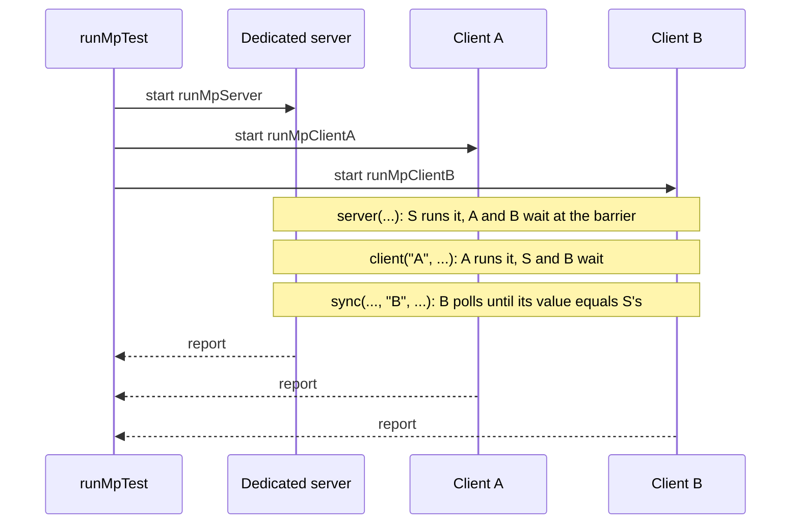

# Multi-Process Tests

<VersionBadge version="2.2.37" label="Since" icon="tag" />

A normal UI test runs one client against its own integrated server. A multi-process test runs **one real dedicated server plus one client per role**, connected over localhost and driven in lockstep. Use it to test what a second player sees: synced block entity fields, per-player UI sessions, client-to-server packets, and RPCs, through the same code paths a real server uses.

It needs `ldlib2-uitest.gradle` and `ldlib2-mptest.gradle`; see [Set up in your mod](./index.md#set-up-in-your-mod).



`runMpTest` starts the server and each client as separate Gradle builds, prepares a fresh flat world in `runs/mpServer`, coordinates the processes over a local TCP hub, and merges their reports. If the hub goes away, every process shuts itself down, so a failed run does not leave game processes behind.

## 1. Write a scenario

A multi-process scenario is an ordered list of **segments**. Each segment belongs to one side, and every other process waits at a barrier until it finishes. Inside a `client(...)` block, the whole [`ScenarioBuilder`](./index.md#build-reliable-steps) step vocabulary is available.

```java
@LDLRegister(name = "machine_sync", group = "mymod", registry = MPScenario.REGISTRY,
        environment = RegistrationEnvironment.DEV_ONLY)
public class MachineSyncScenario implements MPScenario {
    private static final BlockPos POS = new BlockPos(4, -60, 2);

    @Override
    public void configure(MPScenarioOptions options) {
        options.clients("A", "B");
    }

    @Override
    public void define(MPScenarioBuilder s) {
        s.server("place the machine", sc -> sc.server().overworld()
                        .setBlockAndUpdate(POS, MyBlocks.MACHINE.get().defaultBlockState()))
         .client("A", "open the UI and start", b -> b
                 .useBlock(POS)
                 .awaitScreen(ModularUIContainerScreen.class)
                 .click("#btn_start"))
         .serverWaitUntil("the server started the machine",
                 sc -> sc.blockEntity(POS, MachineBlockEntity.class).isRunning())
         .sync("client B sees it running", "B",
                 sc -> sc.blockEntity(POS, MachineBlockEntity.class).isRunning(),
                 ctx -> {
                     var machine = ctx.clientBlockEntity(POS, MachineBlockEntity.class);
                     return machine != null && machine.isRunning();
                 })
         .allClients("close the UI", b -> b.closeScreen())
         .teardownServer("remove the machine", sc -> sc.server().overworld().removeBlock(POS, false));
    }
}
```

Register multi-process scenarios with plain `@LDLRegister`, not `@LDLRegisterClient`: the dedicated server must discover them too.

| Segment | Runs on | Meaning |
| --- | --- | --- |
| `server(name, sc -> ...)` | Dedicated server thread | One task. |
| `serverWaitUntil(desc, sc -> ...)` | Dedicated server, every tick | Releases the barrier once the condition is true. |
| `serverSettle(ticks)` | Dedicated server | Lets that many server ticks pass. |
| `client(role, name, b -> ...)` | The client with that role | Ordinary `ScenarioBuilder` steps. |
| `allClients(name, b -> ...)` | Every client at once | The barrier waits for all of them. |
| `sync(desc, role, server, client)` / `syncAll(desc, server, client)` | One client / every client | Polls until the client's value equals the server's. |
| `fetch(key, desc, type, server)` / `fetchOn(role, key, desc, type, server)` | Server, then every client / one client | Copies one server value into the clients' scratch state. |
| `teardownServer` / `teardownClient` / `teardownAllClients` | The owner only | Cleanup without barriers. |

`MPScenarioOptions` configures the scenario:

| Option | Default | Meaning |
| --- | --- | --- |
| `clients(String...)` | `"A"` | Roles the scenario needs. A run started with fewer clients skips the scenario. |
| `scenarioTimeoutMs(long)` | 5 minutes | Budget for the whole scenario, including time spent waiting at barriers. |
| `tags(String...)` | none | Labels for `-PldMpTest=tag:<tag>`. |
| `clientOptions(o -> ...)` | none | Adjusts each client's `ScenarioOptions`, such as GUI scale or settle time. |

On the server side, `ServerContext#player(role)` returns that role's player, whose username is `LDTest<role>`. `players()` returns all of them.

## 2. Compare values: `sync` or `fetch`

`sync` and `syncAll` compare the client's value with the server's by their JSON form. Use them for values both sides must hold exactly: a synced integer, a string, a block state, a count. Keep the values to primitives, strings, and simple data.

`fetch` is for values that only need to be close, such as a float that moves every tick. It reads the server value once, when the segment runs, and stores it in every client's scratch state. A later client step reads it with `ctx.get(key)` and compares with its own tolerance:

```java
.fetch("server.yaw", "the body angle the server holds", Double.class,
        sc -> (double) mover(sc).yaw())
.client("B", "client B agrees", b -> b.check("within two degrees", ctx -> {
    double server = ctx.get("server.yaw");
    double here = moverOf(ctx).yaw();
    ctx.log("server " + server + ", here " + here);
    return Math.abs(Mth.wrapDegrees(server - here)) < 2.0;
}))
```

Put the `fetch` where you want the reading taken. Use `Double.class` for numbers: the value travels as JSON, and Gson reads a bare number as a double. `fetchOn(role, ...)` delivers the value to one client only.

## 3. Rules that keep scenarios deterministic

- **`define()` runs in every process** and must produce the same segments in the same order everywhere. Never branch on live game state in `define()`; do that inside segment bodies.
- **A failed `check` does not stop the other processes.** It marks the step and the run as failed, as in a normal test. A step that throws, or a timeout, aborts the scenario: every process skips to its teardown, then the next scenario starts.
- **Client blocks have no integrated server.** Server helpers inside a `client(...)` block throw; change the world in `server(...)` segments and wait across processes with `sync(...)`. `useBlock` is the exception: in a multi-process run it uses the real client interaction path.
- **A client without a role in a scenario skips it**, but its clock for the next scenario starts right away, while it waits for the others to finish. When scenarios with different `clients(...)` share a run, make `scenarioTimeoutMs` long enough to cover that wait.

::: warning The dist rule

`define()` also runs in the **dedicated server process**, so the scenario class must load there. A method body only loads its classes when it runs, but a lambda's signature is checked when the class loads.

- Fine: `Consumer<ServerContext>` and `Consumer<ScenarioBuilder>` blocks, `ctx -> ...` steps, `Predicate<TestContext>`, value getters that return boxed values, and class literals such as `awaitScreen(ModularUIContainerScreen.class)`.
- **Not fine:** a lambda whose signature names a client-only type, such as the `Function<TestContext, Screen>` factory of `openScreen`, or a lambda that captures a client-typed local variable. Use `openScreenTest(name)` instead, or move the code into an `@OnlyIn(Dist.CLIENT)` helper class that is only referenced inside step bodies.

Breaking this rule crashes the dedicated server when it loads the scenario.

:::

## 4. Run it

```text
gradlew runMpTest -PldMpTest=machine_sync
```

| Option | Meaning |
| --- | --- |
| `-PldMpTest=all` | Run every registered multi-process scenario. This is the default. |
| `-PldMpTest=<name>` / `a,b` / `group:x` / `tag:y` / `regex:p` | The same selection forms as `-PldTest`. |
| `-PldMpClients=A,B` | Client processes to start. Default `A,B`. Scenarios that need a role not started are skipped. |
| `-PldTestHeadless` | Start the server and clients without windows. See [Headless runs](./running.md#headless-runs). |

The output of each run replaces the previous one:

```text
build/ldlib2-mptest/report.json   merged report
build/ldlib2-mptest/report.txt    summary
build/ldlib2-mptest/server/       the dedicated server's report and gradle.log
build/ldlib2-mptest/clientA/      each client's report, log and screenshots
build/ldlib2-mptest/clientB/
```

`verifyMpTest` fails the build if any scenario failed or no merged report was written. A cold run takes one to two minutes, because three Gradle builds start and the clients join over localhost.

The script defines clients `A` and `B`. For a third role, copy an `mpClient` run in your copy of `ldlib2-mptest.gradle` as `mpClient<Role>`, with the role and the username `LDTest<Role>`.

When a run fails, look in this order:

1. `build/ldlib2-mptest/report.txt`: which role and which segment failed.
2. That role's `report.json` and screenshots.
3. That role's `gradle.log`.

The `[mptest]` lines in the build output show what the hub saw: who connected, who joined, how each scenario ended, and how each process exited.

## Example: block entity sync

LDLib2's own `mp_block_entity_sync` scenario (`MPBlockEntitySyncScenario`) tests [sync annotations](../../sync/annotations.md) across a dedicated server and two clients. It seeds every field on the server, uses `syncAll` to wait until each client's description of the synced fields matches the server's, then checks in `allClients` that `@ConditionalSynced` and `@LazyManaged` held values back and that `@UpdateListener` saw the change.
