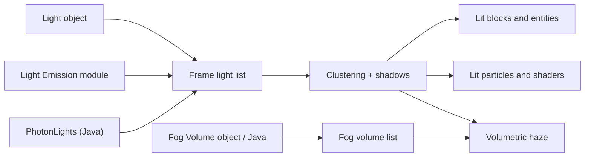

# Dynamic Lights

<VersionBadge version="2.2.8" label="Since" icon="tag" />

Dynamic lights let an effect cast coloured light, with shadows, onto the blocks, entities and particles around it.

<figure>

<figcaption>A night square lit only by Photon: a flickering campfire, a magic circle and an energy shield with their own lights, warm light from inside the temple, and a searchlight beam through low mist. The shadows are voxel shadows with soft edges.</figcaption>
</figure>

## How It Works

Photon lights the finished image on screen. After the opaque world is drawn, a lighting pass reads the screen's colour and depth and adds the light of every dynamic light to it. The game's light levels do not change: a Photon light does not stop mobs from spawning or make plants grow, and it is not part of the world's light data.

Every frame Photon collects the lights from three sources, drops the ones outside the view, and ranks the rest by how bright they look from the camera. Lights are then sorted into screen tiles and depth slices, so each pixel only loops over the lights that reach it. The brightest lights with **Cast Shadows** get shadows.

## What Emits Light, and What Is Lit

| Source | Where | Use |
| --- | --- | --- |
| **Light** object | FX hierarchy, **New → Light** | A point or spot light with curves, flicker, shadows and an optional volumetric glow. See [Lights and Fog](./lights-and-fog.md). |
| **Light Emission** module | Particle Emitter | Turns a share of the particles into lights that follow them. See [Lit Particles and Shaders](./lit-particles-and-shaders.md#light-emission). |
| `PhotonLights` | Java, client only | Lights that are not part of an FX: a lamp, a light on an entity, a flash. See [Dynamic Lights API](../java-api/dynamic-lights-api.md). |

| Target | How it gets light |
| --- | --- |
| Opaque and cutout blocks, entities, block entities | Automatically. |
| Translucent blocks (water, stained glass, ice) | Not lit without a shader pack. |
| Photon particles | Turn on **Lit by Dynamic Lights** on a Texture or Sprite material, or add the Kila Material module of the same name. |
| Shader Graph and Custom Shader materials | The **Dynamic Light** node, or `photon:lit_particle.glsl` in a hand-written shader. |
| The air around a light | **Volumetric** on the light: a halo for a point light, a beam for a spot light. |
| **Fog Volume** objects | Every light that reaches the fog lights it. |

## Client Settings

Open **Mods → Photon → Config** and go to the **Dynamic Lights** section. The values are stored in `config/photon-client.toml` under `[dynamic_lights]`. They are per player and change only how the effect looks on this client.

<figure>

<figcaption>The Dynamic Lights section of Photon's client config screen.</figcaption>
</figure>

| Setting | Key | Default (range) | What it does |
| --- | --- | --- | --- |
| Enable dynamic lights | `enabled` | `true` | Master switch. While off, no dynamic light is drawn or computed. |
| Shadows | `shadow_mode` | Voxel | Off, Screen space or Voxel. See [Shadows](./lights-and-fog.md#shadows). |
| Soft shadows | `soft_shadows` | `true` | Soft shadow edges, sized by each light's Source Radius. |
| Shadowed lights per frame | `shadowed_lights` | 8 (0–32) | How many lights cast shadows each frame. The brightest and closest get them. |
| Lighting resolution | `resolution` | 0.5 (0.25–1) | Resolution of the lighting relative to the screen. 0.5 looks close to full resolution at about a third of the cost. |
| Contact shadow steps | `contact_shadow_steps` | 6 (0–32) | Voxel shadows only: a short screen-space trace for fences, panes and entities. 0 turns it off. |
| Contact shadow length | `contact_shadow_length` | 0.8 (0.1–4) | Voxel shadows only: how far the contact trace reaches, in blocks. |
| Screen shadow steps | `screen_shadow_steps` | 24 (1–128) | Screen space shadows only: trace steps toward each light. |
| Screen shadow thickness | `screen_shadow_thickness` | 1.0 (0.05–16) | Screen space shadows only: how far behind a visible surface something still blocks light, in blocks. |
| Screen shadow distance | `screen_shadow_distance` | 32 (1–128) | Screen space shadows only: the longest shadow trace, in blocks. |
| Voxel build budget (ms) | `voxel_budget_ms` | 2.0 (0.1–20) | CPU time per frame for turning blocks into voxels. Lower keeps frame times steadier; shadows appear later in new areas. |
| Brightest surface colour | `albedo_max` | 0.85 (0.1–1) | The brightest colour a surface is assumed to have. Lower values brighten pale surfaces less. |
| Shader pack ambient | `shader_pack_ambient` | 0.06 (0.001–1) | With a shader pack: the darkest lighting the pack is assumed to give. Raise it if lights look too strong on dark surfaces. |
| Volumetric lighting | `volumetric` | `true` | Draws halos, beams and Fog Volumes. |
| Volumetric haze | `volumetric_density` | 1.0 (0–8) | Multiplies the glow around volumetric lights and the density of fog volumes. 0 turns both off. |
| Forward scattering | `volumetric_forward_scattering` | 0.3 (0–0.9) | How much brighter the glow is when you look toward a light. |
| Volumetric samples | `volumetric_samples` | 4 (1–16) | Integration steps for halos, beams and fog. More is smoother and costs more. |
| Volumetric lighting with shader packs | `volumetric_with_shader_packs` | `true` | Also draws the glow and fog volumes over a shader pack's image. |

## Performance and Limits

| Limit | Value |
| --- | --- |
| Lights per frame | 1024 after view culling; the most important are kept. |
| Shadowed lights per frame | **Shadowed lights per frame**, at most 32. |
| Fog volumes per frame | 32, nearest first. |
| Lights per Light Emission emitter | **Max Lights**, 32 by default. |

The cost follows the screen area the lights cover more than their number. Many small lights with a short **Range** are cheap; a few lights with a large range that fill the screen cost more. Shadows, soft shadows and volumetric glow each add to the cost.

As an indication only: on the developer's RTX 4080 Super at 1080p, the default settings with 8 lights cost about 0.5 ms of GPU time. 1024 lights cost about 1.3 ms GPU and 2.2 ms CPU.

## Shader Packs (Iris)

- Under a shader pack, the lighting pass runs on the pack's final image. Photon estimates the surface colour from that image; **Shader pack ambient** tunes the estimate.
- Halos, beams and fog volumes are drawn over the pack's image. Turn off **Volumetric lighting with shader packs** if they clash with the pack's own fog.
- The pack's own lighting, shadows and reflections do not see Photon's lights.
- Packs that draw the world at a lower internal resolution through their `ResolutionScale` option (such as Kappa and Nostalgia) are supported. SEUS PTGI HRR still shows the lights out of place.

## What Does Not Work

- Without a shader pack, translucent blocks (water, stained glass, ice) and vanilla particles are drawn after the lighting pass and stay unlit.
- Material, node and shader-graph previews show no light.
- Trail, Beam and AraTrail emitters cannot emit lights. Light Emission exists only on the Particle Emitter.
- Lights from FX objects lag one frame behind fast transform changes.
- The editor's scene world is fully lit, so light pools look fainter there than at night in game.
- Lights added with `PhotonLights` show only in the client world, not in the editor or in UI scenes. A UI scene from another mod is lit by its own FX lights only when its `PhotonParticleManager` knows its level; see [Dynamic Lights API](../java-api/dynamic-lights-api.md#ui-scenes).

## In This Section

- [Lights and Fog](./lights-and-fog.md): the Light object, shadows, volumetric lights, Fog Volume, editor preview and Timeline.
- [Lit Particles and Shaders](./lit-particles-and-shaders.md): Light Emission, Lit by Dynamic Lights, the Dynamic Light node and hand-written shaders.
- [Dynamic Lights API](../java-api/dynamic-lights-api.md): `PhotonLights`, `DynamicLight` and `FogVolume` from Java.
