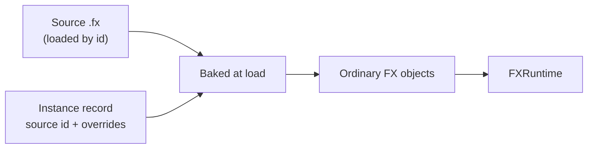

# FX Instances

<VersionBadge version="2.2.9" label="Since" icon="tag" />

An FX instance places an existing `.fx` inside another effect. The placed objects are live copies of the source: you can change, disable, or delete them and add your own objects under them. The file saves only what you changed. When the source changes, the instance follows it on the next load and keeps your changes. Unity users know this as a prefab instance.

Use instances to reuse one effect, such as a spark burst or a shockwave, in several bigger effects, and to make variants of it without copying it.

<figure>

<figcaption>An FX instance in the hierarchy. Its placed objects are drawn in the instance blue, and an added child is marked "+". The Inspector shows a placed emitter: its header reads "From FX instance '…'" and the overridden rows are marked.</figcaption>
</figure>

Your effect stores only the instance record: the source id and the overrides. At load time Photon combines the record with the current source and produces ordinary objects.

## Place an Instance

| Action | Where the instance goes |
| --- | --- |
| Hierarchy right-click → **Add FX Instance...**, then pick an id in **Pick an FX** | Next to the selected object, or under `root` |
| Asset Browser: right-click an `.fx` → **Add as FX Instance** | Under `root` |
| Drag an `.fx` from the Asset Browser into the hierarchy | Onto a row: under that object. Onto empty space: under `root`. |

**Pick an FX** searches every effect the game can load: mod jars, resource packs, and FX packs.

An instance references its source by effect id, so the file must have one. `assets/<namespace>/fx/<path>.fx` is loaded as `<namespace>:<path>`. The editor's assets folder (`<gameDir>/ldlib2/assets/`) and resource packs use the same layout. A file that cannot be loaded by id shows a disabled menu item with the reason:

| Menu item | Cause |
| --- | --- |
| **Add as FX Instance (only an .fx under assets/&lt;namespace&gt;/fx/)** | The file is not inside an `assets/<namespace>/fx/` folder. |
| **Add as FX Instance (the file name is not a valid id)** | The name has characters other than lowercase letters, digits, `_`, `-`, and `.`. |

## How Instances Look

| Item | Shown as |
| --- | --- |
| The instance | FX file icon, instance blue. Inspector header: `FX Instance: <id>`. |
| A placed object | Instance blue. Inspector header: `From FX instance '<name>' (<id>)`. |
| An overridden value | A marked row in the Inspector. |
| An object you added under the instance or under a placed object | Name prefixed with `+`. |
| A disabled or hidden object | Grey. |
| An instance whose source is missing | Red. Inspector header: `FX Instance: <id> (missing)`. |

## Change What It Places

Every edit in this section can be undone.

### Override Values

Edit any value of a placed object in the Inspector. The row becomes an override and is marked. A value set back to the source's value is not an override any more, so it follows the source again.

You can revert at three levels:

| Scope | How |
| --- | --- |
| One value | Right-click the marked row → **Revert**. |
| One object | Right-click the placed object's Inspector header or its hierarchy row → **Revert Object**. It is enabled only when the object has overrides. |
| The whole instance | **Revert All** in the instance menu or the Overrides dialog. Values go back, removed objects come back, and added objects are deleted. |

### Disable, Remove, and Add

- **Disable / Enable** in the hierarchy menu, or the **Enabled** row in the Inspector, switches a placed object off. The switch is saved as an override. A disabled object neither ticks nor renders, and an Activator track cannot wake it.
- **Remove** a placed object to record it as removed, together with everything under it. Bring it back with **Restore** in the Overrides dialog.
- Drag objects onto the instance or onto a placed object in the hierarchy to add them there. Added objects belong to your effect, not to the source, and show `+`. They can be FX instances too.
- Placed objects cannot be moved or reordered. Only the source decides their hierarchy.

### The Overrides Dialog

**Overrides...** opens **Overrides of &lt;name&gt;**. It lists:

- the source id;
- every modified object with its changed values, each with **Revert**, and the object with **Revert Object**;
- removed objects, each with **Restore**;
- added objects, shown as `+ <name>`;
- `N overrides found nothing in the source`, with **Remove Unused Overrides** (see [Follow the Source](#follow-the-source));
- a **Revert All** button.

<figure>

<figcaption>The Overrides dialog of an instance: changed values with Revert, a removed object with Restore, and an added object.</figcaption>
</figure>

### The Instance Menu

Right-click the instance's Inspector header, or open the **FX Instance** submenu of its hierarchy row:

| Item | Does |
| --- | --- |
| **Open Source** | Converts the source `.fx` into a project and opens it. It asks where to save the project first. It works only for a file under the editor's assets folder. An effect from a mod or an `.fxpack` is refused; convert a pack's effect with **File → Manage FXPack...** first. |
| **Overrides...** | Opens the Overrides dialog. |
| **Revert All** | Puts the whole instance back to its source. |
| **Replace...** | Places another FX instead. Overrides that still find their objects in the new source are kept. |

**Overrides...** and **Revert All** are disabled while the source is missing.

<figure>

<figcaption>Right-click an instance in the hierarchy: the FX Instance submenu holds Open Source, Overrides..., Revert All and Replace....</figcaption>
</figure>

### Copy, Paste, and Duplicate

Copying, pasting, or duplicating an instance creates a new instance with the same overrides and added objects. Timeline tracks bound to it are copied too. A paste that would make a cycle places nothing and tells you why.

## Follow the Source

An instance never writes its source. To change the source for every effect that places it:

1. Choose **Open Source** on the instance.
2. Edit the converted project.
3. Export it back to the same id.

When the source is re-exported or its pack is rewritten while an effect that places it is open, the editor places the instance again from the new source and keeps your overrides. This is one history step, **Follow the Updated Source**. Effects that are not open pick up the new source the next time they load.

An override whose object or field is gone from the new source is kept as unused. The Overrides dialog counts these as `N overrides found nothing in the source`. They are kept so that a later source change can use them again. **Remove Unused Overrides** deletes them.

The source is resolved by id like any other effect. If a higher-priority resource pack provides the same id, the instance places that one.

## Nesting and Cycles

A source can contain instances, and you can add instances inside an instance. Any depth works.

A cycle is refused. A cycle means an effect would place itself, directly or through other instances. The editor shows:

> Placing %s here would place this effect inside itself (through %s).

Export checks the same thing against the id you export to:

> Exporting as %s would make an FX instance in it place itself (through %s).

## Timeline

An instance plays its source's Timeline on its own clock.

| Outer Timeline | Instance clock |
| --- | --- |
| The instance is active when the effect starts | Starts at `0`. |
| A Control clip restarts the instance or one of its parents | Starts at `0` when the clip starts. |
| An Activator track turns the instance off | Pauses, then continues when the instance turns on again. |
| A Speed track or `FXRuntime#setRate` changes the instance's time scale | Runs at that speed. |

- The clock starts the first time the instance is active after a reset.
- Tracks in the source that target its root act on the instance.
- You can bind outer tracks to the instance and to its placed objects. When the outer Timeline and the source drive the same object and channel, the outer Timeline wins. This holds at every nesting level.
- A new Control clip for an instance is long enough to hold the source's whole Timeline.
- An instance that is active and playing its Timeline keeps the effect alive until that Timeline ends. A paused instance does not.
- Signals and audio from the source's Timeline go to the same executor as the outer ones.

See [Activator, Control, and Speed](./timeline/activator-control-and-speed.md) for the outer tracks.

## Export and Runtime

| Export | The instance |
| --- | --- |
| `.fx` | Keeps referencing its source by id. The source must be loadable at runtime from a mod, a resource pack, or an `.fxpack`. |
| `.fxpack` | Every source the instances place, at any depth, is packed under its own id. Sources the game or a mod already ships are skipped. Packed sources are playable effects of the pack too. |

At load time, `FXHelper.getFX` bakes the instances into ordinary objects. Java code sees plain objects, and `FXRuntime#findObject` finds placed objects by their names. If an effect places the same source twice, both copies have the same names; use `findObjects` to get all of them. [Preloading](./java-api/preloading.md) an effect also preloads the sources its instances place.

::: warning Older Photon versions
Photon versions before 2.2.9 do not know FX instances. They drop the instances when they read the file, so the placed content is missing.
:::

## Missing Sources

If the source cannot be loaded, the instance stays in the effect. It is drawn red, its header ends with `(missing)`, and it places nothing. Its saved record is kept unchanged. When the source becomes available, for example after an export or after a pack is installed, the effect places it again.

## Tips

- There is no Apply. The source `.fx` is never written from an instance; use **Open Source** and export the source back.
- There is no Unpack. Placed objects stay linked to their source.
- Keep source ids stable. Renaming or moving the source `.fx` changes its id, and the instance reports it as missing.
- Give each instance a clear name. The name appears in the header of every object it places.
