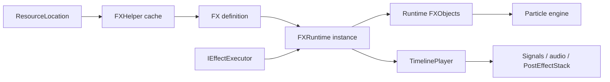

# Java and Runtime API


*The Java API loads the same authored FX used by the editor and owns a separate runtime instance for each playback.*

Photon's public playback API is client-only. Load an immutable-ish `FX` definition, create or let an executor create an `FXRuntime`, and keep all world/render mutations on the client thread.

## Add Photon to Your Mod

[](https://maven.firstdark.dev/#/snapshots/com/lowdragmc/photon/photon-neoforge-1.21.1)

Photon, LDLib2 and KilaGraph are published to the FirstDark Maven. A mod that plays effects compiles against Photon and LDLib2. KilaGraph, the node graph library behind Photon's shader graphs, comes inside Photon's `all` jar, so you add it only when your own code uses KilaGraph classes.

### Versions

Put the versions in `gradle.properties`:

```properties
minecraft_version=1.21.1
ldlib2_version=2.2.43
photon_version=2.2.9
# Only needed if you compile against KilaGraph (see below)
kilagraph_version=21.1.0.15
```

| Requirement | Photon `2.2.9` |
| --- | --- |
| Minecraft | `1.21.1` |
| NeoForge | `21.1` (built against `21.1.217`) |
| LDLib2 | `2.2.43` or later. Required; players install it next to Photon. |
| KilaGraph | `21.1.0.15` or later. Required; nested inside Photon's `all` jar. |
| Mod ID | `photon` |

A newer Photon release often needs a newer LDLib2. When you update Photon, check the LDLib2 version it requires.

### Gradle

<DocTabs>
<DocTab title="Groovy">

```gradle
repositories {
    maven { url = "https://maven.firstdark.dev/snapshots" } // LDLib2, KilaGraph, Photon
}

dependencies {
    // LDLib2: the `all` jar carries LDLib2's own bundled libraries
    implementation "com.lowdragmc.ldlib2:ldlib2-neoforge-${minecraft_version}:${ldlib2_version}:all"
    // Photon: the `all` jar bundles KilaGraph
    implementation "com.lowdragmc.photon:photon-neoforge-${minecraft_version}:${photon_version}:all"
    // Only if your code uses KilaGraph classes directly (e.g. custom shader graph nodes):
    // compileOnly "com.lowdragmc.kilagraph:kilagraph-neoforge-${minecraft_version}:${kilagraph_version}"
}
```

</DocTab>
<DocTab title="Kotlin DSL">

```kotlin
repositories {
    maven("https://maven.firstdark.dev/snapshots") // LDLib2, KilaGraph, Photon
}

dependencies {
    val mc = property("minecraft_version")
    // LDLib2: the `all` jar carries LDLib2's own bundled libraries
    implementation("com.lowdragmc.ldlib2:ldlib2-neoforge-$mc:${property("ldlib2_version")}:all")
    // Photon: the `all` jar bundles KilaGraph
    implementation("com.lowdragmc.photon:photon-neoforge-$mc:${property("photon_version")}:all")
    // Only if your code uses KilaGraph classes directly (e.g. custom shader graph nodes):
    // compileOnly("com.lowdragmc.kilagraph:kilagraph-neoforge-$mc:${property("kilagraph_version")}")
}
```

</DocTab>
</DocTabs>

Refresh the Gradle project. `gradlew dependencies --configuration compileClasspath` should then list one Photon and one LDLib2.

### Why the `all` Jar

Photon publishes two jars for each version:

| Jar | Contents |
| --- | --- |
| `photon-neoforge-1.21.1-2.2.9.jar` | Photon's classes only (the thin jar). |
| `photon-neoforge-1.21.1-2.2.9-all.jar` | The same classes plus KilaGraph `21.1.0.15`, nested with NeoForge Jar-in-Jar. |

The `all` jar is also the file on CurseForge and Modrinth, so players install only Photon and LDLib2. With the `all` classifier, your development run uses the same jar as players.

Photon's Maven metadata lists no compile dependencies. That is why the snippet declares LDLib2 itself: Photon's API uses LDLib2 types, and your code does not compile without them. In the development run, Gradle also adds KilaGraph as a runtime dependency of Photon. NeoForge then finds KilaGraph twice, at the top level and nested in Photon, and loads one copy, the highest version.

::: info Older snippets
Earlier versions of this page used the thin coordinate with `transitive = false`. That still works, because the runtime jar is the `all` jar either way, but it is no longer needed. Leaving out the classifier also works: Gradle compiles against the thin jar and runs the `all` jar.
:::

### When You Also Need KilaGraph

Java cannot compile against classes inside a nested jar. Add KilaGraph as `compileOnly` when your code imports `com.lowdragmc.kilagraph` types, for example in custom shader graph nodes or in a subclass of a Photon class built on KilaGraph. Use the version that your Photon release bundles (`21.1.0.15` for Photon `2.2.9`). Players still get KilaGraph from Photon.

### Declare the Dependency

Add Photon and LDLib2 to your `neoforge.mods.toml`:

```toml
[[dependencies.yourmodid]]
    modId = "photon"
    type = "required"
    versionRange = "[2.2.9,)"
    ordering = "AFTER"
    side = "BOTH"
[[dependencies.yourmodid]]
    modId = "ldlib2"
    type = "required"
    versionRange = "[2.2.43,)"
    ordering = "AFTER"
    side = "BOTH"
```

Do not declare KilaGraph; Photon declares and ships it. Set the lower bound of `photon` to the oldest version whose API you use. If your mod uses Photon only from client code and must also run on dedicated servers without Photon, use `side = "CLIENT"` for the `photon` entry.

For an optional integration, use `type = "optional"` and check `ModList.get().isLoaded("photon")` before you touch any class that imports Photon. Keep those imports in a separate class, so the JVM never loads it when Photon is missing:

```java
public final class EffectsCompat {
    private static final boolean PHOTON = ModList.get().isLoaded("photon");

    public static void playHit(ClientLevel level, BlockPos pos) {
        if (PHOTON) {
            PhotonEffects.playHit(level, pos); // the only class that imports Photon
        }
    }
}
```

Test the guard with a run that does not have Photon on its runtime classpath. An unguarded reference fails with `NoClassDefFoundError` only when that code runs.

::: details Bundle Photon inside your mod (Jar-in-Jar)
Bundle Photon only if installing your mod should also install Photon. If the player also installs Photon or LDLib2, or another mod bundles them, NeoForge loads the highest version.

```gradle
dependencies {
    // `api` instead of `implementation` if your public types expose LDLib2, Photon or KilaGraph types
    jarJar(implementation(group: 'com.lowdragmc.ldlib2', name: "ldlib2-neoforge-${minecraft_version}", classifier: 'all')) {
        version { require "${ldlib2_version}" }
    }
    jarJar(implementation(group: 'com.lowdragmc.photon', name: "photon-neoforge-${minecraft_version}", classifier: 'all')) {
        version { require "${photon_version}" }
    }
    jarJar(implementation(group: 'com.lowdragmc.kilagraph', name: "kilagraph-neoforge-${minecraft_version}")) {
        version { require "${kilagraph_version}" }
    }
}
```

- Embed the `all` classifier for LDLib2 and Photon. The plain jars do not contain their nested libraries, so a build that compiles fine fails at runtime. KilaGraph has no `all` jar; its plain jar is the whole mod.
- Use `require`, not `prefer`. The three libraries depend on each other, so a `prefer` loses to their transitive constraints, and the compile and runtime classpaths can resolve different versions.
- Keep the `[[dependencies]]` entries in `neoforge.mods.toml`.
:::

### Troubleshooting

| Symptom | Cause | Fix |
| --- | --- | --- |
| `NoClassDefFoundError` or `ClassNotFoundException` for a `com.lowdragmc.kilagraph` class at runtime | The game runs or ships the thin Photon jar, which has no KilaGraph inside. | Depend on or bundle the `all` classifier. |
| `package com.lowdragmc.lowdraglib2 does not exist`, or "cannot access" an LDLib2 class, when compiling | LDLib2 is not on the compile classpath; Photon's metadata does not add it. | Add the LDLib2 `implementation` line. |
| "cannot access" a KilaGraph class when compiling | Your code uses KilaGraph types, which stay inside the nested jar. | Add KilaGraph as `compileOnly`. |
| The game stops while loading and reports a missing or too old `ldlib2`, `kilagraph` or `photon` | An installed version is below a declared range. | Update that mod, or check the ranges in your `neoforge.mods.toml` and `gradle.properties`. |
| Compiles, then fails at runtime on a missing class or method | The compile and runtime classpaths resolved different versions. | Run `gradlew dependencies` for both classpaths; use `require` when bundling. |

## How the API Fits Together



## Minimal Playback

```java
FX fx = FXHelper.getFX(ResourceLocation.parse("mymod:fire"));
if (fx != null) {
    new BlockEffectExecutor(fx, level, pos).start();
}
```

`FX`, `FXRuntime`, executors, particle objects, shader resources, and post processing are annotated or designed for client distribution. Do not reference them from code that a dedicated server must class-load; place integrations in client-only classes/events.

The first play of an effect reads its file, compiles its shaders and loads its textures. [Preload](./preloading.md) the effects your mod plays often, so that work does not show as a hitch.

## In This Section

- [Loading, Listing, and Caching FX](./loading-listing-and-caching.md)
- [Preloading Effects](./preloading.md)
- [Built-in Effect Executors](./built-in-executors.md)
- [FXRuntime Lifecycle](./fxruntime-lifecycle.md)
- [Runtime Data Injection](./runtime-data-injection.md)
- [Runtime Objects and Transforms](./runtime-objects-and-transforms.md)
- [Live Meshes and UI Scenes](./live-meshes-and-ui-scenes.md)
- [Custom Executors, Timeline, and Signals](./custom-executors-timeline-and-signals.md)
- [Post Processing API](./post-processing-api.md)
- [Dynamic Lights API](./dynamic-lights-api.md)
- [Extension, Serialization, and Debugging](./extension-serialization-and-debugging.md)
