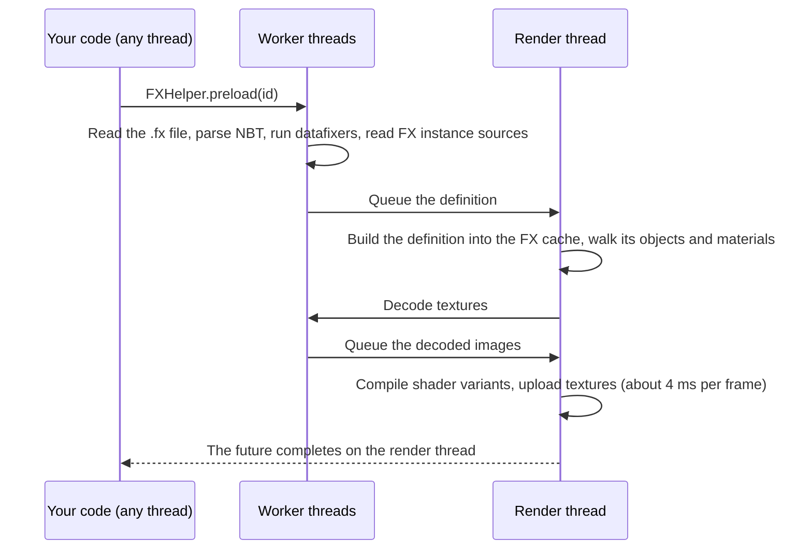

# Preloading Effects

<VersionBadge version="2.2.9" label="Since" icon="tag" />

The first time an effect plays, Photon reads its file, compiles the shader variants its emitters draw with, loads its textures and loads the effects its sub-emitters spawn. That work happens while the effect plays for the first time, and it shows as a hitch. Preloading does the same work earlier: in the background, behind a loading screen, or during the resource reload. The effect then plays smoothly the first time.

The preloading methods are on `FXHelper` (`com.lowdragmc.photon.client.fx`).

## Pick a Method

| Method | Use it for | Call from | Blocks the caller |
| --- | --- | --- | --- |
| `keepPreloaded(ids...)` | Effects that may play at any moment: hits, explosions, ability effects. They stay warm for the whole session, also after resource reloads. | Any thread, also during mod construction and client setup. | No |
| `preload(id)` / `preload(ids)` | An effect you can predict a few seconds ahead: a boss intro, an ability the player just equipped. The work is spread over frames. | Any thread. | No; returns a `CompletableFuture`. |
| `preloadNow(id)` | Effects that must be ready before a scene starts, while your own loading screen is up. Finishes fastest, because nothing waits for the next frame. | Render thread only. | Yes, until everything is warm. |

On a development machine, a 10-emitter effect took 564 ms to preload in the background (spread over many frames, no hitch on first play), 115 ms with `preloadNow`, and 121 ms to warm again during a resource reload. Use these numbers only as an indication.

## Keep Effects Warm for the Session

```java
FXHelper.keepPreloaded(
        ResourceLocation.fromNamespaceAndPath("mymod", "combat/hit"),
        ResourceLocation.fromNamespaceAndPath("mymod", "combat/explosion"));
```

Call it once, for example in your client setup. `keepPreloaded(Collection<ResourceLocation>)` takes a list.

- A resource reload (game start, F3+T, a resource pack change) drops every loaded effect. Photon preloads the kept effects again inside its reload listener, synchronously, while the loading screen is up.
- Calling it during mod construction or client setup is fine: the kept effects are warmed behind the loading screen at game start.
- If you call it after the game has loaded, the new effects are preloaded right away in the background.
- An effect stays kept until the game closes. There is no method to remove it.

Every kept effect adds to the loading screen time of every reload. Keep only the effects that really play often.

## Preload in the Background

```java
ResourceLocation intro = ResourceLocation.fromNamespaceAndPath("mymod", "boss/intro");

FXHelper.preload(intro).thenAccept(fx -> {
    // Render thread. fx is the cached definition, or null if the effect cannot be loaded.
});
```

`preload(Collection<ResourceLocation>)` returns a `CompletableFuture<Void>` that completes once all of the effects are warm.

The work is split between worker threads and the render thread:



- Render-thread work runs at the start of each frame, within a budget of about 4 ms per frame and at least one job per frame.
- It pauses while a loading overlay is shown, for example during a resource reload.
- The effects that the effect's sub-emitters spawn are preloaded in the same batch, each once.
- If a resource reload happens while a preload is running, the preload starts over, so the future never completes with an outdated definition.

::: warning Threading
- Never call `join()` or `get()` on the future from the render thread. The future completes only after the render thread has run the queued work, so waiting there deadlocks. Use `preloadNow` on the render thread.
- The future completes on the render thread, so a callback chained right away (`thenAccept`, `thenRun`) runs there. Keep it short. Creating and emitting a runtime there is safe.
- A callback chained after the future has completed runs on the thread that chains it, as usual for `CompletableFuture`.
:::

If the effect plays before its preload has finished, `getFX` loads the definition on the spot, and the rest of the work happens during the first play, as without preloading.

## Preload Behind a Loading Screen

```java
// Render thread, while your own loading screen is up:
FX fx = FXHelper.preloadNow(ResourceLocation.fromNamespaceAndPath("mymod", "cutscene/opening"));
```

`preloadNow` does the whole preload synchronously and returns the cached definition, or `null` if the effect cannot be loaded. It asserts that it runs on the render thread. Its whole cost is spent in that one frame, so call it only where a pause is acceptable.

## What Gets Warmed

| Warmed | Details |
| --- | --- |
| The definition | Stored in the same cache that `getFX` reads. FX instances are placed when the definition is read, so the sources they place load with it. |
| Shader variants | Every program variant that the enabled emitters draw with. |
| Textures | The textures the materials bind. They are decoded off the render thread and registered only if nothing else has loaded the same texture meanwhile. |
| Kila Material | Its program layout and textures. With **Screen Distortion → Stack** on, the stacked layout, plus the plain one under a shader pack, where stacking can fall back. |
| Model meshes | The mesh of each emitter in Model render mode. |
| Sub-emitter effects | Each effect that a sub-emitter spawns, once per request. |

Values that the timeline animates count as both on and off. If the timeline animates **Use GPU Instance**, both the instanced and the CPU path are warmed. If it animates **Write Custom Mask**, **Trails** or **Sub Emitters**, the mask pass, the trail pass or the spawned effects are warmed even when the definition has them off. Objects that are switched off in the definition, or that sit under a switched-off parent, are skipped.

Not preloaded yet: emission-shape meshes, the background vertex-animation bakes of animated glTF models, Post Process clips and audio. An effect that still hitches on first play after a preload usually uses one of these.

## Reloads and the Cache

- A resource reload clears the cache (`FXHelper.clearCache()`). Effects you preloaded with `preload` or `preloadNow` are gone after it; only kept effects are preloaded again. Call `preload` again if you still need the others.
- `FXHelper.getCachedFX(id)` returns the cached definition, or `null` if it is not loaded. It never loads. A non-null result means the definition is loaded; it does not prove that the shaders and textures are warm, because `getFX` fills the same cache.
- `FXHelper.generation()` increases every time loaded effects are dropped: a reload, `clearCache()` or `invalidate(...)`. Compare two values to see whether the cache was cleared in between.
- Since 2.2.9 the editor can rewrite a mounted FX Pack in place. Photon then forgets only the changed effects (`FXHelper.invalidate(ids)`) and the effects that place them as FX instances. Kept effects are preloaded again in the background.

## Complete Example

```java
package com.example.client;

import com.lowdragmc.photon.client.fx.BlockEffectExecutor;
import com.lowdragmc.photon.client.fx.FX;
import com.lowdragmc.photon.client.fx.FXHelper;
import net.minecraft.client.multiplayer.ClientLevel;
import net.minecraft.core.BlockPos;
import net.minecraft.resources.ResourceLocation;
import net.neoforged.api.distmarker.Dist;
import net.neoforged.bus.api.SubscribeEvent;
import net.neoforged.fml.common.EventBusSubscriber;
import net.neoforged.fml.event.lifecycle.FMLClientSetupEvent;

@EventBusSubscriber(modid = "mymod", bus = EventBusSubscriber.Bus.MOD, value = Dist.CLIENT)
public final class MyModEffects {
    public static final ResourceLocation HIT = id("combat/hit");
    public static final ResourceLocation EXPLOSION = id("combat/explosion");
    public static final ResourceLocation BOSS_INTRO = id("boss/intro");

    private MyModEffects() {}

    @SubscribeEvent
    public static void onClientSetup(FMLClientSetupEvent event) {
        // Played all the time: warm for the whole session, warmed again on every reload.
        FXHelper.keepPreloaded(HIT, EXPLOSION);
    }

    /** The player walked into the arena; the intro plays a few seconds later. */
    public static void prepareBossIntro() {
        FXHelper.preload(BOSS_INTRO);
    }

    public static void playBossIntro(ClientLevel level, BlockPos pos) {
        FX fx = FXHelper.getFX(BOSS_INTRO); // already cached if the preload has finished
        if (fx != null) {
            new BlockEffectExecutor(fx, level, pos).start();
        }
    }

    private static ResourceLocation id(String path) {
        return ResourceLocation.fromNamespaceAndPath("mymod", path);
    }
}
```

## Custom FX Objects and Materials

Photon's built-in objects and materials report what they need. A mod that adds its own FX object type or material implements the same hooks. Without them, preloading skips the object or material silently, and its first play still hitches.

| Hook | Called | Report |
| --- | --- | --- |
| `IFXObject.preload(PreloadContext context)` | On the render thread, on the cached definition that runtimes are copied from. | What the object's first frame would otherwise load lazily: programs, textures, effects it spawns. |
| `IMaterial.preload(MaterialContext context, PreloadContext preload)` | On the render thread, outside any draw, once for each `MaterialContext` the pass draws with. | The program variant for that context and the textures it binds. It must not bind GL state. |

Both do nothing by default. The built-in render passes call `IMaterial.preload` for every material on the path they draw, so a custom material used by a built-in emitter only needs its own hook.

| `PreloadContext` method | Use |
| --- | --- |
| `texture(ResourceLocation)` | A texture bound by location. Loaded through the vanilla texture manager; decoded off-thread in a background preload. |
| `onRenderThread(Runnable)` | GL work such as compiling a program variant. Always runs on the render thread; one job per frame slice in a background preload. |
| `fx(ResourceLocation)` | Another effect this one spawns. Each effect is preloaded once per request. |
| `isAnimated(IFXObject, String)` | Whether the effect's timeline animates the object's config value at a runtime binding path such as `renderer.useGPUInstance`. If it does, warm both states. |

```java
public class GlowMaterial extends ShaderInstanceMaterial {
    private ResourceLocation texture;
    // ...

    @Override
    public void preload(MaterialContext context, PreloadContext preload) {
        preload.texture(texture);
        super.preload(context, preload); // ShaderInstanceMaterial compiles the variant for this context
    }
}

public class PortalObject extends FXObject {
    private ResourceLocation closeEffect;
    // ...

    @Override
    public void preload(PreloadContext context) {
        context.onRenderThread(this::compilePrograms); // your own GL work, never inside a draw
        if (closeEffect != null) {
            context.fx(closeEffect);
        }
    }
}
```

See [Extension, Serialization, and Debugging](./extension-serialization-and-debugging.md) for registering custom objects and materials.
