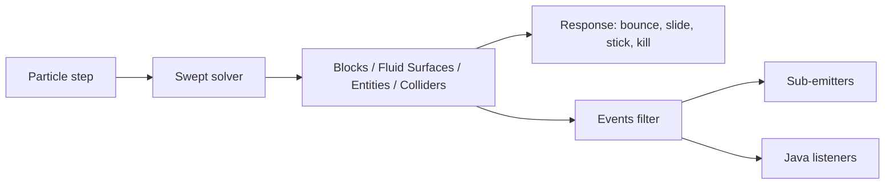

# Particle Collision

<VersionBadge version="2.2.9" label="Since" icon="tag" />

<figure>

<figcaption>Sparks pour over stairs, slabs and a low wall. Collision is swept, so they bounce off and settle on the real block shapes instead of passing through.</figcaption>
</figure>

Since 2.2.9, Particle Emitter particles collide with block shapes, fluid surfaces, entities, and Collider objects in the same FX. Collision is swept: a fast particle stops at the first surface on its path instead of passing through a thin wall or the ground. Each contact can bounce, slide, stick, or remove the particle, and can fire sub-emitters or a Java listener.



## Turning Collision On

1. Select a Particle Emitter and enable the **Physics** module. It is off by default.
2. **Has Collision** is on as soon as the module is enabled.
3. Expand **Physics → Collision** to choose what the particles hit. The defaults (Blocks and Colliders) match the old blocks-only behaviour.

The Physics fields above the Collision group keep their labels. Since 2.2.9 they mean:

| Setting | Default | Meaning |
| --- | --- | --- |
| Bounce Chance | 1 | Rolled on every impact. A particle that does not bounce loses its speed into the surface and slides along it. Before 2.2.9, one failed roll turned bouncing off for good. |
| Bounce Rate | 1 | Restitution: the share of the speed into the surface kept on a bounce. 1 is perfectly elastic. |
| Bounce Spread Rate | 0 | Random speed added along the surface on each bounce. |
| Collided Friction | 0.7 | The share of sliding speed kept per tick. It applies only while the particle touches a surface, and only to the sliding part. Before 2.2.9, it slowed the whole velocity for the rest of the particle's life. |
| Removed When Collided | off | Remove the particle on its first contact with a solid surface. Triggers do not count. |

Gravity and Friction work as before.

## The Collision Group

<figure>

<figcaption>The Physics module with its Collision group expanded: targets at the top, then Response, Filters, Events, and Advanced.</figcaption>
</figure>

The group needs Has Collision. Its options are split into the targets at the top and four sub-groups.

### Targets

| Option | Default | Meaning |
| --- | --- | --- |
| Blocks | on | Block collision shapes, including slabs, stairs, and fences. |
| Fluid Surfaces | off | Land on water and lava surfaces from above. Particles that start under a surface pass through it. |
| Entities | off | Entities near the particles. Client-side only; see [Triggers and Entities](#triggers-and-entities). |
| Colliders | on | [Collider objects](#collider-objects) in the same FX. |
| Particle Shape | `Box` | `Box` uses the particle's size. `Point` uses its centre only. |
| Size Scale | 1 (0–16) | Scales the collision box against the particle size. |
| Kill On Trigger Enter | off | Remove particles as they enter a trigger: a trigger collider, or an entity in Trigger mode. |

With `Box`, the collision box is the particle Size times Size Scale. A billboard is drawn twice its Size wide, so at 1 part of the quad dips into the surface. Set 2 to make it touch with its visible edge. The default of 1 keeps the resting height of effects made before 2.2.9.

### Response

| Option | Default | Meaning |
| --- | --- | --- |
| Dampen | 0 | The share of the whole speed lost on each impact (Unity's Dampen). A function over particle lifetime. |
| Lifetime Loss | 0 | The share of the particle's total lifetime lost on each impact. A function over particle lifetime. |
| Min Kill Speed | 0 (off) | Remove particles left slower than this after an impact, in blocks per tick. |
| Max Kill Speed | 0 (off) | Remove particles that hit faster than this, in blocks per tick. |
| Max Bounces | 0 (no limit) | Stop bouncing after this many bounces. Later impacts slide or rest. |
| Kill After Impacts | 0 (never) | Remove particles on this many impacts. Resting contacts do not count. |
| Stick | off | Stop on the first solid contact and stay there. |

A stuck particle stays in place on a block. On an entity it is carried by position only, not turned. On a Collider it also turns and scales with the collider. It falls again when the block breaks, the entity leaves, or the collider goes.

### Filters

| Option | Default | Meaning |
| --- | --- | --- |
| Only Blocks | empty | Collide only with these blocks: ids or `#tags`, such as `minecraft:stone` or `#minecraft:leaves`. Empty means every block. |
| Except Blocks | empty | Never collide with these blocks, even when Only Blocks lists them. |
| Entity Response | `Solid` | `Solid`: entities block particles like blocks do. `Trigger`: particles pass through and only report Trigger Enter and Trigger Exit. |
| Entity Category | `Living` | `All`, `Living` (players included), `Players`, or `NonLiving`. |
| Only Entity Types | empty | Collide only with these types of the category: ids or `#tags`, such as `minecraft:zombie`. Empty means every type. |
| Except Entity Types | empty | Never collide with these types, even when Only Entity Types lists them. |
| Ignore Owner | on | Skip the entity the effect belongs to. |
| Source Exclusion Radius | 0 (off) | Skip the entities within this distance of the effect when its particles first meet entities. |
| Ignore Spectators | on | Skip players in spectator mode. |
| Pickable Only | off | Only entities the game lets you target: no markers, no items on the ground. |
| Colliders | `SceneAll` | `SceneAll`: every collider in this FX. `List`: only the colliders in Collider List. |
| Collider List | empty | Drag Collider objects here from the hierarchy. |

### Events

Events options decide which impacts and contact deaths are reported to sub-emitters and listeners. They do not change the physics.

| Option | Default | Meaning |
| --- | --- | --- |
| Min Impact Speed | 0 | Impacts slower than this (blocks per tick, into the surface) fire no Collision event. Dampen and Lifetime Loss still apply. |
| De-duplicate | `Off` | Report each target once instead of on every impact. `PerParticle`: once per particle. `PerEmitter`: once for the emitter, whichever particle hits it. `PerGroup`: once between the emitters of this effect that share a Group name. |
| Cooldown | 0 | Ticks before the same target reports again. 0 means once for the whole playback, or once per particle life with `PerParticle`. |
| Group | blank | The name shared by emitters for `PerGroup`. Blank behaves like `PerEmitter`. |

A target is one block, one entity, or one collider. De-duplication applies to impacts and contact deaths. Trigger Enter and Trigger Exit always report. Use De-duplicate when hundreds of sparks hit the same block and you want one impact effect.

### Advanced

| Option | Default | Meaning |
| --- | --- | --- |
| Max Contacts Per Step | 4 (1–16) | How many surfaces one step may slide or bounce along. Past that, the rest of the motion stops at the next surface. |
| Push Out Of Blocks | on | Push particles out of blocks and solid colliders they overlap (grown into a wall, spawned slightly underground, dragged in by a moving emitter) along the shortest way out. |
| Max Push | 0.5 (0–8) | The farthest a particle is pushed out in one step. Deeper particles stay inside and ignore those blocks. |

The defaults suit almost every effect.

### Timeline Properties

The Timeline can animate `physics.collision.blocks`, `physics.collision.fluids`, `physics.collision.entities`, `physics.collision.colliders`, `physics.collision.response.dampen`, and `physics.collision.response.lifetimeLoss`, next to the existing `physics.*` fields. See [Animation Tracks and Record Mode](../timeline/animation-and-recording.md).

## Collider Objects

A **Collider** is an FX object with a transform and one shape. Add it from the hierarchy's add menu, like an emitter.

<figure>

<figcaption>Left: a solid Box collider (green gizmo). Middle: a Sphere collider set to Trigger (cyan); with Kill On Trigger Enter on, sparks vanish inside it. Right: the emitter, with the collision view on, marks its recent contacts and their normals in orange. The editor draws these for the selected object only.</figcaption>
</figure>

| Option | Default | Meaning |
| --- | --- | --- |
| Shape | `Plane` | `Plane`: infinite, facing the object's local +Y, solid from the front only. `Box` and `Sphere`: closed volumes. |
| Box Size | `1 1 1` | The box's full size along its local axes, multiplied by the transform scale. |
| Sphere Radius | 0.5 | The sphere's radius, multiplied by the transform's largest scale. The sphere stays round. |
| Trigger | off | Particles pass through and report entering and leaving instead of bouncing. |

- The transform places, turns, and scales the shape. A disabled collider is ignored.
- Only Particle Emitters in the same FX collide with it, and only when their **Colliders** target is on and the **Colliders** filter accepts it. Ara trails and beams ignore colliders.
- A moving or animated collider pushes the particles it runs into and carries stuck ones. A jump of more than 4 blocks in one tick counts as a teleport and pushes nothing.
- The Timeline can animate Sphere Radius, Trigger, and the transform.
- The editor draws the gizmo of the selected collider while the shape outline toggle or the collision view toggle is on.

## Triggers and Entities

A trigger is a Collider with Trigger on, or any entity while Entity Response is `Trigger`. Particles pass through it. They report Trigger Enter when they come in and Trigger Exit when they leave. A particle born inside a trigger, or reached by a moving one, reports Trigger Enter too. Kill On Trigger Enter removes particles as they enter; that removal also reports a Death.

Entity collision is client-side only. Particles never damage or push entities. The movement of each entity during the tick is swept, so fast mobs do not pass through particles, and moving entities push particles aside.

- **Ignore Owner** skips the entity the effect is attached to, or the owner its executor declares. Entity effects already declare it; custom executors return it from `IEffectExecutor.owner()`.
- **Source Exclusion Radius** covers an effect without an owner, such as a spell played at a position next to its caster. Entities within the radius when the particles first meet entities are skipped.
- **Fluid Surfaces** are one-way. Particles land on water and lava from above, and particles that start under a surface pass through it.

## Events and Sub-Emitters

| What happened | Sub-emitter event | `CollisionEvent.Type` |
| --- | --- | --- |
| A fresh impact with a solid surface | Collision, plus FirstCollision on the particle's first impact | `IMPACT` |
| A collision rule removed the particle | Death | `DEATH` |
| The particle entered a trigger | TriggerEnter | `TRIGGER_ENTER` |
| The particle left a trigger | TriggerExit | `TRIGGER_EXIT` |

Collision fires on a fresh impact only, not every tick while a particle rests on a surface. The rules that remove a particle are Removed When Collided, Min Kill Speed, Max Kill Speed, Kill After Impacts, and Kill On Trigger Enter. Their Death carries the contact point. A particle that reaches the end of its lifetime still reports Death without a contact.

Sub-emitter entries can spawn at the contact point, align to the surface normal, and filter by surface. See [Sub-Emitter Events](./trails-and-sub-emitters.md#sub-emitter-events).

Collisions are not connected to Timeline Signals.

### Java Listener

```java
ParticleEmitter sparks = (ParticleEmitter) runtime.findObject("sparks");
sparks.addCollisionListener((emitter, particle, event) -> {
    if (event.type() == CollisionEvent.Type.IMPACT && event.target() instanceof BlockState state) {
        // client-side reaction: a sound, a decal, or a packet to the server
    }
});
```

`CollisionEvent` carries `type()`, `position()`, `normal()`, `kind()` (block, fluid, entity, or collider), `target()` (a `BlockState`, an `Entity`, or a `ColliderObject`), `key()` (which block, entity, or collider), and `speed()` (into the surface, in blocks per tick; 0 for triggers and deaths). Listeners run on the game thread at the end of the emitter's tick, and De-duplicate applies to them. Remove a listener with `removeCollisionListener`.

::: warning Client side
Listeners run on the client. To change gameplay, such as damaging the entity that was hit, send your own packet to the server.
:::

See [Custom Executors, Timeline, and Signals](../java-api/custom-executors-timeline-and-signals.md) for `IEffectExecutor.owner()` and the rest of the Java side.

## Ground Snap

**Ground Snap** (Particle Emitter → Shape, off by default) drops each spawn point onto the terrain below it, so an effect spawns on uneven ground. It is a Shape option; see [Ground Snap](./emission-and-shapes.md#ground-snap).

## AraTrail and Beam

- **AraTrail:** the Physics group of AraTrail emitters and Ara-type particle trails has **Collide With Blocks**. Trail points then slide along or bounce off blocks, so a trail can lie on the ground. It collides with blocks only. See [AraTrail Emitter](./trail-beam-and-aratrail.md#aratrail-emitter).
- **Beam:** a raycast mode that includes entities now stops the beam at entities. See [Beam Emitter](./trail-beam-and-aratrail.md#beam-emitter).

## Performance and Debugging

<VersionBadge version="2.2.9" label="Changed" icon="tag" />

Emitters with collision can now use **Parallel Update**. Before 2.2.9 they always updated serially. Parallel collision runs in the client level and in the editor. Below 128 particles an emitter still updates serially, because scheduling would cost more than it saves. In an internal test with 30,000 sparks on a 24-thread CPU, one tick took about 18.6 ms before 2.2.9, about 7 ms serial, and about 1.1 ms parallel. Treat these numbers as indicative.

Photon's client config has a **Particle Collision** section:

| Option | Default | Meaning |
| --- | --- | --- |
| Parallel collision | on | Let collision emitters update on worker threads when their Parallel Update is on. Turn it off only if some mod's blocks misbehave when read off the game thread. |
| Collision cache size | 4096 (64–16384) | How many 16×16×16 sections of collision geometry stay cached per level before idle ones are evicted. |

In the editor:

- The **collision view** toggle (collider icon) in the Scene toolbar draws the selected collider, or the last 256 contacts of the selected emitter with their normals.
- With a Particle Emitter selected, the scene information view shows three extra rows: **Collision** (casts, tests, contacts), **Update Time** (milliseconds, parallel or serial), and **Collision World** (cached sections, depenetrated particles, misses).

Turn on only the targets an effect needs. Every extra target is more work per particle.

## Limits

- A collision box reaches at most 8 blocks from the particle centre on each axis.
- A particle that moves more than about 512 blocks in one step skips collision for that step. The old limit was 100 blocks per tick.
- During prewarm and an effect's first steps, entities more than about 8 blocks away can be missed.
- Moving block shapes, such as shulker lids and pistons, count as fixed blocks.
- Colliders affect only Particle Emitters in the same FX.

## Upgrading from 2.2.8

<VersionBadge version="2.2.9" label="Changed" icon="tag" />

::: warning Behaviour changes in 2.2.9
Old files load as they are, and the old `physics.*` fields and Timeline paths keep their names. The new defaults (Blocks and Colliders on, Fluid Surfaces and Entities off) match the old blocks-only collision. Check effects that rely on these details:

- Collision is swept. Particles no longer pass through walls or fall through the ground.
- Bounce Chance is rolled on every impact. A particle that does not bounce slides. Before, one failed roll stopped bouncing for good.
- Collided Friction applies only while touching, and only to the sliding part of the velocity. Before, it slowed the whole velocity after the first contact.
- The Collision sub-emitter event fires once per fresh impact, not again while a particle rests on a surface.
- The **Is Collided** GPU channel now means "has touched anything". It used to mean "had a non-bouncing hit". See [Additional GPU Data](../shaders-and-gpu/additional-gpu-data.md).
- Sub-emitter entries saved before 2.2.9 keep spawning at the particle centre. New entries spawn at the contact point.
- Collision emitters with Parallel Update on now update in parallel. If a modded block misbehaves, turn off **Parallel collision** in the client config.
- Beam raycasts in an entity mode now hit entities.
:::
