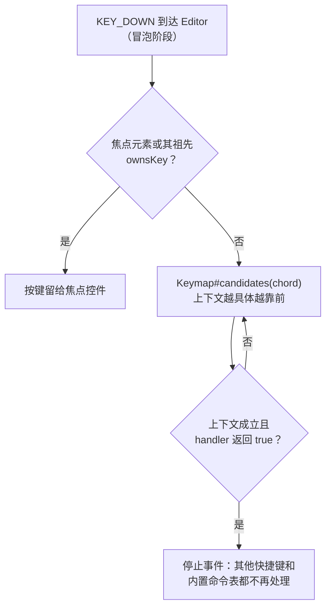

# Keymap

<VersionBadge version="2.2.40" label="自" icon="tag" />

每个 `Editor` 都有自己的 `Keymap`。Keymap 是一组 `EditorAction`：每个 action 有稳定的 id、默认按键组合（chord）、生效上下文和处理函数。用户可以在 **Settings → Keymap** 中重新绑定任意 action，Editor、View 和项目也可以注册自己的 action。

<figure>

<figcaption>
Keymap 设置页。action 按分类分组，每行有一个主 chord 和一个可选的第二 chord。
</figcaption>
</figure>

## 按键如何被解析 { #how-a-key-press-is-resolved }



分发器在 Editor 上以**冒泡**阶段监听。已经消费了按键的控件（例如正在输入字符的文本框）会先停止事件，keymap 根本看不到它。

多个 action 共用一个 chord 时，`Keymap#candidates` 依次按上下文具体程度、`priority`、注册顺序（新注册的优先）排序。handler 返回 `false` 时，chord 交给下一个候选。一个按键因此可以服务多个面板。

## 内置 Action { #built-in-actions }

id 常量位于 `EditorActions`。

| Action | Id | 默认 | 备选 |
| --- | --- | --- | --- |
| Save | `ldlib2:editor.save` | `Ctrl+S` | |
| Save As | `ldlib2:editor.save_as` | `Ctrl+Shift+S` | |
| Open Project | `ldlib2:editor.open_project` | `Ctrl+O` | |
| Settings | `ldlib2:editor.settings` | `Ctrl+Alt+S` | |
| Close Editor | `ldlib2:editor.close` | 未绑定 | |
| Undo | `ldlib2:editor.undo` | `Ctrl+Z` | |
| Redo | `ldlib2:editor.redo` | `Ctrl+Y` | `Ctrl+Shift+Z` |
| Copy / Cut / Paste | `ldlib2:editor.copy` / `cut` / `paste` | `Ctrl+C` / `Ctrl+X` / `Ctrl+V` | |
| Duplicate | `ldlib2:editor.duplicate` | `Ctrl+D` | |
| Select All | `ldlib2:editor.select_all` | `Ctrl+A` | |
| Find | `ldlib2:editor.find` | `Ctrl+F` | |
| Next Tab | `ldlib2:editor.next_view` | `Ctrl+PageDown` | `Ctrl+Tab` |
| Previous Tab | `ldlib2:editor.previous_view` | `Ctrl+PageUp` | `Ctrl+Shift+Tab` |
| Maximize Pane | `ldlib2:editor.maximize_pane` | `Ctrl+M` | |
| Minimize Window | `ldlib2:editor.minimize_window` | `Ctrl+Alt+Down` | |
| Maximize / Restore Window | `ldlib2:editor.maximize_window` | `Ctrl+Alt+Up` | |

Edit 类 action（Undo 到 Find）自己不做事，而是把对应的 `CommandEvents` 命令发给当前焦点，由焦点所在的 View 决定"复制""撤销"的含义。见 [命令处理](./views/builtin-views.md#command-handling)。

Save 也一样：焦点 View 先收到 `save` 命令，没有 View 认领时 Editor 才保存项目。

## 定义 Action { #define-an-action }

```java
EditorAction.builder(MyIds.RUN_PREVIEW)
        .category(KeymapCategories.GENERAL)
        .defaultChord(KeyChord.key(GLFW.GLFW_KEY_F5))
        .defaultAlternative(KeyChord.ctrl(GLFW.GLFW_KEY_R))
        .when(KeyContext.focusWithin(PreviewView.class))
        .onAction(this::runPreview)
        .build();
```

| Builder 方法 | 说明 |
| --- | --- |
| `category(String)` | 设置页中的分组。是一个翻译 key，常量在 `KeymapCategories`（`GENERAL`、`FILE`、`EDIT`、`VIEW`、`WINDOW`）。未知字符串原样显示。默认 `GENERAL`。 |
| `displayName(Component)` | 设置页中的名称。默认使用翻译 key `keymap.<namespace>.<path>`，例如 `keymap.ldlib2.editor.save`。 |
| `defaultChord(KeyChord)` | 主默认 chord。默认未绑定。 |
| `defaultAlternative(KeyChord)` | 可选的第二默认 chord。 |
| `when(KeyContext)` | action 何时可以运行。默认 `KeyContext.global()`。 |
| `priority(int)` | 具体程度相同时的排序，数值高者先运行。 |
| `onAction(Runnable)` | 总是视为已处理的 handler。 |
| `onAction(Handler)` | 返回 `false` 即把 chord 交给下一个候选的 handler。 |

没有设置 handler 时，`build()` 抛出 `IllegalStateException`。

### Chord { #chords }

`KeyChord` 是一个 GLFW 键码加修饰键。使用工厂方法：`KeyChord.key(key)`、`ctrl(key)`、`shift(key)`、`alt(key)`、`ctrlShift(key)`、`ctrlAlt(key)`，或 `KeyChord.of(key, ctrl, shift, alt)`。`KeyChord.UNBOUND` 表示不绑定任何键。

在 macOS 上，Command 键按 Ctrl 读取。

### 上下文 { #contexts }

| 上下文 | 何时成立 | 具体程度 |
| --- | --- | --- |
| `KeyContext.global()` | 总是。 | 0 |
| `KeyContext.withProject()` | 有打开的项目。 | 10 |
| `KeyContext.notTyping()` | 焦点不在文本框、文本区域或代码编辑器中。 | 10 |
| `KeyContext.focusWithin(Class)` | 焦点在该类型的元素上或其内部。 | 100 |
| `a.and(b)` | 两者都成立。 | 取两者较高值 |
| `KeyContext.of(predicate, specificity)` | 自定义条件。 | 自定 |

具体程度高的上下文先尝试，与注册顺序无关。上下文不成立的候选会被跳过，不会挡住后面的 action。

## 注册 Action { #register-actions }

### 在 Editor 子类中 { #from-an-editor-subclass }

覆写 `initKeymap()` 并调用 `super`。要改变某个内置 action 的行为，用同一个 `EditorActions` id 注册你自己的 action，它会替换内置的那个。

```java
@Override
protected void initKeymap() {
    super.initKeymap();
    keymap.register(EditorAction.builder(EditorActions.FIND)
            .category(KeymapCategories.EDIT)
            .defaultChord(KeyChord.ctrl(GLFW.GLFW_KEY_F))
            .onAction(this::openShopSearch)
            .build());
}
```

### 在项目中 { #from-a-project }

Editor 的生命周期比项目长，因此在 `IProject#onLoad` 中注册，在 `onClosed` 中注销：

```java
private ISubscription actions = () -> {};

@Override
public void onLoad(Editor editor) {
    actions = editor.getKeymap().registerAll(
            EditorAction.builder(MyIds.RUN_PREVIEW)
                    .defaultChord(KeyChord.key(GLFW.GLFW_KEY_F5))
                    .when(KeyContext.focusWithin(PreviewView.class))
                    .onAction(this::runPreview)
                    .build());
}

@Override
public void onClosed(Editor editor) {
    actions.unsubscribe();
}
```

`register` 和 `registerAll` 返回 `ISubscription`。如果之后已有别的 action 用同一个 id 注册，注销就不起作用，因此正在销毁的 View 不会把它的后继者也移除掉。

注册的 action 会出现在 Keymap 页，可以像内置 action 一样重新绑定。

## 显示当前快捷键 { #show-the-current-shortcut }

快捷键可以改，所以不要把它写进翻译字符串，而是从 keymap 读取：

| API | 用途 |
| --- | --- |
| `Keymap#menuLabel(id, translationKey)` | 菜单项名称，后面跟上灰色的当前 chord。 |
| `Keymap#shortcutHint(id)` | 只有灰色 chord；未绑定时为空 component。 |
| `Keymaps.of(element)` | 包含该元素的 Editor 的 keymap，没有则为 `null`。 |
| `Keymaps.shortcutTooltip(element, id, fallback)` | 按钮的 tooltip 行。元素不在 Editor 中时使用 `fallback`。 |

```java
menu.leaf(Icons.PLAY, editor.getKeymap().menuLabel(MyIds.RUN_PREVIEW, "shop.menu.run_preview"), this::runPreview);
```

## 用户绑定 { #user-bindings }

`KeymapSettings` 只保存用户改过的绑定。用户没碰过的 action 一直跟随默认值，因此后续版本修改默认值不会覆盖用户的选择。

所有 Editor 共用一个设置文件 `config/ldlib2/editor.json`。当前 Editor 不认识的 action 的绑定会原样保留，所以保存一个 Editor 不会清掉另一个 Editor 的 keymap。

在 Keymap 页中：

* 搜索框过滤 action；
* 点击 chord 字段后，录入下一个按下的键，包括 `Esc`；
* `Backspace` 或 `Delete` 清除绑定；
* 点击其他位置取消录入；
* 每行都有重置按钮，被多个 action 使用的 chord 会被标出。

设置对话框应用（OK）后修改才生效。

## 让焦点控件保留按键 { #keep-keys-in-a-focused-control }

自定义控件处理了某个按键却没有停止事件时，这个键仍可能被快捷键抢走。覆写以下 `UIElement` 方法来保留它：

| 方法 | 说明 |
| --- | --- |
| `ownsKey(UIEvent)` | 对该元素持有焦点时要自己处理的键返回 `true`。keymap 不会为这些键运行任何 action。 |
| `isTextInput()` | 用户正在向该元素输入时返回 `true`。`KeyContext.notTyping()` 读取它。 |

内置的文本框、文本区域和代码编辑器已经实现了这两个方法。

::: warning Esc 与旧的 behavior settings
2.2.40 之前，`BehaviorSettings` 负责 Esc、保存、另存为和打开设置面板。它们现在都是 keymap action。`BehaviorSettings#shouldCloseOnEsc` 已弃用：如果它原本是开启的，Editor 会在首次加载时把 `Esc` 绑定到 `ldlib2:editor.close`。
:::
