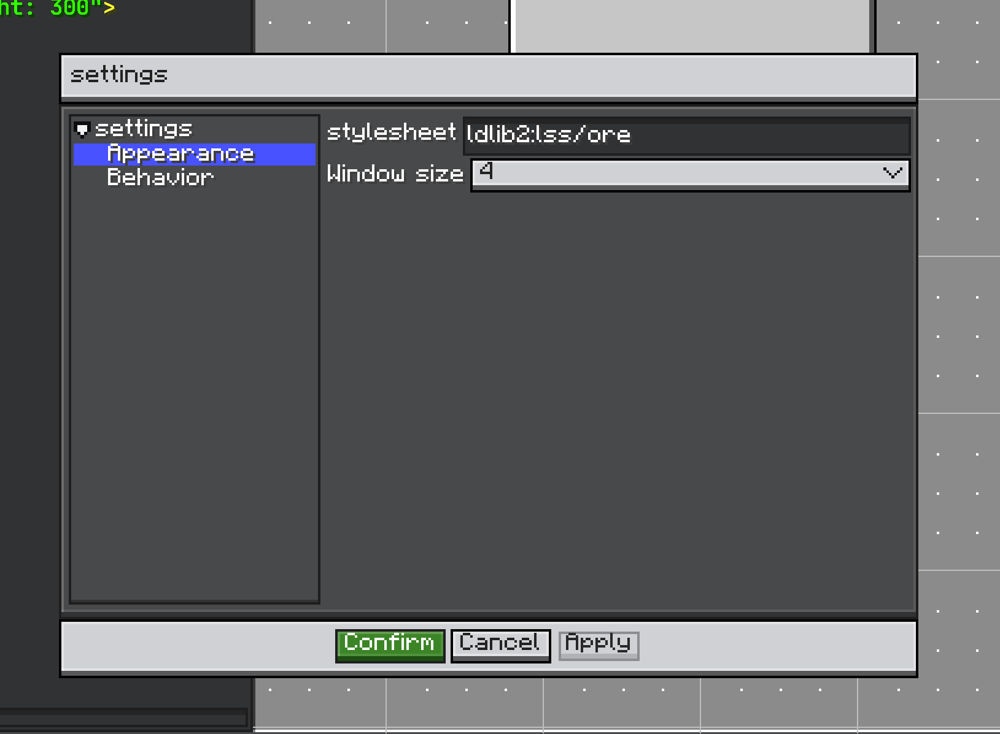

# Settings

Editor settings 是编辑器 UI 和行为的持久化偏好。

<figure>

<figcaption>
Editor settings panel：左侧是设置分组，右侧是可编辑设置。
</figcaption>
</figure>

`Settings` 是配置单元：

```java
public interface Settings extends IConfigurable {
    ResourceLocation getId();
    String getPath();
    void onApply(Editor editor);
    default void onLoaded(Editor editor) {}
}
```

`onApply` 只在有修改时运行。`onLoaded` <VersionBadge version="2.2.40" label="自" icon="tag" /> 在该实例成为 Editor 的设置时运行：注册时一次，此后每次从磁盘重新读取设置（会替换实例）时再运行一次。设置页需要 Editor 才能绘制时使用它。

`EditorSettings` 管理已注册 settings 和 codec。它可以：

* 注册和注销 settings；
* 构建 settings panel；
* 从 `config/ldlib2/editor.json` 加载 JSON；
* 保存 JSON；
* 检测 dirty 状态；
* 应用已修改的 settings；
* 恢复到上次应用的状态。

覆写 `initEditorSettings()` 注册默认设置：

```java
@Override
protected void initEditorSettings() {
    super.initEditorSettings();
    editorSettings.registerSettings(new ShopSettings(), ShopSettings.CODEC);
}
```

## Built-in Settings

`Editor#initEditorSettings()` 注册三个设置页。

| Settings | 页面 | 内容 |
| --- | --- | --- |
| `AppearanceSettings` | Appearance | 编辑器主题（见 [内置样式表](../ui/preliminary/stylesheet.md)）、View 菜单窗口大小项使用的 GUI scale，以及 **Open in Its Own Window**（2.2.42，见 [Windows and Floating Views](./windows.md)）。它还会记住 Editor 窗口在桌面上的位置。 |
| `BehaviorSettings` | Behavior | **Restore Layout When Opening Project**、**Restore Asset Browser Folder When Opening Project** 和 **Recent Projects To Remember**（0–50，默认 10）。 |
| `KeymapSettings` | Keymap | 用户修改过的快捷键绑定。见 [Keymap](./keymap.md)。自 2.2.40。 |

::: warning 按键处理已移到 keymap
2.2.40 之前，`BehaviorSettings` 负责 Esc 关闭、Alt + S、Ctrl + Shift + S 和 Ctrl + S。现在它们都是用户可以重新绑定的 [keymap action](./keymap.md)；打开设置面板改为 `Ctrl+Alt+S`。`BehaviorSettings#shouldCloseOnEsc` 已弃用且不再显示。如果它原本是开启的，Editor 会在首次加载时把 `Esc` 绑定到 `ldlib2:editor.close`。
:::

## 自定义 Settings

```java
public class ShopSettings implements Settings {
    public static final ResourceLocation ID = LDLib2.id("shop");
    public static final Codec<ShopSettings> CODEC =
            PersistedParser.createCodec(ShopSettings::new);

    @Configurable
    private boolean previewItems = true;

    @Override
    public ResourceLocation getId() {
        return ID;
    }

    @Override
    public String getPath() {
        return "Shop";
    }

    @Override
    public void onApply(Editor editor) {
        // 读取 settings 并更新 editor 行为。
    }
}
```

本页只展示 editor-side settings 流程。Configurator 细节会在单独章节介绍。
