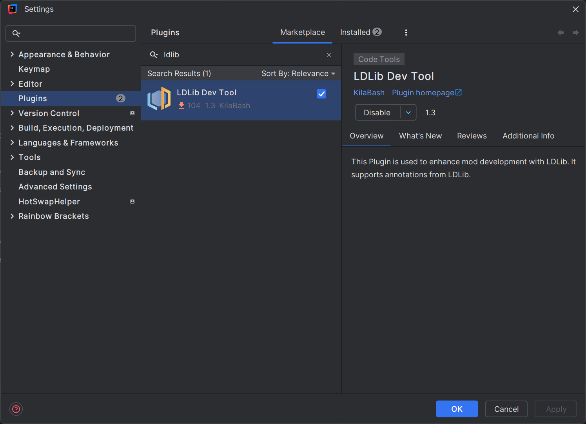

# Java 集成

## Maven
你可以在 [Maven](https://maven.firstdark.dev/#/snapshots/com/lowdragmc) 中找到最新版本。

[](https://maven.firstdark.dev/#/snapshots/com/lowdragmc/ldlib2/ldlib2-neoforge-1.21.1)

[](https://maven.firstdark.dev/#/snapshots/com/lowdragmc/ldlib2/ldlib2-neoforge-26.1)

[](https://maven.firstdark.dev/#/snapshots/com/lowdragmc/ldlib2/ldlib2-neoforge-26.2)

[](https://maven.firstdark.dev/#/snapshots/com/lowdragmc/ldlib2/ldlib2-neoforge-26.3)

<VersionBadge version="2.2.1" label="自" icon="tag" />
``` c
repositories {
    // LDLib2
    maven { url = "https://maven.firstdark.dev/snapshots" } 
}

dependencies {
    // for LDLib2 1.21
    implementation("com.lowdragmc.ldlib2:ldlib2-neoforge-${minecraft_version}:${ldlib2_version}:all")
    // for LDLib2 26.1+
    implementation("com.lowdragmc.ldlib2:ldlib2-neoforge-${minecraft_version}:${ldlib2_version}")
}
```

::: details 2.2.1 之前
``` c
repositories {
    // LDLib2
    maven { url = "https://maven.firstdark.dev/snapshots" } 
}

dependencies {
    // LDLib2
    implementation("com.lowdragmc.ldlib2:ldlib2-neoforge-${minecraft_version}:${ldlib2_version}:all") { transitive = false }
    compileOnly("org.appliedenergistics.yoga:yoga:1.0.0")   
}
```
:::

::: info 配方查看器不是传递依赖
JEI、REI 和 EMI 的支持都是可选的。LDLib2 编译时依赖它们，但发布的 POM 不会把它们带进来，所以请在你自己的 `dependencies` 里声明要编译的配方查看器。在 1.21.1 上，JEI 集成需要 JEI `19.51.0.417` 或更高版本。
:::

::: info 加入没有 LDLib2 的服务器
<VersionBadge version="2.2.41" label="自" icon="tag" />

LDLib2 的网络通道是可选的，所以装了 LDLib2 的客户端可以加入没有安装它的服务器。需要服务端配合的功能（例如 UI 同步、RPC 事件和菜单）在那里不可用。
:::

## 可选模块：ldlib2-compose {#optional-module-ldlib2-compose}

<VersionBadge version="2.2.44" label="自" icon="tag" />

[](https://maven.firstdark.dev/#/snapshots/com/lowdragmc/ldlib2/ldlib2-compose-1.21.1)

[Compose](./ui/compose/index.md) 是一个独立的模组（`ldlib2_compose`），每个 Minecraft 版本单独构建。版本号以它针对的 Minecraft 版本线开头：`21.0.0.1` 是 1.21.x 的第一个版本，26.1 的构建则是 `26.1.0.1`。请使用以你的 Minecraft 版本命名的 artifact；目前只发布了 1.21.1。详见[版本号](./ui/compose/getting-started.md#versions)。它需要 LDLib2 2.2.44 或更高版本，以及与 Kotlin 插件同版本（2.1.20）的 Kotlin Compose 编译器插件。

``` groovy
plugins {
    id 'org.jetbrains.kotlin.jvm' version '2.1.20'
    id 'org.jetbrains.kotlin.plugin.compose' version '2.1.20'
}

repositories {
    maven { url = "https://maven.firstdark.dev/snapshots" }
    maven {
        // Compose runtime 用到的 androidx 库
        url = "https://maven.google.com"
        content { includeGroupByRegex "androidx\\..*" }
    }
}

jarJar.enable()

dependencies {
    implementation "com.lowdragmc.ldlib2:ldlib2-compose-1.21.1:21.0.0.1"
    // 玩家不会自己安装 ldlib2-compose，所以由你的模组带上它。
    jarJar(group: 'com.lowdragmc.ldlib2', name: 'ldlib2-compose-1.21.1') {
        version { require '[21.0.0.1,)'; prefer '21.0.0.1' }
    }
}
```

在 `neoforge.mods.toml` 中把 `ldlib2`（`[2.2.44,)`）和 `ldlib2_compose`（`[21.0.0.1,)`）声明为必需依赖。详见 [Compose：快速开始](./ui/compose/getting-started.md)。

## IDEA 插件 - LDLib Dev Tool


如果你打算使用 LDLib2 进行开发，我们强烈建议你安装我们的 IDEA 插件 [LDLib Dev Tool](https://plugins.jetbrains.com/plugin/28032-ldlib-dev-tool)。
该插件提供了：

- 代码高亮
- 语法检查
- 代码跳转
- 自动补全
- 其他功能

这些功能将极大地帮助你使用 LDLib2 的各项特性。特别地，所有 LDLib2 的注解均已支持使用。

## LDLibPlugin
你可以通过使用 `ILDLibPlugin` 和 `@LDLibPlugin` 来创建一个 LDLibPlugin。
```java
@LDLibPlugin
public class MyLDLibPlugin implements ILDLibPlugin {
    public void onLoad() {
        // 在此处进行 LDLib2 的注册或设置
    }
}
```