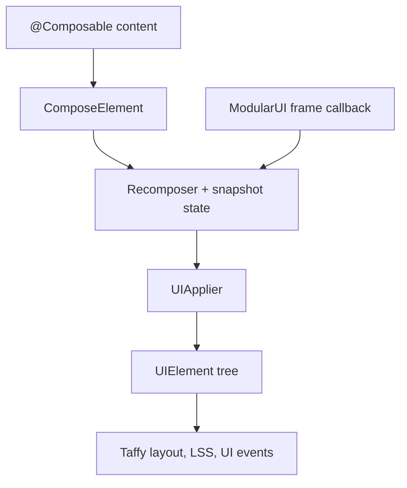

# Compose

<VersionBadge version="2.2.44" label="自" icon="tag" />

`ldlib2-compose` 让你用 `@Composable` 函数构建 LDLib2 UI。状态一改，元素树就跟着变，不需要调用 `clearAllChildren()`、重建树或维护脏标记。

```kotlin
@Composable
fun DynamicButtonList() {
    var items by remember { mutableStateOf(listOf("A", "B", "C")) }

    ScrollView {
        items.forEach { item ->
            key(item) {
                Button(onClick = { println(item) }, text = item)
            }
        }
        Button(onClick = { items = items + "Button ${items.size + 1}" }, text = "Add")
    }
}
```

<figure>

<figcaption>
用 Compose 写的待办面板。每一行都来自状态里的一个 <code>List</code>：添加、勾选或删除条目只改这个列表，元素树会自动跟上。其中每个控件都是包装普通 LDLib2 元素的 composable。
</figcaption>
</figure>

::: info 可选模块
**先安装再使用。** 你的模组依赖了 `ldlib2-compose` 之后，这些页面里的内容才能用：安装步骤见 Java 集成页的[可选模块：ldlib2-compose](../../java_integration.md#optional-module-ldlib2-compose)。

`ldlib2-compose`（mod id `ldlib2_compose`）是一个独立的模组，每个 Minecraft 版本单独构建，版本号以 Minecraft 版本线开头，例如 `21.0.0.1` 是 1.21.x 的第一个版本（见[版本号](./getting-started.md#versions)）。它只发布到 Maven，不包含在 LDLib2 的 jar 里。它需要 LDLib2 2.2.44 或更高版本，并且 composable 必须用 Kotlin 编写。见[快速开始](./getting-started.md)。
:::

## 工作方式

运行时是 JetBrains Compose runtime 1.8.2（包名 `androidx.compose.runtime`）。`@Composable`、重组、快照状态、`remember`、`key` 和 effect 的行为与 Compose 一致。

只引入了 runtime，没有 `compose.ui`，也没有 `compose.foundation`。因此没有 `Modifier`、没有 `pointerInput`，也没有 foundation 里的布局。其余部分由 LDLib2 提供：

- 一个 applier，把组合产生的树编辑转换成 `UIElement` 的插入、移动和移除；
- 一个由 `ModularUI` 渲染循环驱动的帧时钟。

布局仍然是 Taffy，样式仍然是 LSS，事件仍然是 LDLib2 的 UI 事件。



| 对象 | 职责 |
| --- | --- |
| `ComposeElement` | 子元素由组合生成的 `UIElement`，是入口。 |
| `composeUI` / `composeModularUI` | 构建根元素为 `ComposeElement` 的 `UI` 或 `ModularUI`。 |
| `UIElementNode` | 把任意 `UIElement` 子类作为节点发出。所有包装函数都基于它。 |
| `rememberServerMessenger` | 从组合内向服务端发送具名消息。 |
| `ComposeSavedState` | 带 `stateKey` 的界面关闭期间，保存它的 `rememberSaveable` 状态。 |

## 何时使用

[Kotlin DSL](../kotlin_support.md) 和 [XML](../xml.md) 只构建一次树。Compose 适合结构随数据变化的 UI：会增删的列表、按条件出现的面板、运行时新增的标签页。

两者可以混用。可以把 `ComposeElement` 放进任何方式构建的树里，也可以用 `Mount` 把已有元素放进组合。

## 页面导航

- [快速开始](./getting-started.md)：依赖、第一个界面、第一个菜单。
- [样式与事件](./styling-and-events.md)：具名参数、样式块、事件处理器、悬停状态。
- [组件](./components.md)：控件包装、受控值、容器、包装自己的元素。
- [状态与同步](./state-and-sync.md)：`rememberSaveable`、绑定桥接、服务端驱动的 UI。
- [惰性列表与动画](./lazy-and-animation.md)：`LazyColumn`、`LazyRow`、`LazyVerticalGrid`、动画、`AnimatedVisibility`。
- [限制](./limitations.md)：与 Jetpack Compose 的差异，Side 与生命周期规则。
