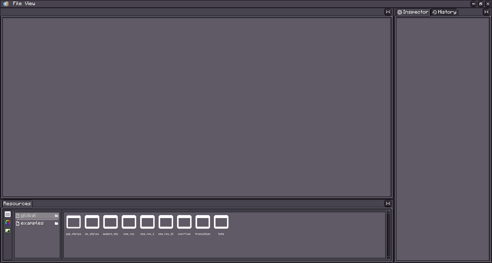
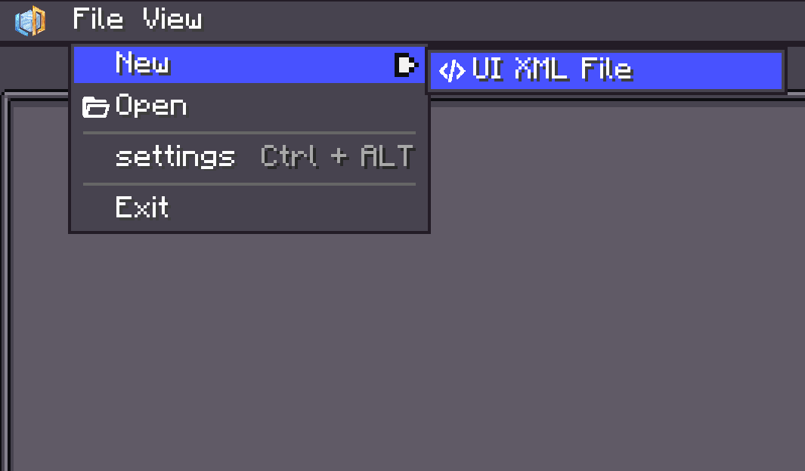
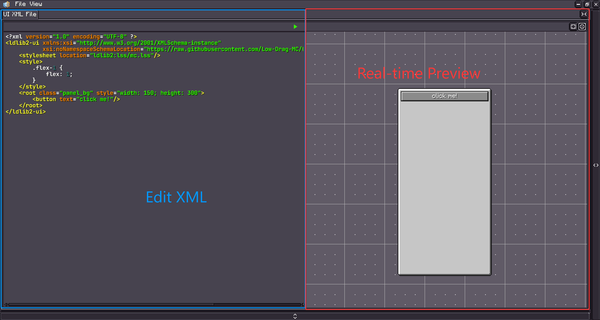
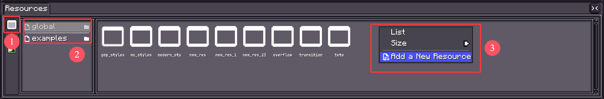
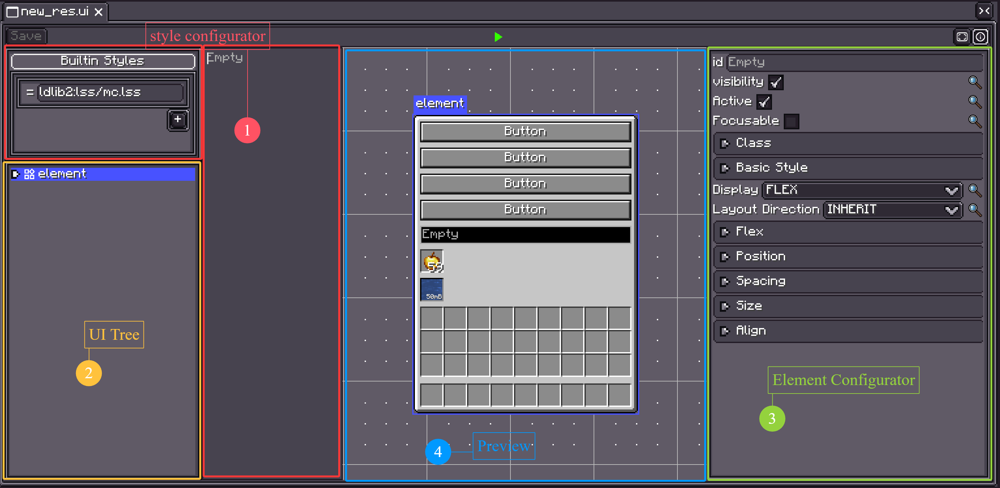
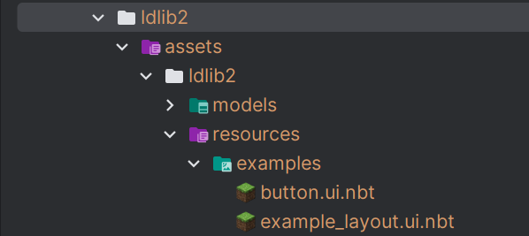
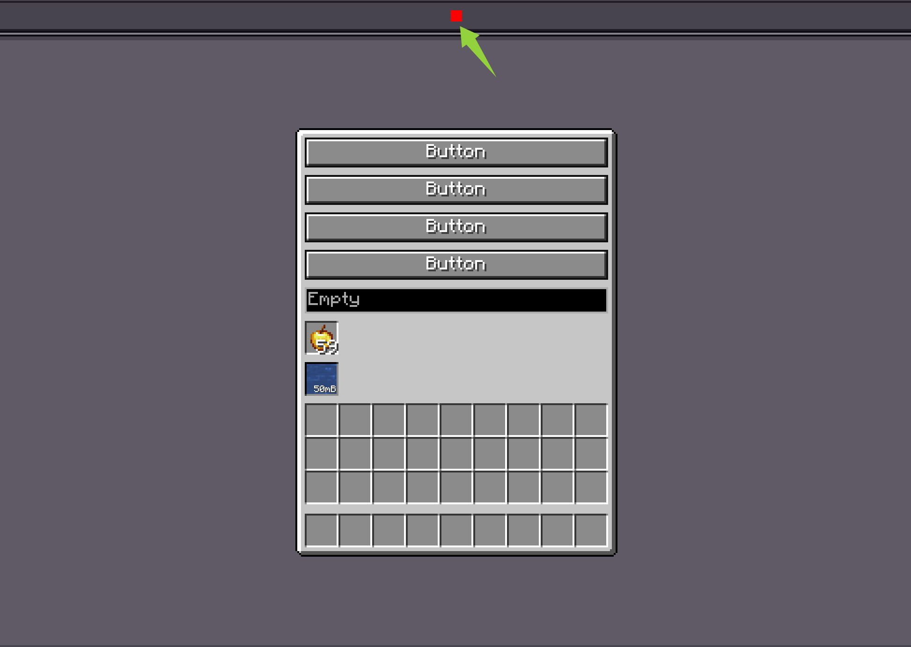

# UI 编辑器

<VersionBadge version="2.1.5" label="自" icon="tag" />

::: warning
该命令只能在 `single player` 世界中使用。
:::

LDLib2 提供了一个可视化编辑器来支持 UI 创建。使用以下命令打开 UI 编辑器：

```shell
/ldlib2_ui_editor
```

<figure>

</figure>

UI 编辑器支持两种通过可视化方式创建 UI 的方法：

* `UI XML`
* `UI 模板`

---

## UI XML

点击 **`文件 → 新建 → UI XML 文件`** 以创建一个新的 UI XML 文件。  
你也可以点击 **`打开`** 来加载一个已有的 XML 文件。

<figure>

</figure>

<figure>

</figure>

打开后，你可以直接编辑 XML，并在编辑器中查看 UI 的**实时预览**。有关更多 XML 的详细信息，请查看 [UI XML](./xml.md)

::: tip
你也可以使用外部 IDE（例如 VS Code 或 IntelliJ IDEA）来编辑 XML 文件。  
保存更改后，预览将自动更新。
:::

---

## UI 模板

**UI 模板** 与 **UI XML** 类似，用于定义 UI 内容  
（包括**样式**和**组件树**）。

主要区别如下：

- UI 模板可以通过 **UI 编辑器** 进行 **可视化编辑**。
- 保存后的 UI 模板可以在其他 **UI XML** 文件或 **UI 模板** 中作为**模板组件**重复使用。

与 UI XML 文件不同，**UI 模板由 LDLib2 的资源系统管理**。  
要创建一个 UI 模板，请使用**资源面板**：

<figure>

</figure>

**步骤：**

1. 选择 **UI** 资源分类。
2. 选择或创建一个**资源提供器**。
3. 右键创建一个 **UI 模板**，然后双击进入编辑模式。

::: info 内置模板
<VersionBadge version="2.2.38" label="自" icon="tag" />

内置 provider 中的模板以只读方式打开，标签页标题以 `(read-only)` 结尾。要修改它，右键 → **Copy Resource To**，选择一个可写的资源提供器和名称，然后编辑副本。见 [Providers and Paths](../editor/resources/providers.md#built-in-provider)。
:::

### 编辑你的模板

打开 UI 模板后，你将看到如下编辑器界面：

<figure>

</figure>

1. **样式配置器**  
   编辑内置样式，添加或移除外部样式表，并检查已应用的样式。

2. **UI 树**  
   显示完整的 UI 层级结构。  
   你可以通过右键菜单创建或删除组件，多选元素，或拖拽以重新排序层级。  
   自 2.2.42 起，添加、删除、粘贴和移动元素都可以像属性修改一样撤销和重做。

3. **元素配置器**  
   显示当前选中元素的可配置属性。

4. **预览**  
   提供 UI 的实时预览。

使用 UI 编辑器，你可以可视化地配置**布局**、**样式**和其他设置。  
如果你理解了 *预备知识* 部分介绍的概念，那么编辑器应该易于上手。  
对于具有特殊配置选项的组件，请参考它们的单独文档页面。

### 加载 UI 模板并进行设置

有两种方法可以加载并使用你的 UI 模板。

1. 你也可以将其移动到你的 assets 文件夹中，并通过 `ResourceLocation` 来加载它。
2. 如果资源位于 ldlib2 文件夹下，你可以右键点击该资源来获取资源路径并加载它。

<figure>

</figure>

<DocTabs>
<DocTab title="Java">

```java
@Override
public ModularUI createUI(Player player) {
    var ui = Optional.ofNullable(UIResource.INSTANCE.getResourceInstance()
            // 基于资源位置
            .getResource(new FilePath(ResourceLocation.parse("ldlib2:resources/examples/example_layout.ui.nbt"))))

            // 基于文件
            //.getResource(new FilePath(new File(LDLib2.getAssetsDir(), "ldlib2/resources/examples/example_layout.ui.nbt"))) // LDLib2.getAssetsDir() = ".minecraft/ldlib2/assets"

            .map(UITemplate::createUI)
            .orElseGet(UI::empty);

    // 查找元素并在此处进行数据绑定或逻辑设置
    var buttons = ui.select(".button_container > button").toList(); // 通过选择器
    var container = ui.selectRegex("container").findFirst().orElseThrow(); // 通过 ID 正则表达式

    return ModularUI.of(ui, player);
}
```

</DocTab>
<DocTab title="KubeJS">

```js
function createUIFromUIResource(path) {
    return UIResource.INSTANCE.getResourceInstance().getResource(path).createUI();
}

function createUI(player) {
    // 基于文件
    let ui = createUIFromUIResource("file(./ldlib2/assets/ldlib2/resources/global/modern_styles.ui.nbt)")

    // 基于资源位置
    // let ui = createUIFromUIResource("pack(ldlib2:resources/global/modern_styles.ui.nbt)")

    // 查找元素并在此处进行数据绑定或逻辑设置
    let buttons = ui.select(".button_container > button").toList(); // 通过选择器
    let container = ui.selectRegex("container").findFirst().orElseThrow(); // 通过 ID 正则表达式

    return ModularUI.of(ui, player)
}
```

</DocTab>
</DocTabs>

### 加载事件

已保存的 **UI 模板** 仅定义了视觉结构和样式 —— 默认情况下不包含运行时逻辑。  
在大多数情况下，你需要加载模板，然后在代码中手动附加处理程序或绑定。

但是，如果你希望在**不同的上下文中复用同一个 UI**，每次都重复相同的设置逻辑会变得非常繁琐。

为了解决这个问题，**LDLib2 提供了一个钩子事件**，允许你在 **UI 模板调用 `createUI()` 时注入逻辑**，从而在创建过程中自动配置返回的 `UI`。

```java
@SubscribeEvent
public static void onUICreated(UITemplate.CreateUI event) {
    var template = event.template;
    var ui = event.ui;
    // 在此处进行初始化
}
```

---

## UI 模拟

点击编辑器顶部的**绿色播放按钮**以进入**模拟模式**。  
这允许你与 UI 交互并验证其行为。

<figure>

</figure>

### 调试模拟中的 UI { #debug-the-simulation }

<VersionBadge version="2.2.42" label="自" icon="tag" />

运行中的模拟可以用 [UI 调试器](./preliminary/modularui.md#debug-your-ui) 检查：

* 点击进入模拟区域后按 **`F3`**：调试器会打开在模拟的 UI 上，而不是外面的编辑器上；或者
* 在编辑器上打开调试器，然后在目标选择器中选择 **Game Window / Simulation**。如果编辑器在独立窗口中，该项以那个窗口的标题开头。

模拟是绘制在编辑器内部的一个独立 `ModularUI`。它通过 `ModularUI#embedIn(host, name)` 注册自己，调试器因此能找到它。你自己绘制在另一个 UI 元素内部的 UI 也可以调用同一个方法：

```java
embeddedUI.embedIn(hostElement, "Preview");
```

之后焦点在 `hostElement` 内部时按 `F3` 会以嵌入的 UI 为目标，目标选择器会把它列在外层 UI 之下，例如 `Game Window / Preview`。嵌入的 UI 被移除时，注册也会随之移除。
