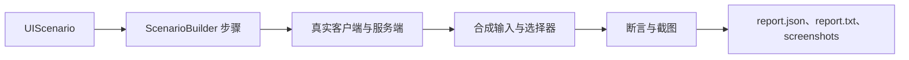

# UI 自动化测试

<VersionBadge version="2.2.34" label="自" icon="tag" />

UI 测试框架在真实 Minecraft 客户端中运行场景：创建独立世界、打开真实 UI、通过普通 Screen 路径发送输入、等待服务端同步、记录断言，并输出截图和报告。



<figure>

<figcaption>
真实 <code>snake_hud</code> 场景生成的截图。测试框架在客户端中打开此 HUD、操作控件，并将图片与 <code>report.txt</code>、<code>report.json</code> 一并输出。
</figcaption>
</figure>

| 页面 | 内容 |
| --- | --- |
| 本页 | 接入 Gradle 脚本、编写场景、运行选项、步骤，以及独立 OS 窗口中的 UI。 |
| [运行测试](./running.md) | 后台运行、headless 运行、分辨率，以及用 `runParTest` 并行运行。 |
| [多进程测试](./multi-process.md) | 用 `runMpTest` 运行一个专用服务端加多个客户端。 |

## 1. 在你的模组中接入 {#set-up-in-your-mod}

LDLib2 jar 里包含测试框架本身：场景 registry、builder，以及并行和多进程运行的编排器。Gradle 接线**不在** jar 里，而是 [LDLib2 仓库](https://github.com/Low-Drag-MC/LDLib2) `gradle/` 目录下的三份脚本，你的模组需要拷贝并 apply 它们。

| 脚本 | 提供 | 用途 |
| --- | --- | --- |
| `ldlib2-uitest.gradle` | `client` run 上的 `-PldTest*` 属性、`verifyUiTest`、报告清理和 `-PldTestHeadless`。 | 所有运行。必需。 |
| `ldlib2-uitest-par.gradle` | `runParTest`、`verifyParTest` 和 `uiTestShard<N>` 系列 run。 | [并行运行](./running.md#parallel-runs)。 |
| `ldlib2-mptest.gradle` | `runMpTest`、`verifyMpTest`，以及 `mpServer`、`mpClientA`、`mpClientB` 三个 run。 | [多进程测试](./multi-process.md)。 |

从与你所依赖的 LDLib2 版本对应的 tag 拷贝脚本，然后按以下顺序在 `runs { }` 块之后 apply：

```groovy
runs {
    client {
        // ...
    }
    // ...
}

apply from: rootProject.file('gradle/ldlib2-uitest.gradle')
apply from: rootProject.file('gradle/ldlib2-uitest-par.gradle')   // 可选：runParTest
apply from: rootProject.file('gradle/ldlib2-mptest.gradle')       // 可选：runMpTest
```

不 apply `ldlib2-uitest.gradle` 时，`-PldTest` 不起任何作用，也没有 `verifyUiTest`。另外两份脚本依赖它提供 headless 支持，所以它必须始终 apply。

::: warning 构建要求

- 脚本为 NeoGradle 编写，使用 `runs { ... runType 'client' }`；ModDevGradle 项目需要自行改写。
- 客户端 run 必须命名为 `client`。
- `ldlib2-uitest-par.gradle` 和 `ldlib2-mptest.gradle` 必须 apply 在**根项目**中。它们的编排器会用根项目的 `gradlew` 启动子构建。
- 如果构建中还有其他子项目应用了 NeoGradle，它的 `run<Name>` 任务规则会响应不带路径的 `gradlew runParTest` 或 `gradlew runMpTest`，导致构建失败。在那个子项目中注册同名的禁用任务，或者改用 `gradlew :runParTest` / `gradlew :runMpTest`。这需要 LDLib2 2.2.44 或更新版本的脚本。<VersionBadge version="2.2.44" label="自" icon="tag" />

:::

```groovy
// 在另一个应用了 NeoGradle 的子项目的 build.gradle 中
['runParTest', 'runMpTest'].each { name -> tasks.register(name) { enabled = false } }
```

::: tip 升级时重新拷贝脚本

脚本随 LDLib2 一起变化，每次升级 LDLib2 都要替换你的副本。2.2.39 之前的副本不会在运行前删除上一次的报告；如果客户端没能启动，`verifyUiTest` 会读到旧报告，打印上一次运行的结果。

:::

## 2. 注册场景

场景放入 `src/main/java`，不要放在 `src/test`，并注册到仅客户端的场景 registry。

```java
@LDLRegisterClient(name = "furnace_ui", group = "mymod", registry = UIScenario.REGISTRY,
        environment = RegistrationEnvironment.DEV_ONLY)
public class FurnaceUiScenario implements UIScenario {
    private static final BlockPos POS = new BlockPos(8, 65, 8);

    @Override
    public void configure(ScenarioOptions options) {
        options.tags("machine").guiScale(3);
    }

    @Override
    public void define(ScenarioBuilder s) {
        s.clearArea(POS, 2)
         .setBlock(POS, MyBlocks.FURNACE.get())
         .awaitClientBlockEntity(POS)
         .useBlock(POS)
         .awaitScreen(ModularUIContainerScreen.class)
         .awaitModularUI()
         .click("#btn_start")
         .waitForTextContains("#status_label", "Burning")
         .screenshot("running")
         .teardown("close", ctx -> ctx.requirePlayer().closeContainer());
    }
}
```

`RegistrationEnvironment.DEV_ONLY` 确保场景不会进入生产构建。

## 3. 运行

```text
gradlew runClient -PldTest=furnace_ui
```

| 选项 | 作用 |
| --- | --- |
| `-PldTest=all` | 运行所有已注册场景。 |
| `-PldTest=name1,name2` | 运行指定场景。 |
| `-PldTest=group:mymod` / `tag:fast` / `regex:.*_ui` | 按 group、tag 或名称模式选择。 |
| `-PldTestExclude=slow_one` | 从选择中排除场景。写法与 `-PldTest` 相同。 |
| `-PldTestKeepOpen` | 保持客户端打开，便于迭代。 |
| `-PldTestWindow=1440x900` | 固定窗口尺寸。默认最大化；headless 运行时为 `1920x1080`。见[分辨率](./running.md#resolution)。 |
| `-PldTestGuiScale=3` | 设置整个运行的 GUI scale。默认 `2`；`ScenarioOptions#guiScale` 可为单个场景覆盖。 |
| `-PldTestWatchdogSec=90` | 超过这么多秒没有渲染出新帧时判定运行失败。默认 `90`。 |
| `-PldTestInputMode=REAL` | 使用物理鼠标；需要前台焦点。 |
| `-PldTestHeadless` | 不显示窗口运行。见 [Headless 运行](./running.md#headless-runs)。 |

报告写入 `build/ldlib2-uitest/`：`report.json`、`report.txt` 和 `screenshots/`。`verifyUiTest` 会在 `runClient` 后执行；缺少报告也会失败。自 2.2.39 起，`runClient` 启动前会先删除上一次的 `build/ldlib2-uitest/`，所以过早崩溃的客户端不会留下旧报告。

选择没有匹配到任何场景时，运行判定失败。自 2.2.38 起，报告会把它记为一条名为 `<selection>` 的错误；更早的版本会报告一个空的通过结果。

快速迭代时，使用 `-PldTestKeepOpen`，然后在游戏内执行 `/ldlib2_autotest list` 或 `/ldlib2_autotest run furnace_ui`。

## 4. 编写可靠步骤 {#build-reliable-steps}

| 目标 | 常用方法 |
| --- | --- |
| 准备世界 | `setBlock`、`clearArea`、`withBlockEntity`、`giveItem` |
| 打开 UI | `openScreen`、`openModularUI`、`useBlock`、`awaitScreen`、`awaitModularUI` |
| 交互 | `hover`、`click`、`drag`、`scroll`、`typeInto`、`key` |
| 等待 | `frames`、`ticks`、`waitUntil`、`waitForText`、`waitForSync` |
| 断言 | `check`、`checkText`、`checkVisible`、`checkValue`、`checkBounds` |
| 截图 | `screenshot`、`screenshotElement`、`screenshotSurface` |

目标使用 LDLib2 CSS 选择器：标签名、`.class`、`#id`、后代和子选择器以及状态伪类。优先使用稳定 ID，例如 `#btn_start`。不支持选择器列表、属性选择器和 `:nth-child`；这些场景使用 `ctx.query(...)`。

::: tip 后台运行

默认合成输入不夺取焦点也不移动物理鼠标。只有测试操作系统级行为时才用 `REAL`；运行期间框架还会阻止意外 OS 输入。见[后台运行](./running.md#background-runs)。

:::

::: warning 等待状态，不等待任意帧数

每个 builder step 在一帧中运行，但游戏和数据绑定 UI 可能每秒只更新 20 tick。优先使用 `waitForSync`、`waitForText` 或 `waitUntil`，不要依赖任意帧延迟。

:::

### 断言后的等待

<VersionBadge version="2.2.41" label="自" icon="tag" />

每一步执行完都会等待场景的 settle 时间，只做断言的步骤也不例外。`ScenarioOptions#settleAfterAssertions(false)` 会去掉断言步骤之后的这段等待。

```java
@Override
public void configure(ScenarioOptions options) {
    options.settleAfterAssertions(false);
}
```

它不会让失败的断言变成通过：每个断言的时机都来自它前一步的 settle，保持不变，提前到来的只是下一个操作。原本暗中依赖这段停顿的场景会在需要它的那一步失败。如果两个断言之间确实需要时间，在那里显式加一个 `ticks(...)` 或 `waitUntil(...)` 步骤。

## 5. 测试独立 OS 窗口中的 UI

<VersionBadge version="2.2.38" label="自" icon="tag" />

`ctx.el`、`ctx.query` 和所有输入步骤都通过 `Minecraft#screen` 背后的 UI 解析。托管在 [`ModularUIWindow`](../modular-ui-window.md) 中的 UI 不在任何 screen 背后：它从自己的 OS 窗口读取输入，并绘制到自己的离屏目标。用以下三个 API 操作它：

| API | 用途 |
| --- | --- |
| `ctx.in(window.getModularUI(), selector)` | 在该窗口的 UI 中查询元素，而不是在 screen 的 UI 中查询。 |
| `ctx.input(window)` | 返回一个 `WindowInput`，把事件投递到窗口自己的事件队列：`moveTo`、`mouseDown`、`mouseUp`、`scroll`、`key`、`charTyped`、`closeRequest`。 |
| `screenshotSurface(label, ctx -> window.surface())` | 截取窗口自己的帧缓冲。 |

```java
s.step("aim at Save", ctx -> ctx.input(window).moveTo(
                ctx.in(window.getModularUI(), "button").withText("Save").one().element()))
 .step("press", ctx -> ctx.input(window).mouseDown(GLFW.GLFW_MOUSE_BUTTON_LEFT))
 .step("release", ctx -> ctx.input(window).mouseUp(GLFW.GLFW_MOUSE_BUTTON_LEFT))
 .screenshotSurface("saved", ctx -> window.surface());
```

传给 `moveTo(x, y)` 的坐标是该窗口的 GUI 坐标，也就是 `ElementBounds` 为其中元素报告的坐标。

::: warning 每步只发一个输入原语

窗口每帧只处理一次事件队列。像上面那样每步只投递一个原语；把一次拖拽塞进同一步，拖拽永远不会开始。例外是会关闭自身窗口的控件，比如窗口的关闭按钮。LDLib2 控件在鼠标按下时触发，所以要在同一步里按下并抬起，否则下一步已经没有窗口可以抬起了。

:::
