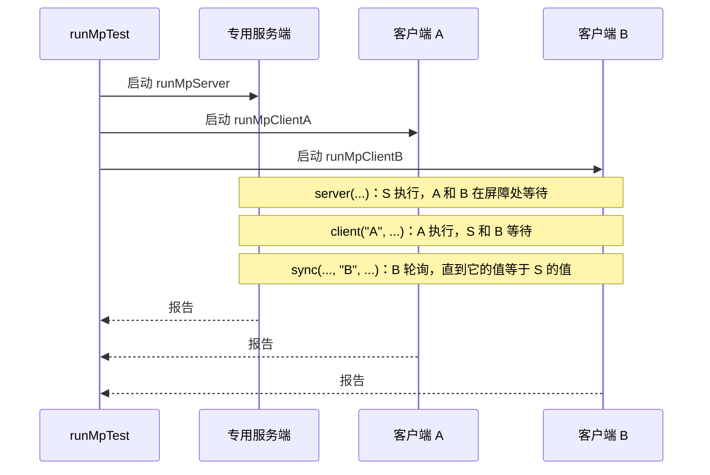

# 多进程测试

<VersionBadge version="2.2.37" label="自" icon="tag" />

普通 UI 测试是一个客户端对着它自己的集成服务端运行。多进程测试运行**一个真实的专用服务端，外加每个角色一个客户端**，通过 localhost 连接并同步推进。用它来测试第二个玩家看到的内容：同步的方块实体字段、每个玩家各自的 UI 会话、客户端到服务端的数据包，以及 RPC，走的都是真实服务端使用的代码路径。

它需要 `ldlib2-uitest.gradle` 和 `ldlib2-mptest.gradle`，见[在你的模组中接入](./index.md#set-up-in-your-mod)。



`runMpTest` 把服务端和每个客户端作为独立的 Gradle 构建启动，在 `runs/mpServer` 中准备一个全新的超平坦世界，通过本地 TCP hub 协调各进程，最后合并它们的报告。hub 断开时每个进程都会自行退出，所以失败的运行不会留下游戏进程。

## 1. 编写场景 {#write-a-scenario}

多进程场景是一串有序的**分段**。每个分段属于一方，其余进程在屏障处等它完成。在 `client(...)` 块里，可以使用完整的 [`ScenarioBuilder`](./index.md#build-reliable-steps) 步骤。

```java
@LDLRegister(name = "machine_sync", group = "mymod", registry = MPScenario.REGISTRY,
        environment = RegistrationEnvironment.DEV_ONLY)
public class MachineSyncScenario implements MPScenario {
    private static final BlockPos POS = new BlockPos(4, -60, 2);

    @Override
    public void configure(MPScenarioOptions options) {
        options.clients("A", "B");
    }

    @Override
    public void define(MPScenarioBuilder s) {
        s.server("place the machine", sc -> sc.server().overworld()
                        .setBlockAndUpdate(POS, MyBlocks.MACHINE.get().defaultBlockState()))
         .client("A", "open the UI and start", b -> b
                 .useBlock(POS)
                 .awaitScreen(ModularUIContainerScreen.class)
                 .click("#btn_start"))
         .serverWaitUntil("the server started the machine",
                 sc -> sc.blockEntity(POS, MachineBlockEntity.class).isRunning())
         .sync("client B sees it running", "B",
                 sc -> sc.blockEntity(POS, MachineBlockEntity.class).isRunning(),
                 ctx -> {
                     var machine = ctx.clientBlockEntity(POS, MachineBlockEntity.class);
                     return machine != null && machine.isRunning();
                 })
         .allClients("close the UI", b -> b.closeScreen())
         .teardownServer("remove the machine", sc -> sc.server().overworld().removeBlock(POS, false));
    }
}
```

多进程场景用普通的 `@LDLRegister` 注册，而不是 `@LDLRegisterClient`：专用服务端也必须能发现它。

| 分段 | 运行位置 | 含义 |
| --- | --- | --- |
| `server(name, sc -> ...)` | 专用服务端线程 | 一个任务。 |
| `serverWaitUntil(desc, sc -> ...)` | 专用服务端，每 tick 一次 | 条件为真后释放屏障。 |
| `serverSettle(ticks)` | 专用服务端 | 让服务端走过指定数量的 tick。 |
| `client(role, name, b -> ...)` | 该角色的客户端 | 普通的 `ScenarioBuilder` 步骤。 |
| `allClients(name, b -> ...)` | 所有客户端同时执行 | 屏障等待所有客户端完成。 |
| `sync(desc, role, server, client)` / `syncAll(desc, server, client)` | 一个客户端 / 所有客户端 | 轮询，直到客户端的值等于服务端的值。 |
| `fetch(key, desc, type, server)` / `fetchOn(role, key, desc, type, server)` | 服务端，然后所有客户端 / 一个客户端 | 把一个服务端的值复制到客户端的临时状态中。 |
| `teardownServer` / `teardownClient` / `teardownAllClients` | 仅所属方 | 清理，不经过屏障。 |

`MPScenarioOptions` 用于配置场景：

| 选项 | 默认值 | 含义 |
| --- | --- | --- |
| `clients(String...)` | `"A"` | 场景需要的角色。启动的客户端少于此数时跳过该场景。 |
| `scenarioTimeoutMs(long)` | 5 分钟 | 整个场景的时间预算，包括在屏障处等待的时间。 |
| `tags(String...)` | 无 | 供 `-PldMpTest=tag:<tag>` 选择的标签。 |
| `clientOptions(o -> ...)` | 无 | 调整每个客户端的 `ScenarioOptions`，如 GUI scale 或 settle 时间。 |

在服务端，`ServerContext#player(role)` 返回该角色的玩家，用户名为 `LDTest<role>`；`players()` 返回所有玩家。

## 2. 比较值：`sync` 还是 `fetch` {#sync-or-fetch}

`sync` 和 `syncAll` 按 JSON 形式比较客户端和服务端的值。用于两端必须完全一致的值：同步的整数、字符串、方块状态、数量。值只用基本类型、字符串和简单数据结构。

`fetch` 用于只需要足够接近的值，比如每 tick 都在变的浮点数。它在分段执行时读取一次服务端的值，存进每个客户端的临时状态。之后的客户端步骤用 `ctx.get(key)` 取出，并按自己的容差比较：

```java
.fetch("server.yaw", "the body angle the server holds", Double.class,
        sc -> (double) mover(sc).yaw())
.client("B", "client B agrees", b -> b.check("within two degrees", ctx -> {
    double server = ctx.get("server.yaw");
    double here = moverOf(ctx).yaw();
    ctx.log("server " + server + ", here " + here);
    return Math.abs(Mth.wrapDegrees(server - here)) < 2.0;
}))
```

`fetch` 放在你希望取样的位置。数值请用 `Double.class`：值以 JSON 传输，Gson 会把裸数字读成 double。`fetchOn(role, ...)` 只把值交给一个客户端。

## 3. 保证场景确定性的规则 {#determinism-rules}

- **`define()` 在每个进程里都会运行**，必须在所有进程中产生相同顺序的相同分段。不要在 `define()` 里根据游戏实时状态分支；那应该放在分段体内。
- **失败的 `check` 不会阻止其他进程。** 和普通测试一样，它把该步骤和本次运行标记为失败。抛出异常的步骤或超时会中止场景：每个进程直接进入自己的清理，然后开始下一个场景。
- **客户端块里没有集成服务端。** 在 `client(...)` 块里调用服务端辅助方法会抛异常；修改世界请放在 `server(...)` 分段中，跨进程等待请用 `sync(...)`。`useBlock` 是例外：在多进程运行中它走真实的客户端交互路径。
- **没有分配角色的客户端会跳过该场景**，但它下一个场景的计时会立即开始，同时等待其他进程完成。当 `clients(...)` 不同的场景在同一次运行中时，把 `scenarioTimeoutMs` 设得足够长，覆盖这段等待。

::: warning Dist 规则

`define()` 也会在**专用服务端进程**中运行，所以场景类必须能在那里加载。方法体只在执行时才加载它用到的类，但 lambda 的签名在类加载时就会被检查。

- 可以：`Consumer<ServerContext>` 和 `Consumer<ScenarioBuilder>` 块、`ctx -> ...` 步骤、`Predicate<TestContext>`、返回装箱值的 getter，以及 `awaitScreen(ModularUIContainerScreen.class)` 这样的类字面量。
- **不可以**：签名中出现仅客户端类型的 lambda，例如 `openScreen` 的 `Function<TestContext, Screen>` 工厂，或捕获了客户端类型局部变量的 lambda。改用 `openScreenTest(name)`，或者把代码移到一个 `@OnlyIn(Dist.CLIENT)` 辅助类里，只在步骤体内引用它。

违反这条规则会让专用服务端在加载场景时崩溃。

:::

## 4. 运行 {#run-it}

```text
gradlew runMpTest -PldMpTest=machine_sync
```

| 选项 | 作用 |
| --- | --- |
| `-PldMpTest=all` | 运行所有已注册的多进程场景，这是默认值。 |
| `-PldMpTest=<name>` / `a,b` / `group:x` / `tag:y` / `regex:p` | 与 `-PldTest` 相同的选择写法。 |
| `-PldMpClients=A,B` | 要启动的客户端进程。默认 `A,B`。需要未启动角色的场景会被跳过。 |
| `-PldTestHeadless` | 不显示窗口地启动服务端和客户端。见 [Headless 运行](./running.md#headless-runs)。 |

每次运行的输出会替换上一次的输出：

```text
build/ldlib2-mptest/report.json   合并后的报告
build/ldlib2-mptest/report.txt    摘要
build/ldlib2-mptest/server/       专用服务端的报告和 gradle.log
build/ldlib2-mptest/clientA/      每个客户端的报告、日志和截图
build/ldlib2-mptest/clientB/
```

有场景失败或没有写出合并报告时，`verifyMpTest` 会让构建失败。冷启动一次大约一到两分钟，因为要启动三个 Gradle 构建，客户端还要通过 localhost 加入。

脚本预定义了客户端 `A` 和 `B`。需要第三个角色时，在你拷贝的 `ldlib2-mptest.gradle` 中把一个 `mpClient` run 复制为 `mpClient<Role>`，并设置对应的角色和用户名 `LDTest<Role>`。

运行失败时按以下顺序排查：

1. `build/ldlib2-mptest/report.txt`：哪个角色、哪个分段失败了。
2. 该角色的 `report.json` 和截图。
3. 该角色的 `gradle.log`。

构建输出中的 `[mptest]` 行是 hub 视角的记录：谁连接了、谁加入了、每个场景如何结束、每个进程以什么方式退出。

## 示例：方块实体同步 {#example-block-entity-sync}

LDLib2 自带的 `mp_block_entity_sync` 场景（`MPBlockEntitySyncScenario`）在专用服务端和两个客户端之间测试[同步注解](../../sync/annotations.md)。它在服务端给每个字段赋值，用 `syncAll` 等到每个客户端对同步字段的描述与服务端一致，然后在 `allClients` 中检查 `@ConditionalSynced` 和 `@LazyManaged` 按预期扣住了值，以及 `@UpdateListener` 观察到了变化。
