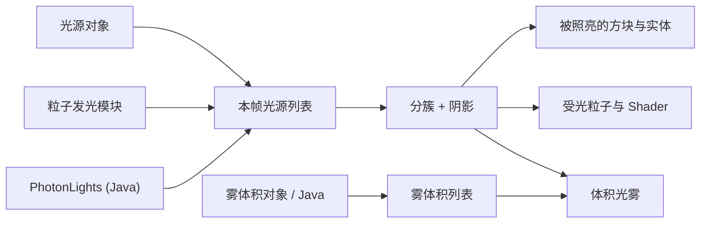

# 动态光照

<VersionBadge version="2.2.8" label="自" icon="tag" />

动态光照让特效向周围的方块、实体和粒子投射彩色光，并带有阴影。

<figure>

<figcaption>只由 Photon 照亮的夜晚广场：闪烁的营火、带着各自光源的法阵和能量护盾、神殿里透出的暖光，以及穿过薄雾的探照灯光柱。阴影是边缘柔和的体素阴影。</figcaption>
</figure>

## 工作原理

Photon 照亮的是屏幕上已经画好的画面。不透明的世界画完之后，光照 Pass 读取屏幕的颜色和深度，把每个动态光源的光叠加上去。游戏本身的光照等级不会改变：Photon 的光源不会阻止怪物生成，也不会让植物生长，它不属于世界的光照数据。

每一帧，Photon 从三个来源收集光源，剔除视野之外的，再按从相机看过去有多亮给剩下的排序。随后光源被分进屏幕分块和深度切片，每个像素只需遍历照得到它的那几个光源。排在前面、并开启了 **投射阴影** 的光源才会有阴影。

## 谁发光，谁被照亮

| 光源来源 | 在哪里 | 用途 |
| --- | --- | --- |
| **光源**（Light）对象 | 特效层级，**新建 → 光源** | 点光源或聚光灯，支持曲线、闪烁、阴影和可选的体积光。见[光源与雾](./lights-and-fog.md)。 |
| **粒子发光**（Light Emission）模块 | 粒子发射器 | 让一部分粒子变成跟随它们的光源。见[受光粒子与 Shader](./lit-particles-and-shaders.md#light-emission)。 |
| `PhotonLights` | Java，仅客户端 | 不属于任何特效的光源：一盏灯、跟随实体的光、一次闪光。见[动态光照 API](../java-api/dynamic-lights-api.md)。 |

| 被照亮的对象 | 如何受光 |
| --- | --- |
| 不透明与镂空方块、实体、方块实体 | 自动受光。 |
| 半透明方块（水、染色玻璃、冰） | 不使用光影包时不受光。 |
| Photon 粒子 | 在 Texture 或 Sprite 材质上开启 **受动态光照**（Lit by Dynamic Lights），或给 Kila 材质添加 **受动态光照亮** 模块。 |
| Shader Graph 与 Custom Shader 材质 | 使用 **动态光源**（Dynamic Light）节点，或在手写 Shader 中引入 `photon:lit_particle.glsl`。 |
| 光源周围的空气 | 开启光源的 **体积光**（Volumetric）：点光源显出光晕，聚光灯显出光柱。 |
| **雾体积**（Fog Volume）对象 | 照进雾里的每个光源都会照亮它。 |

## 客户端设置

打开 **模组 → Photon → 配置**，进入 **动态光照** 分区。数值保存在 `config/photon-client.toml` 的 `[dynamic_lights]` 下。这些设置属于每个玩家自己，只影响本客户端上的画面。

<figure>

<figcaption>Photon 客户端配置界面中的动态光照分区。</figcaption>
</figure>

| 设置 | 配置键 | 默认值（范围） | 作用 |
| --- | --- | --- | --- |
| 启用动态光照 | `enabled` | `true` | 总开关。关闭后不绘制、也不计算任何动态光源。 |
| 阴影 | `shadow_mode` | 体素 | 关闭、屏幕空间或体素。见[阴影](./lights-and-fog.md#shadows)。 |
| 软阴影 | `soft_shadows` | `true` | 按每个光源的光源半径产生柔和的阴影边缘。 |
| 每帧投影光源数 | `shadowed_lights` | 8（0–32） | 每帧有多少个光源投射阴影，最亮、最近的优先。 |
| 光照分辨率 | `resolution` | 0.5（0.25–1） | 计算光照所用的分辨率（相对屏幕）。0.5 看起来接近全分辨率，开销约为三分之一。 |
| 接触阴影步数 | `contact_shadow_steps` | 6（0–32） | 仅体素阴影：一段很短的屏幕空间追踪，补上栅栏、玻璃板和实体的阴影。0 为关闭。 |
| 接触阴影长度 | `contact_shadow_length` | 0.8（0.1–4） | 仅体素阴影：接触阴影追踪的距离（方块）。 |
| 屏幕阴影步数 | `screen_shadow_steps` | 24（1–128） | 仅屏幕空间阴影：朝每个光源追踪的步数。 |
| 屏幕阴影厚度 | `screen_shadow_thickness` | 1.0（0.05–16） | 仅屏幕空间阴影：可见表面后方多远以内仍算遮挡（方块）。 |
| 屏幕阴影距离 | `screen_shadow_distance` | 32（1–128） | 仅屏幕空间阴影：阴影追踪的最远距离（方块）。 |
| 体素构建预算（毫秒） | `voxel_budget_ms` | 2.0（0.1–20） | 每帧把方块转换成体素的 CPU 时间。越低帧时间越平稳，但新到的区域阴影出现得越慢。 |
| 最亮表面颜色 | `albedo_max` | 0.85（0.1–1） | 假定表面最亮能有的颜色。数值越低，光源对浅色表面的提亮越少。 |
| 光影包环境光 | `shader_pack_ambient` | 0.06（0.001–1） | 使用光影包时，假定光影包给表面的最暗光照。动态光照在暗处显得太强就调高。 |
| 体积光 | `volumetric` | `true` | 绘制光晕、光柱和雾体积。 |
| 体积光雾浓度 | `volumetric_density` | 1.0（0–8） | 同时调整体积光周围的光雾和雾体积的密度。0 同时关闭两者。 |
| 前向散射 | `volumetric_forward_scattering` | 0.3（0–0.9） | 朝光源方向看时，光晕比从侧面看亮多少。 |
| 体积光采样数 | `volumetric_samples` | 4（1–16） | 光晕、光柱和雾的积分步数。越多越平滑，开销也越大。 |
| 光影包下启用体积光 | `volumetric_with_shader_packs` | `true` | 在光影包的画面上也绘制光晕、光柱和雾体积。 |

## 性能与限制

| 限制 | 数值 |
| --- | --- |
| 每帧光源数 | 视野剔除后最多 1024 个，保留最重要的。 |
| 每帧投影光源数 | 由 **每帧投影光源数** 决定，最多 32。 |
| 每帧雾体积数 | 32 个，近的优先。 |
| 每个粒子发光发射器的光源数 | **最大光源数**，默认 32。 |

开销主要取决于光源覆盖了多大的屏幕面积，而不是光源的个数。大量 **范围** 很小的光源很便宜；少数几个范围很大、铺满屏幕的光源反而更贵。阴影、软阴影和体积光都会额外增加开销。

数据仅供参考：在开发者的 RTX 4080 Super、1080p 下，默认设置、8 个光源约占 0.5 ms GPU 时间；1024 个光源约为 1.3 ms GPU 加 2.2 ms CPU。

## 光影包（Iris）

- 使用光影包时，光照 Pass 在光影包的最终画面上运行。Photon 从这张画面估算表面颜色，可以用 **光影包环境光** 调整这一估算。
- 光晕、光柱和雾体积画在光影包的画面之上。如果和光影包自带的雾冲突，关闭 **光影包下启用体积光**。
- 光影包自己的光照、阴影和反射看不到 Photon 的光源。
- 通过 `ResolutionScale` 选项以较低内部分辨率绘制世界的光影包（如 Kappa、Nostalgia）已经适配。SEUS PTGI HRR 下光照位置仍会错开。

## 目前不支持的情况

- 不使用光影包时，半透明方块（水、染色玻璃、冰）和原版粒子在光照 Pass 之后才绘制，不会被照亮。
- 材质、节点和 Shader Graph 的预览中没有光照。
- 拖尾、光束和 Ara拖尾发射器不能发光，粒子发光只存在于粒子发射器。
- 特效对象的光源在 Transform 快速变化时会落后一帧。
- 编辑器场景里的世界是全亮的，光斑看起来比游戏里的夜晚更淡。
- 用 `PhotonLights` 添加的光源只出现在客户端世界中，不会出现在编辑器或 UI 场景里。其他模组的 UI 场景只有在它的 `PhotonParticleManager` 知道所在的 level 时，才会被自己特效里的光源照亮，见[动态光照 API](../java-api/dynamic-lights-api.md#ui-scenes)。

## 本章内容

- [光源与雾](./lights-and-fog.md)：光源对象、阴影、体积光、雾体积、编辑器预览与 Timeline。
- [受光粒子与 Shader](./lit-particles-and-shaders.md)：粒子发光、受动态光照、动态光源节点与手写 Shader。
- [动态光照 API](../java-api/dynamic-lights-api.md)：在 Java 中使用 `PhotonLights`、`DynamicLight` 和 `FogVolume`。
