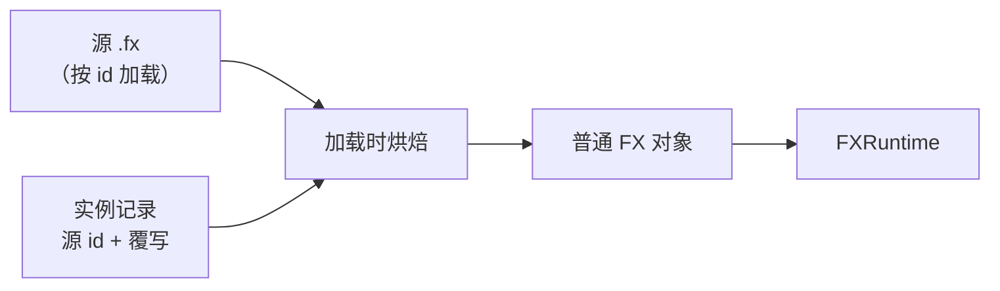

# FX 实例

<VersionBadge version="2.2.9" label="自" icon="tag" />

FX 实例把一个现有的 `.fx` 放进另一个效果里。放进来的对象是源特效的活副本：可以修改、禁用、删除它们，也可以在它们下面添加自己的对象。文件只保存你改动的部分。源特效更新后，实例会在下次加载时跟着更新，同时保留你的改动。用过 Unity 的读者可以把它理解为 Prefab 实例。

适合的场景：把一个火花爆发、冲击波之类的效果复用到多个更大的效果里，或者在不复制它的前提下做出若干变体。

<figure>

<figcaption>Hierarchy 中的一个 FX 实例。它放置的对象显示为实例蓝色，新加的子对象标有「+」。Inspector 中是一个放置的发射器：头部显示“来自 FX 实例「…」”，被覆写的行带有标记。</figcaption>
</figure>

你的效果只保存实例记录：源 id 和覆写。加载时，Photon 把记录和当前的源合并，生成普通对象。

## 放置实例

| 操作 | 实例放在哪里 |
| --- | --- |
| Hierarchy 右键 → **添加 FX 实例…**（Add FX Instance...），然后在 **选择 FX**（Pick an FX）中选一个 id | 放在所选对象旁边；没有选中时放在 `root` 下 |
| Asset Browser：右键 `.fx` → **作为 FX 实例添加**（Add as FX Instance） | `root` 下 |
| 把 `.fx` 从 Asset Browser 拖进 Hierarchy | 拖到某一行上：放在该对象下；拖到空白处：放在 `root` 下 |

**选择 FX** 会搜索游戏能加载的所有效果：Mod jar、Resource Pack 和 FX Pack 中的都在内。

实例按效果 id 引用源特效，所以文件必须有 id。`assets/<namespace>/fx/<path>.fx` 的 id 是 `<namespace>:<path>`。编辑器资源目录（`<gameDir>/ldlib2/assets/`）和 Resource Pack 使用相同结构。不能按 id 加载的文件，菜单项会被禁用并写明原因：

| 菜单项 | 原因 |
| --- | --- |
| **作为 FX 实例添加（仅限 assets/&lt;命名空间&gt;/fx/ 下的 .fx）** | 文件不在 `assets/<namespace>/fx/` 文件夹中。 |
| **作为 FX 实例添加（文件名不是合法的 id）** | 文件名包含小写字母、数字、`_`、`-`、`.` 以外的字符。 |

## 实例的显示方式

| 项目 | 显示方式 |
| --- | --- |
| 实例本身 | FX 文件图标，实例蓝色。Inspector 头部：`FX 实例：<id>`。 |
| 放置的对象 | 实例蓝色。Inspector 头部：`来自 FX 实例「<name>」（<id>）`。 |
| 被覆写的值 | Inspector 中带标记的行。 |
| 在实例或放置的对象下新加的对象 | 名称前带 `+`。 |
| 禁用或隐藏的对象 | 灰色。 |
| 源缺失的实例 | 红色。Inspector 头部：`FX 实例：<id>（缺失）`。 |

## 修改放置的内容

本节的所有编辑都可以撤销。

### 覆写数值

在 Inspector 中修改放置对象的任意值，该行就成为覆写并带上标记。把值改回和源相同后，它就不再是覆写，会重新跟随源。

还原有三个层级：

| 范围 | 操作 |
| --- | --- |
| 单个值 | 右键带标记的行 → **还原**（Revert）。 |
| 单个对象 | 右键放置对象的 Inspector 头部或它在 Hierarchy 中的行 → **还原此对象**（Revert Object）。只有对象存在覆写时才可用。 |
| 整个实例 | 实例菜单或覆写列表中的 **还原全部**（Revert All）。数值恢复，删除的对象回来，新加的对象被移除。 |

### 禁用、删除与添加

- Hierarchy 菜单中的 **禁用 / 启用**（Disable / Enable），或 Inspector 中的 **启用**（Enabled）行，可以关闭放置的对象。这个开关会保存为覆写。禁用的对象既不 tick 也不渲染，Activator Track 也无法唤醒它。
- **移除**（Remove）放置的对象，会连同其下所有对象记为已删除。可以在覆写列表中用 **恢复**（Restore）找回。
- 在 Hierarchy 中把对象拖到实例或放置的对象上，即可添加到那里。新加的对象属于你的效果，不属于源，名称前显示 `+`。它们也可以是 FX 实例。
- 放置的对象不能移动或重排，它们的层级只由源决定。

### 覆写列表

**覆写列表…**（Overrides...）会打开 **&lt;名称&gt; 的覆写**（Overrides of &lt;name&gt;）对话框，其中列出：

- 源 id；
- 每个被修改的对象及其改动的值，每个值带 **还原**，对象本身带 **还原此对象**；
- 被删除的对象，每个带 **恢复**；
- 新加的对象，显示为 `+ <name>`；
- `N 条覆写在源里找不到目标`，带 **清除失效覆写**（Remove Unused Overrides），见[跟随源](#跟随源)；
- **还原全部** 按钮。

<figure>

<figcaption>一个实例的覆写列表：带「还原」的改动值、带「恢复」的已删除对象，以及一个新加的对象。</figcaption>
</figure>

### 实例菜单

右键实例的 Inspector 头部，或打开它在 Hierarchy 中那一行的 **FX 实例**（FX Instance）子菜单：

| 菜单项 | 作用 |
| --- | --- |
| **打开源**（Open Source） | 把源 `.fx` 转换成工程并打开，打开前会询问工程保存位置。只适用于编辑器资源目录中的文件。来自 Mod 或 `.fxpack` 的效果会被拒绝；Pack 中的效果需要先通过 **文件 → 管理 FXPack…**（File → Manage FXPack...）转换。 |
| **覆写列表…** | 打开覆写列表。 |
| **还原全部** | 把整个实例恢复成源的样子。 |
| **替换…**（Replace...） | 改为放置另一个 FX。仍能在新源中找到对象的覆写会保留。 |

源缺失时，**覆写列表…** 和 **还原全部** 不可用。

<figure>

<figcaption>在 Hierarchy 中右键实例：FX 实例子菜单里有打开源、覆写列表…、还原全部和替换…。</figcaption>
</figure>

### 复制、粘贴与创建副本

复制、粘贴或创建实例副本，会得到一个带有相同覆写和新加对象的新实例，绑定到它的 Timeline Track 也会一起复制。如果粘贴会导致成环，则不会放置任何内容，并提示原因。

## 跟随源

实例永远不会写入源特效。要让所有放置它的效果都使用新的源：

1. 在实例上选择 **打开源**。
2. 编辑转换出的工程。
3. 导出回同一个 id。

如果在某个放置了该源的效果打开期间，源被重新导出或它所在的 Pack 被重写，编辑器会用新源重新放置实例，并保留你的覆写。这会记为一条历史记录 **跟随更新后的源**（Follow the Updated Source）。没有打开的效果会在下次加载时使用新源。

如果某条覆写对应的对象或字段在新源中不存在了，它会作为失效覆写保留下来。覆写列表会显示为 `N 条覆写在源里找不到目标`。保留它们是为了让之后的源更新还能重新用上。**清除失效覆写** 会删除它们。

源和其他效果一样按 id 解析。如果优先级更高的 Resource Pack 提供了同一个 id，实例会放置那一个。

## 嵌套与成环

源里可以包含实例，也可以在实例里再添加实例，嵌套层数不限。

成环会被拒绝。成环是指一个效果会直接或经由其他实例放置它自己。编辑器会提示：

> 在这里放置 %s 会让这个特效套住自己（经由 %s）。

导出时也会针对导出目标 id 做同样的检查：

> 导出为 %s 会让其中的 FX 实例套住自己（经由 %s）。

## Timeline

实例在自己的时钟上播放源特效的 Timeline。

| 外层 Timeline | 实例时钟 |
| --- | --- |
| 效果开始时实例处于 Active | 从 `0` 开始。 |
| Control Clip 重启实例或它的某个父对象 | 在 Clip 开始时从 `0` 开始。 |
| Activator Track 关闭实例 | 暂停；实例重新打开后继续。 |
| Speed Track 或 `FXRuntime#setRate` 改变实例的 Time Scale | 按该速度运行。 |

- 实例在一次 Reset 之后第一次 Active 时启动时钟。
- 源中绑定其 root 的 Track 作用于实例本身。
- 外层 Track 可以绑定实例和它放置的对象。外层 Timeline 和源驱动同一对象的同一通道时，外层优先；每一层嵌套都遵循这个规则。
- 为实例新建的 Control Clip 长度足以容纳源的整个 Timeline。
- Active 且正在播放 Timeline 的实例会让效果保持存活，直到该 Timeline 结束；暂停的实例不会。
- 源 Timeline 中的 Signal 和 Audio 与外层的一样交给同一个 Executor。

外层 Track 的说明见 [Activator、Control 与 Speed](./timeline/activator-control-and-speed.md)。

## 导出与运行时

| 导出 | 实例的处理 |
| --- | --- |
| `.fx` | 继续按 id 引用源。运行时必须能从 Mod、Resource Pack 或 `.fxpack` 加载到源。 |
| `.fxpack` | 实例放置的所有源（任意深度）都按各自的 id 打进包中。游戏或 Mod 已经自带的源会跳过。打进包的源本身也是包中可播放的效果。 |

加载时，`FXHelper.getFX` 会把实例烘焙成普通对象。Java 代码看到的是普通对象，`FXRuntime#findObject` 可以按名称找到放置的对象。如果一个效果把同一个源放置了两次，两份对象名称相同，可以用 `findObjects` 取得全部。[预加载](./java-api/preloading.md)一个效果时，也会预加载它的实例所放置的源。

::: warning 旧版 Photon
2.2.9 之前的 Photon 不认识 FX 实例。它们读取文件时会丢弃实例，放置的内容会缺失。
:::

## 源缺失

源无法加载时，实例仍保留在效果中：显示为红色，头部以 `（缺失）` 结尾，不放置任何内容，保存的记录原样保留。源可用之后（例如导出了源或安装了 Pack），效果会重新放置它。

## 提示

- 没有 Apply。实例不会写入源 `.fx`；请使用 **打开源**，再把源导出回去。
- 没有解包（Unpack）。放置的对象始终与源保持关联。
- 保持源 id 稳定。重命名或移动源 `.fx` 会改变它的 id，实例会显示为缺失。
- 给每个实例起一个清楚的名字。这个名字会出现在它放置的每个对象的头部。
