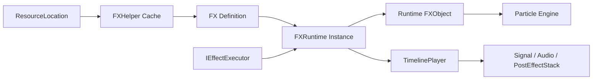

# Java 与 Runtime API


*Java API 加载编辑器使用的同一份 FX 定义，并为每次播放持有独立 Runtime Instance。*

Photon 的公开播放 API 仅用于客户端。加载近似不可变的 `FX` 定义，创建或由 Executor 创建 `FXRuntime`，并让所有世界/渲染修改留在客户端线程。

## 在模组中引入 Photon

[](https://maven.firstdark.dev/#/snapshots/com/lowdragmc/photon/photon-neoforge-1.21.1)

Photon、LDLib2 和 KilaGraph 都发布在 FirstDark Maven 上。播放特效的模组需要对 Photon 和 LDLib2 编译。KilaGraph 是 Photon Shader Graph 背后的节点图库，已经打包在 Photon 的 `all` jar 里，只有你自己的代码用到 KilaGraph 的类时才需要单独添加。

### 版本

把版本写进 `gradle.properties`：

```properties
minecraft_version=1.21.1
ldlib2_version=2.2.43
photon_version=2.2.9
# 只有对 KilaGraph 编译时才需要（见下文）
kilagraph_version=21.1.0.15
```

| 要求 | Photon `2.2.9` |
| --- | --- |
| Minecraft | `1.21.1` |
| NeoForge | `21.1`（基于 `21.1.217` 构建） |
| LDLib2 | `2.2.43` 或更高。必需，由玩家与 Photon 一起安装。 |
| KilaGraph | `21.1.0.15` 或更高。必需，嵌在 Photon 的 `all` jar 中。 |
| Mod ID | `photon` |

新的 Photon 版本经常需要更新的 LDLib2。升级 Photon 时，请确认它要求的 LDLib2 版本。

### Gradle

<DocTabs>
<DocTab title="Groovy">

```gradle
repositories {
    maven { url = "https://maven.firstdark.dev/snapshots" } // LDLib2、KilaGraph、Photon
}

dependencies {
    // LDLib2：`all` jar 带有 LDLib2 自己打包的库
    implementation "com.lowdragmc.ldlib2:ldlib2-neoforge-${minecraft_version}:${ldlib2_version}:all"
    // Photon：`all` jar 打包了 KilaGraph
    implementation "com.lowdragmc.photon:photon-neoforge-${minecraft_version}:${photon_version}:all"
    // 只有代码直接使用 KilaGraph 的类时才需要（例如自定义 Shader Graph 节点）：
    // compileOnly "com.lowdragmc.kilagraph:kilagraph-neoforge-${minecraft_version}:${kilagraph_version}"
}
```

</DocTab>
<DocTab title="Kotlin DSL">

```kotlin
repositories {
    maven("https://maven.firstdark.dev/snapshots") // LDLib2、KilaGraph、Photon
}

dependencies {
    val mc = property("minecraft_version")
    // LDLib2：`all` jar 带有 LDLib2 自己打包的库
    implementation("com.lowdragmc.ldlib2:ldlib2-neoforge-$mc:${property("ldlib2_version")}:all")
    // Photon：`all` jar 打包了 KilaGraph
    implementation("com.lowdragmc.photon:photon-neoforge-$mc:${property("photon_version")}:all")
    // 只有代码直接使用 KilaGraph 的类时才需要（例如自定义 Shader Graph 节点）：
    // compileOnly("com.lowdragmc.kilagraph:kilagraph-neoforge-$mc:${property("kilagraph_version")}")
}
```

</DocTab>
</DocTabs>

刷新 Gradle 项目后，`gradlew dependencies --configuration compileClasspath` 应当只列出一个 Photon 和一个 LDLib2。

### 为什么用 `all` jar

Photon 的每个版本都发布两个 jar：

| Jar | 内容 |
| --- | --- |
| `photon-neoforge-1.21.1-2.2.9.jar` | 只有 Photon 自己的类（精简 jar）。 |
| `photon-neoforge-1.21.1-2.2.9-all.jar` | 同样的类，外加通过 NeoForge Jar-in-Jar 嵌入的 KilaGraph `21.1.0.15`。 |

CurseForge 和 Modrinth 上发布的也是 `all` jar，所以玩家只需要安装 Photon 和 LDLib2。使用 `all` classifier 后，你的开发环境运行的就是玩家手里的同一个 jar。

Photon 的 Maven 元数据没有列出任何编译依赖，所以上面的配置要自己声明 LDLib2：Photon 的 API 用到了 LDLib2 的类型，缺少它代码就无法编译。在开发环境运行时，Gradle 还会把 KilaGraph 作为 Photon 的运行时依赖加入。这时 NeoForge 会找到两份 KilaGraph，一份在顶层，一份嵌在 Photon 里，只加载版本最高的那一份。

::: info 旧写法
本页的旧版本使用精简坐标加 `transitive = false`。这种写法仍然可用，因为运行时用的始终是 `all` jar，但已经没有必要。不写 classifier 也可以：Gradle 会对精简 jar 编译，运行时使用 `all` jar。
:::

### 什么时候还需要 KilaGraph

Java 无法对嵌套 jar 里的类编译。当你的代码导入 `com.lowdragmc.kilagraph` 下的类型时，例如编写自定义 Shader Graph 节点，或继承基于 KilaGraph 的 Photon 类，就把 KilaGraph 加为 `compileOnly`。版本使用你所用 Photon 版本打包的那个（Photon `2.2.9` 对应 `21.1.0.15`）。玩家仍然从 Photon 中获得 KilaGraph。

### 声明依赖

在 `neoforge.mods.toml` 中添加 Photon 和 LDLib2：

```toml
[[dependencies.yourmodid]]
    modId = "photon"
    type = "required"
    versionRange = "[2.2.9,)"
    ordering = "AFTER"
    side = "BOTH"
[[dependencies.yourmodid]]
    modId = "ldlib2"
    type = "required"
    versionRange = "[2.2.43,)"
    ordering = "AFTER"
    side = "BOTH"
```

不需要声明 KilaGraph，Photon 会声明并自带它。`photon` 的下界设为你用到的 API 所需的最低版本。如果你的模组只在客户端代码里使用 Photon，又要能在没有 Photon 的专用服务器上运行，把 `photon` 这一项设为 `side = "CLIENT"`。

做可选联动时，使用 `type = "optional"`，并在接触任何导入了 Photon 的类之前检查 `ModList.get().isLoaded("photon")`。把这些导入集中到一个单独的类里，这样 Photon 不存在时 JVM 永远不会加载它：

```java
public final class EffectsCompat {
    private static final boolean PHOTON = ModList.get().isLoaded("photon");

    public static void playHit(ClientLevel level, BlockPos pos) {
        if (PHOTON) {
            PhotonEffects.playHit(level, pos); // 唯一导入 Photon 的类
        }
    }
}
```

用一个运行时 classpath 中没有 Photon 的启动配置测试这个检查。没有加检查的引用只会在那段代码真正执行时才抛出 `NoClassDefFoundError`。

::: details 把 Photon 打包进你的模组（Jar-in-Jar）
只有在“安装你的模组就应该同时装上 Photon”时才这样做。如果玩家另外安装了 Photon 或 LDLib2，或者别的模组也打包了它们，NeoForge 会加载版本最高的那一份。

```gradle
dependencies {
    // 如果你的公开类型暴露了 LDLib2、Photon 或 KilaGraph 的类型，用 `api` 代替 `implementation`
    jarJar(implementation(group: 'com.lowdragmc.ldlib2', name: "ldlib2-neoforge-${minecraft_version}", classifier: 'all')) {
        version { require "${ldlib2_version}" }
    }
    jarJar(implementation(group: 'com.lowdragmc.photon', name: "photon-neoforge-${minecraft_version}", classifier: 'all')) {
        version { require "${photon_version}" }
    }
    jarJar(implementation(group: 'com.lowdragmc.kilagraph', name: "kilagraph-neoforge-${minecraft_version}")) {
        version { require "${kilagraph_version}" }
    }
}
```

- LDLib2 和 Photon 要嵌入 `all` classifier。普通 jar 不包含它们自己嵌套的库，构建能通过编译，运行时却会失败。KilaGraph 没有 `all` jar，它的普通 jar 就是完整的模组。
- 使用 `require`，不要用 `prefer`。这三个库互相依赖，`prefer` 会输给它们的传递约束，编译和运行时 classpath 可能解析出不同的版本。
- `neoforge.mods.toml` 里的 `[[dependencies]]` 条目仍然保留。
:::

### 常见问题

| 现象 | 原因 | 解决 |
| --- | --- | --- |
| 运行时对 `com.lowdragmc.kilagraph` 下的类报 `NoClassDefFoundError` 或 `ClassNotFoundException` | 游戏运行或打包的是精简 Photon jar，里面没有 KilaGraph。 | 依赖或打包 `all` classifier。 |
| 编译时报 `package com.lowdragmc.lowdraglib2 does not exist`，或无法访问某个 LDLib2 类 | LDLib2 不在编译 classpath 上；Photon 的元数据不会带上它。 | 添加 LDLib2 的 `implementation` 行。 |
| 编译时无法访问某个 KilaGraph 类 | 你的代码用到了 KilaGraph 类型，而它们只存在于嵌套 jar 中。 | 把 KilaGraph 加为 `compileOnly`。 |
| 游戏在加载时停止，提示缺少 `ldlib2`、`kilagraph` 或 `photon`，或版本过旧 | 已安装的版本低于声明的范围。 | 更新对应模组，或检查 `neoforge.mods.toml` 与 `gradle.properties` 中的范围。 |
| 能编译，运行时却找不到某个类或方法 | 编译和运行时 classpath 解析出了不同版本。 | 对两个 classpath 分别运行 `gradlew dependencies`；打包时使用 `require`。 |

## API 结构



## 最小播放示例

```java
FX fx = FXHelper.getFX(ResourceLocation.parse("mymod:fire"));
if (fx != null) {
    new BlockEffectExecutor(fx, level, pos).start();
}
```

`FX`、`FXRuntime`、Executor、粒子对象、Shader 资源和后处理都属于客户端。不要让 Dedicated Server 必须 Class-load 引用这些类型的代码；把集成放进 Client-only Class/Event。

特效第一次播放时要读取文件、编译 Shader、加载纹理。对模组经常播放的特效进行[预加载](./preloading.md)，这些工作就不会表现为卡顿。

## 本章内容

- [加载、列出与缓存 FX](./loading-listing-and-caching.md)
- [预加载特效](./preloading.md)
- [内置 Effect Executor](./built-in-executors.md)
- [FXRuntime 生命周期](./fxruntime-lifecycle.md)
- [Runtime 数据注入](./runtime-data-injection.md)
- [Runtime Object 与 Transform](./runtime-objects-and-transforms.md)
- [动态网格与 UI 场景](./live-meshes-and-ui-scenes.md)
- [自定义 Executor、Timeline 与 Signal](./custom-executors-timeline-and-signals.md)
- [后处理 Java API](./post-processing-api.md)
- [动态光照 API](./dynamic-lights-api.md)
- [扩展、序列化与调试](./extension-serialization-and-debugging.md)
