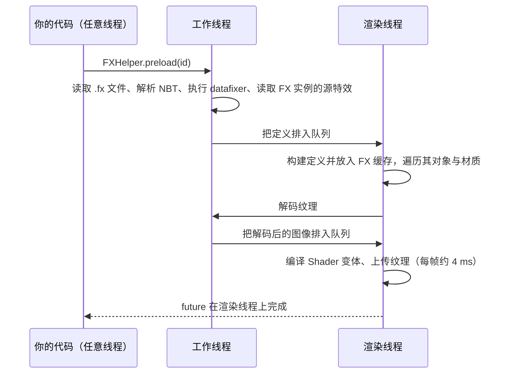

# 预加载特效

<VersionBadge version="2.2.9" label="自" icon="tag" />

特效第一次播放时，Photon 要读取它的文件、编译各发射器绘制所用的 Shader 变体、加载纹理，还要加载子发射器生成的特效。这些工作会表现为一次卡顿。预加载把同样的工作提前完成：放到后台、放到加载界面后面，或者放进资源重载过程。这样特效首次播放也很流畅。

预加载方法都在 `FXHelper`（`com.lowdragmc.photon.client.fx`）上。

## 选择方法 {#pick-a-method}

| 方法 | 适用场景 | 调用线程 | 是否阻塞调用者 |
| --- | --- | --- | --- |
| `keepPreloaded(ids...)` | 随时可能播放的特效：命中、爆炸、技能特效。它们在整个会话中保持预热，资源重载后也一样。 | 任意线程，模组构造和客户端初始化阶段也可以。 | 否 |
| `preload(id)` / `preload(ids)` | 能提前几秒预判的特效：Boss 登场、玩家刚装备的技能。工作会分摊到多帧。 | 任意线程。 | 否；返回 `CompletableFuture`。 |
| `preloadNow(id)` | 必须在场景开始前准备好的特效，在你自己的加载界面显示期间调用。完成得最快，因为不用等下一帧。 | 仅渲染线程。 | 是，直到全部预热完成。 |

在一台开发机上，一个包含 10 个发射器的特效在后台预加载用了 564 ms（分摊到很多帧，首次播放没有卡顿），用 `preloadNow` 用了 115 ms，资源重载时重新预热用了 121 ms。这些数字仅供参考。

## 整个会话保持预热

```java
FXHelper.keepPreloaded(
        ResourceLocation.fromNamespaceAndPath("mymod", "combat/hit"),
        ResourceLocation.fromNamespaceAndPath("mymod", "combat/explosion"));
```

调用一次即可，例如放在客户端初始化里。`keepPreloaded(Collection<ResourceLocation>)` 接受一个列表。

- 资源重载（游戏启动、F3+T、更换资源包）会丢弃所有已加载的特效。Photon 会在自己的重载监听器里同步地重新预加载这些常驻特效，此时加载界面仍在显示。
- 在模组构造或客户端初始化阶段调用没有问题：游戏启动时，这些特效会在加载界面后面完成预热。
- 如果在游戏加载完成后调用，新加入的特效会立即在后台预加载。
- 特效一旦设为常驻，就保持到游戏关闭，没有移除的方法。

每个常驻特效都会延长每次重载时加载界面的时间。只把真正经常播放的特效设为常驻。

## 后台预加载

```java
ResourceLocation intro = ResourceLocation.fromNamespaceAndPath("mymod", "boss/intro");

FXHelper.preload(intro).thenAccept(fx -> {
    // 渲染线程。fx 是缓存中的定义；特效无法加载时为 null。
});
```

`preload(Collection<ResourceLocation>)` 返回 `CompletableFuture<Void>`，所有特效都预热完成后才完成。

工作分布在工作线程和渲染线程上：



- 渲染线程上的工作在每帧开始时执行，每帧预算约 4 ms，且每帧至少执行一项。
- 显示加载覆盖层时（例如资源重载期间）会暂停。
- 该特效的子发射器生成的特效会在同一批中预加载，每个只加载一次。
- 如果预加载过程中发生了资源重载，预加载会重新开始，因此 future 永远不会带着过期的定义完成。

::: warning 线程
- 不要在渲染线程上对 future 调用 `join()` 或 `get()`。future 要等渲染线程执行完排队的工作才会完成，在渲染线程上等待会造成死锁。渲染线程上请用 `preloadNow`。
- future 在渲染线程上完成，所以立刻链上的回调（`thenAccept`、`thenRun`）也在渲染线程上执行。回调要简短。在回调里创建并 Emit Runtime 是安全的。
- 如果在 future 已经完成之后才链上回调，回调会在链接它的线程上执行，这是 `CompletableFuture` 的常规行为。
:::

如果特效在预加载完成之前就播放了，`getFX` 会当场加载定义，其余工作在首次播放时完成，与不做预加载时相同。

## 在加载界面后预加载

```java
// 渲染线程，你自己的加载界面正在显示：
FX fx = FXHelper.preloadNow(ResourceLocation.fromNamespaceAndPath("mymod", "cutscene/opening"));
```

`preloadNow` 同步完成整个预加载，返回缓存中的定义；特效无法加载时返回 `null`。它会断言自己运行在渲染线程上。全部开销都花在这一帧里，所以只在可以接受停顿的地方调用。

## 预热的内容

| 预热内容 | 说明 |
| --- | --- |
| 定义 | 存入 `getFX` 读取的同一个缓存。FX 实例在读取定义时就会放置，所以它们放置的源特效会一起加载。 |
| Shader 变体 | 已启用的发射器绘制时用到的每个程序变体。 |
| 纹理 | 材质绑定的纹理。它们在渲染线程之外解码，只有在此期间没有别的代码加载过同一纹理时才会注册。 |
| Kila 材质 | 它的程序布局和纹理。开启 **屏幕扭曲 → 叠加** 时预热叠加布局；使用光影包时叠加可能退回普通方式，因此普通布局也会预热。 |
| Model 网格 | 渲染模式为 Model 的每个发射器的网格。 |
| 子发射器特效 | 子发射器生成的每个特效，每次请求只加载一次。 |

Timeline 动画化的值会同时按开和关两种状态预热。如果 Timeline 动画化了 **使用GPU实例**，实例化路径和 CPU 路径都会预热；如果动画化了 **写入自定义遮罩**、**拖尾** 或 **子发射器**，即使定义中它们是关闭的，遮罩 Pass、拖尾 Pass 或生成的特效也会预热。在定义中被关闭的对象，或位于已关闭父对象下的对象，会被跳过。

目前还不会预加载：发射形状的网格、动画 glTF 模型在后台进行的顶点动画烘焙、Post Process 片段和音频。如果预加载之后首次播放仍然卡顿，通常是用到了其中某一项。

## 重载与缓存 {#reloads-and-the-cache}

- 资源重载会清空缓存（`FXHelper.clearCache()`）。之后，用 `preload` 或 `preloadNow` 预加载过的特效都没了，只有常驻特效会重新预加载。如果仍然需要其他特效，请再次调用 `preload`。
- `FXHelper.getCachedFX(id)` 返回缓存中的定义，未加载时返回 `null`，它从不触发加载。返回非 null 只说明定义已加载，并不能证明 Shader 和纹理已经预热，因为 `getFX` 也写入同一个缓存。
- 每当已加载的特效被丢弃（重载、`clearCache()` 或 `invalidate(...)`），`FXHelper.generation()` 就会增加。比较前后两个值，就能知道期间缓存是否被清空过。
- 从 2.2.9 起，编辑器可以就地改写已挂载的 FX Pack。此时 Photon 只会遗忘发生变化的特效（`FXHelper.invalidate(ids)`）以及把它们作为 FX 实例放置的特效。常驻特效会在后台重新预加载。

## 完整示例

```java
package com.example.client;

import com.lowdragmc.photon.client.fx.BlockEffectExecutor;
import com.lowdragmc.photon.client.fx.FX;
import com.lowdragmc.photon.client.fx.FXHelper;
import net.minecraft.client.multiplayer.ClientLevel;
import net.minecraft.core.BlockPos;
import net.minecraft.resources.ResourceLocation;
import net.neoforged.api.distmarker.Dist;
import net.neoforged.bus.api.SubscribeEvent;
import net.neoforged.fml.common.EventBusSubscriber;
import net.neoforged.fml.event.lifecycle.FMLClientSetupEvent;

@EventBusSubscriber(modid = "mymod", bus = EventBusSubscriber.Bus.MOD, value = Dist.CLIENT)
public final class MyModEffects {
    public static final ResourceLocation HIT = id("combat/hit");
    public static final ResourceLocation EXPLOSION = id("combat/explosion");
    public static final ResourceLocation BOSS_INTRO = id("boss/intro");

    private MyModEffects() {}

    @SubscribeEvent
    public static void onClientSetup(FMLClientSetupEvent event) {
        // 经常播放：整个会话保持预热，每次重载后重新预热。
        FXHelper.keepPreloaded(HIT, EXPLOSION);
    }

    /** 玩家走进了竞技场，几秒后播放登场特效。 */
    public static void prepareBossIntro() {
        FXHelper.preload(BOSS_INTRO);
    }

    public static void playBossIntro(ClientLevel level, BlockPos pos) {
        FX fx = FXHelper.getFX(BOSS_INTRO); // 预加载完成后已在缓存中
        if (fx != null) {
            new BlockEffectExecutor(fx, level, pos).start();
        }
    }

    private static ResourceLocation id(String path) {
        return ResourceLocation.fromNamespaceAndPath("mymod", path);
    }
}
```

## 自定义 FX 对象与材质 {#custom-fx-objects-and-materials}

Photon 的内置对象和材质会报告自己需要的资源。添加了自定义 FX 对象类型或材质的模组需要实现同样的钩子。不实现的话，预加载会悄悄跳过这个对象或材质，它首次播放时仍会卡顿。

| 钩子 | 调用时机 | 需要报告 |
| --- | --- | --- |
| `IFXObject.preload(PreloadContext context)` | 在渲染线程上，针对 Runtime 复制来源的那份缓存定义调用。 | 对象第一帧原本会延迟加载的东西：程序、纹理、它生成的特效。 |
| `IMaterial.preload(MaterialContext context, PreloadContext preload)` | 在渲染线程上、任何绘制之外调用；Pass 绘制所用的每个 `MaterialContext` 各调用一次。 | 该 Context 对应的程序变体以及它绑定的纹理。不得绑定 GL 状态。 |

两者默认什么都不做。内置的渲染 Pass 会对其绘制路径上的每个材质调用 `IMaterial.preload`，所以被内置发射器使用的自定义材质只需要实现自己的钩子。

| `PreloadContext` 方法 | 用途 |
| --- | --- |
| `texture(ResourceLocation)` | 按位置绑定的纹理。通过原版纹理管理器加载；后台预加载时在其他线程解码。 |
| `onRenderThread(Runnable)` | GL 工作，例如编译程序变体。始终在渲染线程上执行；后台预加载时每个帧切片执行一项。 |
| `fx(ResourceLocation)` | 这个特效会生成的另一个特效。每次请求中每个特效只预加载一次。 |
| `isAnimated(IFXObject, String)` | 特效的 Timeline 是否动画化了对象在某个运行时绑定路径（如 `renderer.useGPUInstance`）上的配置值。若是，两种状态都要预热。 |

```java
public class GlowMaterial extends ShaderInstanceMaterial {
    private ResourceLocation texture;
    // ...

    @Override
    public void preload(MaterialContext context, PreloadContext preload) {
        preload.texture(texture);
        super.preload(context, preload); // ShaderInstanceMaterial 会编译该 Context 的变体
    }
}

public class PortalObject extends FXObject {
    private ResourceLocation closeEffect;
    // ...

    @Override
    public void preload(PreloadContext context) {
        context.onRenderThread(this::compilePrograms); // 你自己的 GL 工作，不要放在绘制过程中
        if (closeEffect != null) {
            context.fx(closeEffect);
        }
    }
}
```

注册自定义对象与材质的方法见[扩展、序列化与调试](./extension-serialization-and-debugging.md)。
