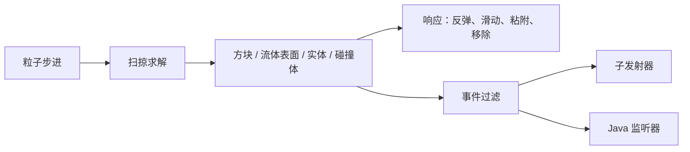

# 粒子碰撞

<VersionBadge version="2.2.9" label="自" icon="tag" />

<figure>

<figcaption>火花洒在楼梯、台阶和矮墙上。碰撞是扫掠的，所以它们会在真实的方块形状上弹开并停住，而不是穿过去。</figcaption>
</figure>

从 2.2.9 起，粒子发射器的粒子可以与方块碰撞形状、流体表面、实体，以及同一 FX 中的碰撞体对象碰撞。碰撞采用扫掠检测：高速粒子会停在路径上的第一个表面，不会再穿过薄墙或掉进地面。每次接触都可以让粒子反弹、滑动、粘附或被移除，也可以触发子发射器或 Java 监听器。



## 开启碰撞

1. 选中粒子发射器，开启 **物理**（Physics）模块。该模块默认关闭。
2. 模块开启后，**启用碰撞**（Has Collision）默认就是开启的。
3. 展开 **物理 → 碰撞**（Physics → Collision），选择粒子要与哪些目标碰撞。默认目标（方块和碰撞体）与旧版只碰方块的行为一致。

碰撞组上方的物理字段名称没变。从 2.2.9 起，它们的含义如下：

| 设置 | 默认值 | 含义 |
| --- | --- | --- |
| 反弹几率（Bounce Chance） | 1 | 每次撞击都重新判定。没有反弹的粒子会失去撞向表面的速度，并沿表面滑动。2.2.9 之前，只要有一次没反弹，之后就永远不再反弹。 |
| 反弹率（Bounce Rate） | 1 | 恢复系数：反弹时保留的撞向表面速度的比例。1 为完全弹性。 |
| 反弹扩散率（Bounce Spread Rate） | 0 | 每次反弹时沿表面附加的随机速度。 |
| 碰撞摩擦（Collided Friction） | 0.7 | 每 tick 保留的滑动速度比例。只在粒子贴着表面时生效，并且只作用于滑动分量。2.2.9 之前，它会在第一次接触后一直减慢整个速度。 |
| 碰撞时移除（Removed When Collided） | 关 | 粒子第一次接触实心表面时移除。触发器不算。 |

重力（Gravity）和摩擦（Friction）的行为与以前相同。

## 碰撞组

<figure>

<figcaption>展开碰撞组的物理模块：顶部是碰撞目标，下面依次是响应、过滤、事件和高级。</figcaption>
</figure>

碰撞组只在开启 **启用碰撞** 后生效。组内选项分为顶部的碰撞目标和四个子组。

### 碰撞目标

| 选项 | 默认值 | 含义 |
| --- | --- | --- |
| 方块（Blocks） | 开 | 方块的碰撞形状，包括半砖、楼梯和栅栏。 |
| 流体表面（Fluid Surfaces） | 关 | 从上方落到水面和岩浆面上。从液面以下出发的粒子会直接穿过。 |
| 实体（Entities） | 关 | 粒子附近的实体。仅客户端表现，见 [触发器与实体](#triggers-and-entities)。 |
| 碰撞体（Colliders） | 开 | 同一 FX 中的 [碰撞体对象](#collider-objects)。 |
| 粒子形状（Particle Shape） | `Box` | `Box` 使用粒子自身大小，`Point` 只使用粒子中心点。 |
| 尺寸缩放（Size Scale） | 1（0–16） | 碰撞盒相对粒子尺寸的缩放。 |
| 进入触发器时移除（Kill On Trigger Enter） | 关 | 粒子进入触发器时移除。触发器指触发器碰撞体，或触发器模式下的实体。 |

使用 `Box` 时，碰撞盒大小等于粒子尺寸乘以尺寸缩放。公告板的绘制宽度是其尺寸的两倍，所以设为 1 时面片会有一部分陷进表面；设为 2 时正好以可见边缘接触表面。默认值 1 能让 2.2.9 之前制作的效果保持原来的停留高度。

### 响应

| 选项 | 默认值 | 含义 |
| --- | --- | --- |
| 阻尼（Dampen） | 0 | 每次撞击损失的整体速度比例（对应 Unity 的 Dampen）。可以是随粒子生命周期变化的 Function。 |
| 寿命损失（Lifetime Loss） | 0 | 每次撞击损失的总寿命比例。可以是随粒子生命周期变化的 Function。 |
| 最小存活速度（Min Kill Speed） | 0（关） | 撞击后速度低于此值（格/tick）的粒子被移除。 |
| 最大存活速度（Max Kill Speed） | 0（关） | 撞击速度高于此值（格/tick）的粒子被移除。 |
| 最大弹跳次数（Max Bounces） | 0（不限） | 弹跳达到该次数后不再弹跳，之后的撞击改为滑动或停住。 |
| 撞击次数后销毁（Kill After Impacts） | 0（从不） | 撞击达到该次数时移除粒子。静止贴着表面不计入。 |
| 粘附（Stick） | 关 | 第一次接触实心表面时停住并保持在那里。 |

粘在方块上的粒子原地不动。粘在实体上的粒子只跟随实体位置移动，不跟着旋转。粘在碰撞体上的粒子会随碰撞体一起旋转和缩放。方块被破坏、实体离开或碰撞体消失后，粒子会重新下落。

### 过滤

| 选项 | 默认值 | 含义 |
| --- | --- | --- |
| 仅限方块（Only Blocks） | 空 | 只与这些方块碰撞：填写 id 或 `#tag`，例如 `minecraft:stone` 或 `#minecraft:leaves`。为空表示所有方块。 |
| 排除方块（Except Blocks） | 空 | 永不与这些方块碰撞，即使仅限方块中列出了它们。 |
| 实体响应（Entity Response） | `Solid` | `Solid`：实体像方块一样挡住粒子。`Trigger`：粒子直接穿过，只报告进入（Trigger Enter）和离开（Trigger Exit）。 |
| 实体类别（Entity Category） | `Living` | `All`、`Living`（含玩家）、`Players` 或 `NonLiving`。 |
| 仅限实体类型（Only Entity Types） | 空 | 只与该类别中的这些类型碰撞：填写 id 或 `#tag`，例如 `minecraft:zombie`。为空表示所有类型。 |
| 排除实体类型（Except Entity Types） | 空 | 永不与这些类型碰撞，即使仅限实体类型中列出了它们。 |
| 忽略施放者（Ignore Owner） | 开 | 跳过效果所属的实体。 |
| 源排除半径（Source Exclusion Radius） | 0（关） | 粒子第一次遇到实体时，跳过距离效果在该范围内的实体。 |
| 忽略旁观者（Ignore Spectators） | 开 | 跳过旁观模式的玩家。 |
| 仅可选中实体（Pickable Only） | 关 | 只碰游戏允许选中的实体，不包括 marker 和地上的掉落物。 |
| 碰撞体（Colliders） | `SceneAll` | `SceneAll`：本 FX 中的所有碰撞体。`List`：只使用碰撞体列表中的碰撞体。 |
| 碰撞体列表（Collider List） | 空 | 从层级面板把碰撞体对象拖到这里。 |

### 事件 {#events}

事件选项决定哪些撞击和接触导致的死亡会报告给子发射器和监听器，不会改变物理行为。

| 选项 | 默认值 | 含义 |
| --- | --- | --- |
| 最小冲击速度（Min Impact Speed） | 0 | 撞向表面的速度低于此值（格/tick）时，不触发 Collision 事件。阻尼和寿命损失仍然生效。 |
| 去重（De-duplicate） | `Off` | 每个目标只报告一次，而不是每次撞击都报告。`PerParticle`：每个粒子一次。`PerEmitter`：整个发射器一次，不论哪个粒子撞到。`PerGroup`：本效果中组名相同的发射器之间共用一次。 |
| 冷却（Cooldown） | 0 | 同一目标再次报告前需要等待的 tick 数。0 表示整次播放只报告一次；`PerParticle` 下表示粒子一生只报告一次。 |
| 组（Group） | 空 | `PerGroup` 使用的共享组名。留空时等同于 `PerEmitter`。 |

一个目标指一个方块、一个实体或一个碰撞体。去重作用于撞击和接触导致的死亡。进入触发器和离开触发器始终会报告。几百个火花撞到同一个方块、而你只想要一次撞击效果时，就使用去重。

### 高级

| 选项 | 默认值 | 含义 |
| --- | --- | --- |
| 每步最大接触数（Max Contacts Per Step） | 4（1–16） | 一步之内最多可以沿多少个表面滑动或反弹。超过后，剩余的运动停在下一个表面。 |
| 推出方块（Push Out Of Blocks） | 开 | 把与方块或实心碰撞体重叠的粒子（长进墙里、生成在地下一点、被移动的发射器拖进去）沿最短路径推出。 |
| 最大推出距离（Max Push） | 0.5（0–8） | 一步内最多推出的距离。陷得更深的粒子留在内部，并忽略这些方块。 |

默认值适合几乎所有效果。

### Timeline 属性

Timeline 可以动画 `physics.collision.blocks`、`physics.collision.fluids`、`physics.collision.entities`、`physics.collision.colliders`、`physics.collision.response.dampen` 和 `physics.collision.response.lifetimeLoss`，原有的 `physics.*` 字段也照常可用。详见 [Animation Track 与 Record Mode](../timeline/animation-and-recording.md)。

## 碰撞体对象 {#collider-objects}

**碰撞体**（Collider）是带 Transform 和一个形状的 FX 对象。和发射器一样，从层级面板的添加菜单中添加。

<figure>

<figcaption>左：实心的盒形碰撞体（绿色辅助线）。中：设为触发器的球形碰撞体（青色）；开启进入触发器时移除后，火花进入球体就会消失。右：开启碰撞视图后，发射器用橙色标出最近的接触点和法线。编辑器只为当前选中的对象画这些。</figcaption>
</figure>

| 选项 | 默认值 | 含义 |
| --- | --- | --- |
| 形状（Shape） | `Plane` | `Plane`：无限大平面，朝向对象局部 +Y，只有正面是实心的。`Box` 和 `Sphere`：封闭体积。 |
| 盒子尺寸（Box Size） | `1 1 1` | 盒子沿局部轴的完整尺寸，再乘以 Transform 缩放。 |
| 球半径（Sphere Radius） | 0.5 | 球的半径，再乘以 Transform 各轴中最大的缩放。球始终保持圆形。 |
| 触发器（Trigger） | 关 | 粒子直接穿过，并报告进入和离开，而不是反弹。 |

- Transform 决定形状的位置、朝向和缩放。禁用的碰撞体会被忽略。
- 只有同一 FX 中的粒子发射器会与它碰撞，并且要求发射器开启了 **碰撞体** 目标、**碰撞体** 过滤也接受它。Ara 拖尾和光束不会与碰撞体碰撞。
- 移动或带动画的碰撞体会推动它碰到的粒子，并带着粘附在上面的粒子移动。一个 tick 内跳跃超过 4 格视为瞬移，不推动任何粒子。
- Timeline 可以动画球半径、触发器和 Transform。
- 开启形状轮廓开关或碰撞视图开关时，编辑器会绘制当前选中碰撞体的 Gizmo。

## 触发器与实体 {#triggers-and-entities}

触发器指开启了触发器的碰撞体，或实体响应设为 `Trigger` 时的任意实体。粒子会直接穿过它：进入时报告 Trigger Enter，离开时报告 Trigger Exit。在触发器内部出生的粒子，或被移动的触发器碰到的粒子，也会报告 Trigger Enter。进入触发器时移除会在粒子进入时把它移除，这次移除同样会报告 Death。

实体碰撞只是客户端表现。粒子不会伤害或推动实体。每个实体在这一 tick 内的移动都会被扫掠，所以快速移动的生物不会穿过粒子，移动的实体会把粒子推开。

- **忽略施放者** 跳过效果附着的实体，或 Executor 声明的所有者。实体效果已经声明了所有者；自定义 Executor 通过 `IEffectExecutor.owner()` 返回它。
- **源排除半径** 用于没有所有者的效果，例如在施法者旁边某个位置播放的法术。粒子第一次遇到实体时，处于该半径内的实体会被跳过。
- **流体表面** 是单向的：粒子从上方落到水面和岩浆面上，从液面以下出发的粒子会直接穿过。

## 事件与子发射器 {#events-and-sub-emitters}

| 发生了什么 | 子发射器事件 | `CollisionEvent.Type` |
| --- | --- | --- |
| 与实心表面的一次新撞击 | Collision；粒子第一次撞击时还会触发 FirstCollision | `IMPACT` |
| 碰撞规则移除了粒子 | Death | `DEATH` |
| 粒子进入触发器 | TriggerEnter | `TRIGGER_ENTER` |
| 粒子离开触发器 | TriggerExit | `TRIGGER_EXIT` |

Collision 只在新的撞击时触发，粒子静止贴在表面上时不会每 tick 重复触发。会移除粒子的规则包括碰撞时移除、最小存活速度、最大存活速度、撞击次数后销毁和进入触发器时移除，它们触发的 Death 带有接触点。粒子寿命自然结束时仍会触发 Death，但不带接触点。

子发射器条目可以在接触点生成、对齐表面法线，并按表面类型过滤。详见 [Sub Emitter Event](./trails-and-sub-emitters.md#sub-emitter-events)。

碰撞不与 Timeline Signal 关联。

### Java 监听器

```java
ParticleEmitter sparks = (ParticleEmitter) runtime.findObject("sparks");
sparks.addCollisionListener((emitter, particle, event) -> {
    if (event.type() == CollisionEvent.Type.IMPACT && event.target() instanceof BlockState state) {
        // 客户端反应：音效、贴花，或向服务端发送数据包
    }
});
```

`CollisionEvent` 包含 `type()`、`position()`、`normal()`、`kind()`（方块、流体、实体或碰撞体）、`target()`（`BlockState`、`Entity` 或 `ColliderObject`）、`key()`（具体是哪个方块、实体或碰撞体）以及 `speed()`（撞向表面的速度，单位为格/tick；触发器事件和死亡事件为 0）。监听器在发射器 tick 结束时于游戏线程上运行，去重同样作用于监听器。使用 `removeCollisionListener` 移除监听器。

::: warning 客户端
监听器运行在客户端。要影响玩法，例如伤害被击中的实体，需要自行向服务端发送数据包。
:::

`IEffectExecutor.owner()` 和其他 Java 用法见 [自定义 Executor、Timeline 与 Signal](../java-api/custom-executors-timeline-and-signals.md)。

## 贴地

**贴地**（Ground Snap，位于粒子发射器 → 形状，默认关闭）会把每个生成点投放到下方的地形上，让效果贴着起伏的地面生成。它是形状模块的选项，详见 [贴地](./emission-and-shapes.md#ground-snap)。

## AraTrail 与 Beam

- **AraTrail：** AraTrail 发射器和 Ara 类型粒子拖尾的物理组中有 **与方块碰撞**（Collide With Blocks）。开启后拖尾节点会沿方块滑动或被弹开，拖尾可以躺在地面上。它只与方块碰撞。详见 [AraTrail Emitter](./trail-beam-and-aratrail.md#aratrail-emitter)。
- **Beam：** 包含实体的 Raycast 模式现在会让光束停在实体上。详见 [Beam Emitter](./trail-beam-and-aratrail.md#beam-emitter)。

## 性能与调试 {#performance-and-debugging}

<VersionBadge version="2.2.9" label="Changed" icon="tag" />

带碰撞的发射器现在可以使用 **并行更新**（Parallel Update）。2.2.9 之前，它们总是串行更新。并行碰撞在客户端世界和编辑器中运行。粒子少于 128 个时发射器仍然串行更新，因为此时调度成本会超过收益。在一次内部测试中（30,000 个火花，24 线程 CPU），每 tick 耗时在 2.2.9 之前约为 18.6 ms，现在串行约 7 ms，并行约 1.1 ms。这些数字仅供参考。

Photon 客户端配置中有 **粒子碰撞**（Particle Collision）分区：

| 选项 | 默认值 | 含义 |
| --- | --- | --- |
| 并行碰撞（Parallel collision） | 开 | 开启了并行更新的碰撞发射器在工作线程上更新粒子。只有某个模组的方块在非游戏线程读取时出问题，才需要关闭。 |
| 碰撞缓存大小（Collision cache size） | 4096（64–16384） | 每个世界缓存多少个 16×16×16 的碰撞几何分区，超出后淘汰闲置的分区。 |

在编辑器中：

- Scene 工具栏中的 **碰撞视图** 开关（碰撞体图标）会绘制当前选中的碰撞体，或当前选中发射器最近 256 个接触点和它们的法线。
- 选中粒子发射器时，场景信息视图会多出三行：**碰撞**（Collision：casts、tests、contacts）、**更新耗时**（Update Time：毫秒数，以及并行或串行）和 **碰撞世界**（Collision World：缓存分区数、被推出的粒子数、未命中数）。

只开启效果真正需要的碰撞目标。每多一个目标，每个粒子的计算量都会增加。

## 限制

- 碰撞盒在每个轴上距离粒子中心最多 8 格。
- 粒子在一步内移动超过约 512 格时，这一步跳过碰撞。旧版限制为每 tick 100 格。
- 在 Prewarm 和效果最初的几步中，约 8 格以外的实体可能被漏掉。
- 移动的方块形状（例如潜影盒盖和活塞）按固定方块处理。
- 碰撞体只影响同一 FX 中的粒子发射器。

## 从 2.2.8 升级

<VersionBadge version="2.2.9" label="Changed" icon="tag" />

::: warning 2.2.9 的行为变化
旧文件可以直接加载，旧的 `physics.*` 字段和 Timeline 路径保持原名。新的默认值（开启方块和碰撞体，关闭流体表面和实体）与旧版只碰方块的行为一致。依赖以下细节的效果需要检查：

- 碰撞改为扫掠检测。粒子不再穿墙或掉进地面。
- 反弹几率在每次撞击时重新判定，没有反弹的粒子会滑动。以前只要一次没反弹，就永远不再反弹。
- 碰撞摩擦只在贴着表面时生效，并且只作用于速度的滑动分量。以前它会在第一次接触后一直减慢整个速度。
- Collision 子发射器事件只在每次新撞击时触发一次，粒子静止贴在表面上时不再重复触发。
- **是否发生碰撞**（Is Collided）GPU 通道现在表示“接触过任何东西”，以前表示“发生过一次没有反弹的撞击”。详见 [Additional GPU Data](../shaders-and-gpu/additional-gpu-data.md)。
- 2.2.9 之前保存的子发射器条目仍在粒子中心生成，新建的条目在接触点生成。
- 开启了并行更新的碰撞发射器现在会并行更新。如果某个模组的方块出现异常，在客户端配置中关闭 **并行碰撞**。
- Beam 在包含实体的 Raycast 模式下现在会真正命中实体。
:::
