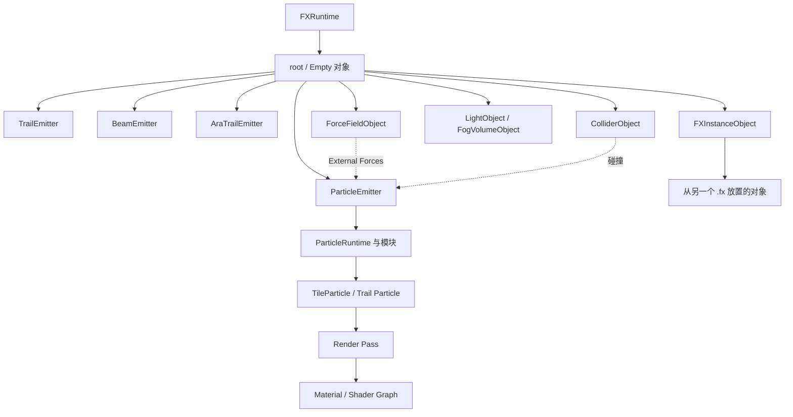

# Particle System

Photon 使用 FX 对象层级构建效果。Emitter 负责模拟粒子；Renderer 设置把状态转换成 draw call；Material 决定顶点如何变成像素；Timeline 可以随时间覆盖同一批 Runtime 值。

<figure>

<figcaption>真实 tornado 项目同时展示对象、材质、Scene 实时预览、Resources 与 Timeline。</figcaption>
</figure>

## FX 对象类型

| 类型 | 用途 |
| --- | --- |
| Empty | 组合子对象，并提供可动画的 Transform。 |
| Particle Emitter | 生成大量独立 Tile/Model 粒子和可选粒子 Trail。 |
| Trail Emitter | 根据移动中的 Emitter 构建连续 Ribbon 或 Tube。 |
| Beam Emitter | 在端点之间或 Raycast 方向上渲染 Beam。 |
| AraTrail Emitter | 模拟带物理运动和分段属性的 Trail。 |
| Force Field | 通过 External Forces 施加 directional、gravity、drag 和 vortex 影响。 |
| Collider（碰撞体） | 平面、盒或球，同一 FX 中的粒子会与它碰撞；设为触发器时只报告进出。见 [粒子碰撞](./collision.md#collider-objects)。 |
| Light（光源） | 点光源或聚光灯形式的动态光源，可开启阴影和体积光。见 [光源与雾](../dynamic-lights/lights-and-fog.md)。 |
| Fog Volume（雾体积） | 盒形或球形的体积雾。见 [光源与雾](../dynamic-lights/lights-and-fog.md)。 |
| FX Instance（FX 实例） | 把另一个 `.fx` 放进当前效果，只覆盖不同的部分。见 [FX 实例](../fx-instances.md)。 |

<VersionBadge version="2.2.8" label="自" icon="tag" /> Light 与 Fog Volume 对象。

<VersionBadge version="2.2.9" label="自" icon="tag" /> Collider 与 FX Instance 对象。

## 推荐阅读顺序

1. [Hierarchy 与 Transform](./hierarchy-and-transforms.md)
2. [Curve、Gradient 与 Value Function](./value-functions.md)
3. [Particle Emitter](./particle-emitter.md)
4. [Emission 与 Shape](./emission-and-shapes.md)
5. [Simulation 与 Force](./simulation-and-forces.md)
6. [Lifetime 与 Speed 模块](./lifetime-and-speed-modules.md)
7. [Rendering、Material 与 Mesh](./rendering-materials-and-meshes.md)

## 更多主题

- [Physics、Noise、Lighting 与 UV](./physics-noise-lighting-uv.md)
- [粒子碰撞](./collision.md)：方块、流体、实体、碰撞体对象、触发器和碰撞事件。
- [Trail 与 Sub Emitter](./trails-and-sub-emitters.md)
- [glTF 模型](./gltf-models.md)
- [Trail、Beam 与 AraTrail Emitter](./trail-beam-and-aratrail.md)

## Runtime 模型

编辑器中的设置保持为 Config 数据。每个发射出的对象都会创建 Runtime layer；没有 override 时，Runtime 值回退到 Config。Timeline 和 Java 可以写入 Runtime slot，而不修改可复用的 FX 定义。因此同一个 `.fx` 可以同时播放多个互不影响的实例。

::: tip 一次只调试一个系统
先使用普通 Texture Material、常量值和一个模块。确认 Emission 与运动正确后，再加入 Curve、Trail、自定义 Shader 和后处理。
:::
