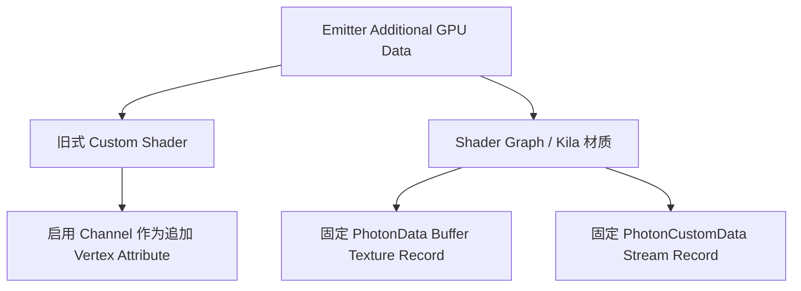

# Vertex Format 与 GPU Instancing

<VersionBadge version="2.2.0" label="GPU Instancing" icon="tag" />

*Instance 测试项目会实际走 Particle Instance Format，并同时展示 Scene、Inspector、Resources 与 Timeline。*

Photon 会合并几何和材质状态相同的对象，一次绘制多个 Instance。基础 Mesh Vertex 描述 Quad、Model 或 Trail Segment；逐 Instance Record 提供 Transform、Color、UV、Light 和可选数据。

## 渲染 Variant

| Define | 几何 | 基础 Instance 内容 |
| --- | --- | --- |
| `PARTICLE_INSTANCE` | Billboard/Tile Quad | position、rotation、size、color、UV/light |
| `PARTICLE_MODEL_INSTANCE` | Model Mesh | transform、color、UV/light 与 Model Attribute；可选切线 |
| `TRAIL_INSTANCE` | Flat/Tube Trail Segment | 端点、逐点 width/color/UV |
| `BEAM_INSTANCE` | Ray/Beam Segment | start/end、width/color/UV |
| `ARA_TRAIL_INSTANCE` / `ARA_TRAIL_TUBE_INSTANCE` | Flat / Tube AraTrail Segment | 相邻点数据与插值 |

非 Instanced CPU 路径仍会提供 Particle Data。<VersionBadge version="2.2.8" label="Changed" icon="tag" /> 自 2.2.8 起，不开 Instancing 的 Particle Emitter 在材质（Shader Graph 或 Kila 材质）读取 Additional/Custom Data 时，也会上传逐粒子 Record。Trail、Beam 和 AraTrail 读取这些流仍需要 GPU Instancing，否则读到 0。

## 附加 Define { #extra-defines }

Photon 会在渲染 Variant 之上再加入以下 Define：

| Define | 附加于 | 版本 | 含义 |
| --- | --- | --- | --- |
| `PHOTON_TANGENT` | `PARTICLE_MODEL_INSTANCE` | <VersionBadge version="2.2.5" label="自" icon="tag" /> | Model 渲染模式打开了 **tangent** 开关。增加 `layout(location = 3) in vec4 aTangent`（xyz = 切线，w = 手性）。 |
| `PHOTON_VAT` | `PARTICLE_MODEL_INSTANCE` | <VersionBadge version="2.2.7" label="自" icon="tag" /> | 动画 glTF 模型逐粒子播放。Vertex Shader 从预烘焙的姿态表（`PhotonVat`）读取姿态。 |
| `PHOTON_CPU_DATA` | CPU 路径（无 Instance Define） | <VersionBadge version="2.2.8" label="自" icon="tag" /> | Particle Emitter 不开 Instancing 绘制，且材质读取粒子数据。Record 按粒子查找，而不是按 `gl_InstanceID`。 |

`getParticleData()` 会处理这三种情况。启用 `PHOTON_TANGENT` 时，Model 的逐 Instance Attribute 仍在 Location 4–8，传统 Custom Data 仍从 9 开始。tangent 开关需要 GPU Instancing；glTF 模型沿用自带的切线，其他模型由 UV 生成切线。

`ParticleData.Tangent` 与 `ObjectTangent` 提供切线坐标系。Instanced Billboard、Trail、Beam 和 AraTrail 会在 Vertex Shader 中构建精确切线，无需开关。未打开开关的 Model Instancing 以及非 Instanced CPU 路径返回常量 `vec4(1, 0, 0, 1)`。动画模型见 [glTF 模型](../particle-system/gltf-models.md)。

## 两种数据布局

旧式 Attribute Layout 只包含 Inspector 启用的 Channel，并按 Registry 顺序排列。启用一个新 Channel 可能移动后续 Attribute Location，手写 Shader 必须和发射器配置完全一致。

Shader Graph 按发射器类型使用固定 `vec4` Slot Layout，并通过 `gl_InstanceID` 索引（`PHOTON_CPU_DATA` 路径按粒子索引）。Compiler 会记录 Graph 读取的 Channel 并上传有效 Mask，同一个编译结果可服务 Inspector Toggle 不同的发射器。

## Batching 限制

Geometry、Material Program、Texture/Sampler State、Render Layer 或所需 Layout 不同时都会拆 Batch。多材质 Model 需要多个 Pass。大量 Custom Data 和透明层即使粒子数不多，也会增加上传与排序成本。

不要默认 Instancing 一定更快，应结合 Profiler 和 Render Statistics。只有几个粒子时初始化成本可能占主导；几百个相同 Quad/Model 时通常收益明显。

## Shader 编写检查

- Shader Graph 使用 Photon Accessor；Custom Shader Material 的传统数据路径必须声明与 Emitter 开关匹配的 Attribute Location。
- 通过 `photon_data_*()` Accessor 读取 `PhotonData`，不要自己计算索引：Instanced 绘制按 `gl_InstanceID` 索引，`PHOTON_CPU_DATA` 路径按粒子索引。
- 不支持 Channel 时返回 0，Shader 要有合理 Fallback。
- 透明排序/Layer 保持一致，发射器才容易合批。
- 分别测试 Tile、Model、Trail 与 Beam，它们的基础输入不可互换。

Custom Stream 的 Location 公式与完整代码见 [Additional GPU Data](./additional-gpu-data.md)。
